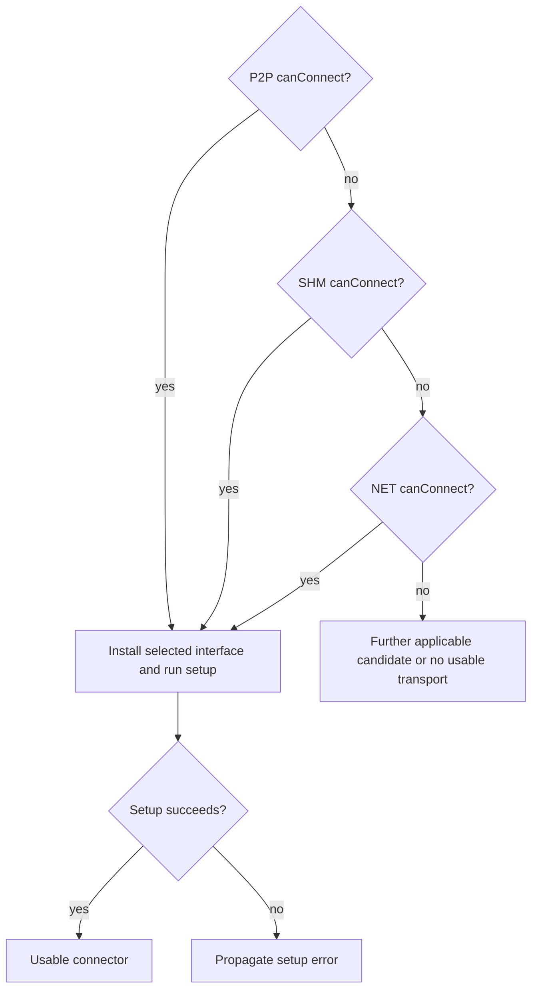

import Source from '../../../../components/Source.astro';

## Connect local ranks to usable memory

Two GPUs on the same host still need a valid path and usable addresses to exchange data. NCCL chooses a transport beneath the algorithm's peer relationships. The main local choices are GPU peer-to-peer access, or **P2P**, and shared host memory, or **SHM**. A selected network path is another possibility.

The consequential distinction is direct device access versus a shared/staged path. Process boundaries, device visibility, and shared-memory domains affect that choice even when the physical GPUs are unchanged.

## Follow transport selection

For a connector, `selectTransport` checks candidate feasibility and installs the selected connection implementation. The ordinary candidates include P2P, SHM, and NET:

Eligibility selects a candidate; setup then has to create its resources. Setup failure is reported through that selected path, rather than guaranteeing an automatic successful fallback.

<Source project="nccl" path="src/transport.cc" lines="15-48" label="Candidate order and connection setup" />

The graph's desired route also matters. Same-host placement alone does not identify the connector that execution will use.

## Understand the P2P address boundary

P2P checks combine topology and GPU access capability. Once usable, connection setup supplies addresses or imported mappings through which peers can access communication memory.

In one process, peers can sometimes use a direct address relationship. Separate processes need shareable allocation information and mapping/import machinery. A pointer value copied from another process is insufficient; each process needs its own valid mapping.

<Source project="nccl" path="src/transport/p2p.cc" lines="129-183" label="Topology and CUDA peer-access checks" />
<Source project="nccl" path="src/transport/p2p.cc" lines="350-465" label="Memory mapping and P2P setup" />

The framework controls rank-to-device placement. NCCL owns its connection buffers and imported resources. Application tensors retain their own lifetime, including all GPU readers that can still access them.

## Understand the shared-memory boundary

SHM creates a communication path through shareable host storage. Peers must belong to the same host and shared-memory domain. That second requirement matters in containers: two ranks can share a physical node while their shared-memory namespaces remain isolated.

<Source project="nccl" path="src/transport/shm.cc" lines="60-84" label="Host and shared-memory-domain eligibility" />
<Source project="nccl" path="src/transport/shm.cc" lines="298-354" label="Shareable host storage setup" />

For example, when direct P2P is unavailable, an isolated shared-memory namespace can also exclude SHM. Diagnose the deployment boundary and the actual selected alternative. A collective algorithm override cannot create the missing memory access.

## Read the code and compare deployments

Read `selectTransport`, the selected `canConnect`, then setup, mapping, and cleanup. For a performance comparison, retain process layout, rank/device mapping, device visibility, and selected connector logs. Moving from one process to several can change the access mechanism without changing the GPUs.

Locality also leaves asynchronous ownership intact: consumers need stream dependencies and storage cannot be reused until all users retire. Continue to [network and proxy](/architecture/nccl/network-and-proxy/) for the corresponding remote path.
