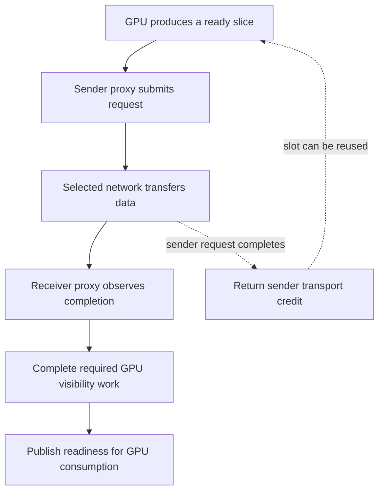

import Source from '../../../../components/Source.astro';

## Bridge GPU work to network progress

**NET** is NCCL's network transport. In its general path, a **host proxy** advances communication described by the collective plan. It observes GPU-produced slices, submits asynchronous network requests, tests completion, and publishes progress back to GPU protocol state.

A proxy advances communication already chosen by the planner. Model scheduling remains in the inference engine. Bootstrap separately establishes initial peer information.

NCCL supplies built-in network implementations and supports optional external plugins. [AWS OFI NCCL](/architecture/aws-ofi-nccl/) is one such plugin, with libfabric beneath it; other NCCL deployments use different network implementations.

<Source project="nccl" path="src/plugin/net.cc" lines="103-137" label="External network implementation loading" />

## Follow a slice across the boundary

Sender credit permits transport storage reuse. Receiver readiness permits the selected GPU consumer to proceed. Neither event means the destination model has finished computing with the whole tensor.

## Track acceptance and completion separately

`sendProxyProgress` waits for the GPU's readiness indication, selects the buffer/registration, and calls `isend`. The network interface may temporarily return a null request, so the proxy advances accepted work only after a real request exists. It later calls `test` and returns the corresponding credit when that request completes.

<Source project="nccl" path="src/transport/net.cc" lines="1415-1473" label="Produced slices, request acceptance, completion, and credit" />

On receive, the proxy posts capacity, tests the network request, and establishes the selected path's GPU visibility before publishing progress. Applicable GPU-direct paths need a flush mechanism; the exact action belongs to the selected transport and backend.

<Source project="nccl" path="src/transport/net.cc" lines="1640-1729" label="Receive completion and visibility publication" />

This is why a network completion can be one stage of GPU readiness rather than the final application event. Buffer registration, network requests, and CUDA consumers each contribute a lifetime boundary.

## Locate a stalled transition

For one slice, distinguish three observers:

| Observer | Question |
| --- | --- |
| GPU protocol | Was the slice produced, and is receive readiness visible? |
| Host proxy | Was the request accepted and later completed? |
| Network implementation | Are the connection and peer making progress? |

A proxy waiting for GPU production points upstream to compute or collective ordering. A GPU waiting for receive progress points toward proxy, backend, or peer work. This narrows diagnosis before treating every stall as insufficient bandwidth.

Asynchronous proxy failures are exposed through communicator error state. The framework coordinates recovery and keeps its tensors alive; the selected network implementation owns its accepted request machinery.

## Read the code

Follow NET setup, `sendProxyProgress`, `recvProxyProgress`, then `src/proxy.cc` for scheduling and progress ownership. Cross the plugin interface only after identifying the selected implementation.

<Source project="nccl" path="src/include/plugin/net/net_v12.h" lines="104-122" label="Network request and visibility interface" />
<Source project="nccl" path="src/proxy.cc" label="Host proxy lifecycle and progress" />
