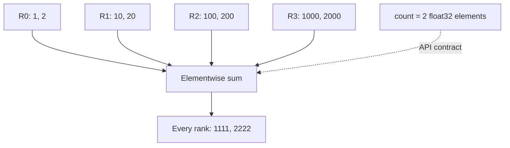

import Source from '../../../../components/Source.astro';

## Choose the operation from the result you need

NCCL lets a framework describe GPU communication without implementing the peer exchanges itself. For example, tensor-parallel GPUs may each compute a partial activation. **All-reduce** adds corresponding elements and gives the complete sum to every participant, ready for the next layer.

Start with who needs which result:

| Operation | Result ownership |
| --- | --- |
| All-reduce | Complete reduction on every rank |
| Reduce | Complete reduction at one root rank |
| Reduce-scatter | A different reduced block on each rank |
| All-gather | All rank contributions concatenated on every rank |

The framework chooses these semantics and matches calls across ranks. NCCL chooses an execution plan for that operation.

## Describe tensors and participants

A **communicator** identifies the cooperating group. A **rank** is a position within that group, independent of the process's CUDA device number. A root argument names a communicator rank.

The all-reduce signature captures the main contract:

```cpp
ncclResult_t ncclAllReduce(const void* sendbuff, void* recvbuff, size_t count,
    ncclDataType_t datatype, ncclRedOp_t op, ncclComm_t comm, cudaStream_t stream);
```

`count` is the number of datatype elements. For two float32 values, count is two and each buffer covers eight bytes. All-reduce permits equal input/output pointers for in-place execution. Other collectives have their own buffer-size and ownership contracts; choose those from the public header before writing pointer arithmetic.

<Source project="nccl" path="src/nccl.h.in" lines="595-625" label="All-reduce and reduce-scatter contracts" />

For these four input vectors, every rank receives the same sum:



The diagram shows the required result. The selected algorithm determines the exchanges that produce it.

## Follow a call into NCCL

`ncclAllReduce` builds an `ncclInfo` operation description and passes it to `ncclEnqueueCheck`. Enqueue validates local arguments and communicator readiness, then appends work within a group scope. Planning later selects the algorithm, protocol, and resources.

<Source project="nccl" path="src/collectives.cc" lines="188-220" label="All-reduce intent and enqueue handoff" />
<Source project="nccl" path="src/enqueue/enqueue.cc" lines="3478-3536" label="Validation and task append" />

This boundary separates the mathematical request from its implementation. A public all-reduce call does not commit the operation to a ring, a particular NIC, or an external plugin.

## Keep result consumption ordered

The supplied CUDA stream orders GPU work. A producer, collective, and consumer on one stream run in that order. A consumer on another stream needs an explicit dependency, such as an event. The framework retains source and destination storage until all their users finish.

Successful enqueue establishes queued work. Output becomes usable through the corresponding stream dependency or synchronization. For grouped calls, place dependent CUDA work after the outer group ends.

Two questions dominate integration debugging: did every rank issue compatible operations in the same order, and did the application keep its tensors alive? Correct local arguments cannot compensate for a missing participant or premature storage reuse.

<Source project="nccl" path="src/nccl.h.in" lines="849-884" label="Grouping and dependent CUDA work" />

## Read the code

Follow the public contract in `nccl.h.in`, the wrapper in `collectives.cc`, then `ncclEnqueueCheck`. Continue to [enqueue and groups](/architecture/nccl/enqueue-and-groups/) to see how calls become a launchable unit, or [communicators](/architecture/nccl/communicators/) to trace setup.
