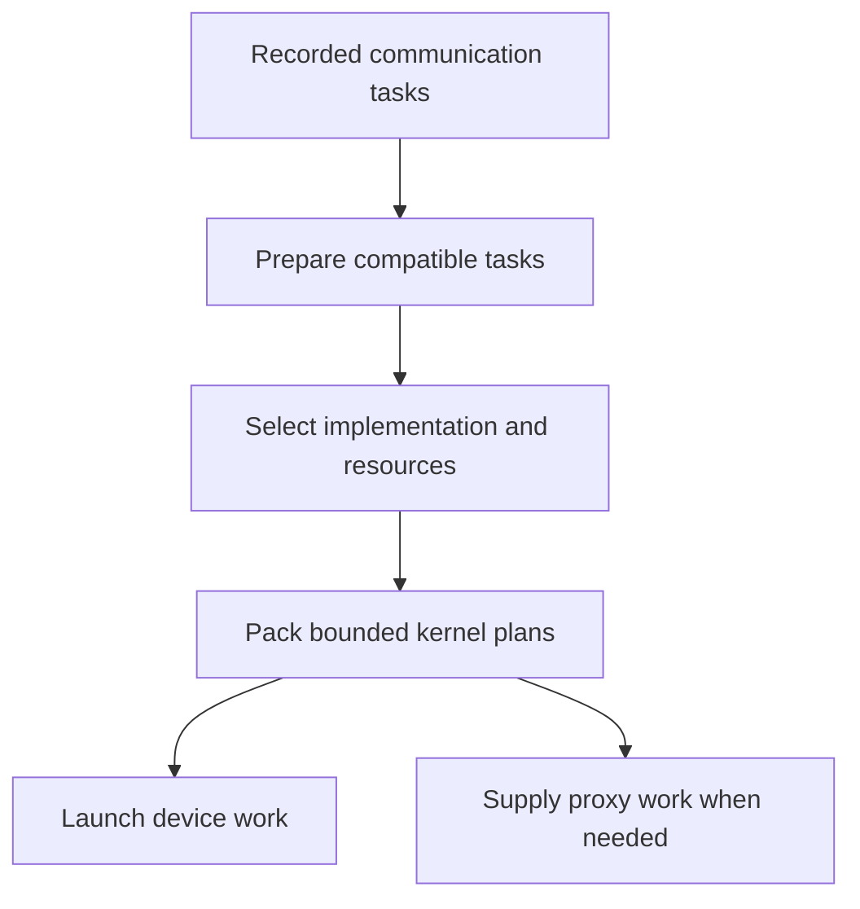

import Source from '../../../../components/Source.astro';

## Translate communication intent into bounded work

A task records what an operation needs: function, buffers, count, datatype, reduction, stream, and configuration. A **plan** packages prepared tasks into work that a kernel and its associated progress machinery can execute.

This distinction explains why there is no fixed one-call/one-kernel mapping. Several compatible calls may fit in one plan; a large group may require several plans. The framework owns tensor allocations while NCCL owns the descriptions that refer to them.

## Follow the main preparation path

For the default path in this snapshot, `taskAppend` adds collective or peer tasks to planner queues. Collective preparation groups compatible tasks and obtains tuning information. The selected implementation supplies algorithm, protocol, and resource requirements before work is packed for launch.

<Source project="nccl" path="src/enqueue/enqueue.cc" lines="464-544" label="Default collective preparation" />
<Source project="nccl" path="src/enqueue/enqueue.cc" lines="2159-2226" label="Tuning handoff" />

The main responsibilities are:

The graph shows ownership handoffs. Proxy work advances selected transport operations alongside GPU execution.

## Understand the important plan constraints

`ncclLaunchPrepare` chooses device work storage and packs tasks within argument/work budgets. General collective work is drained before peer work so ranks derive compatible communication boundaries.

<Source project="nccl" path="src/enqueue/enqueue.cc" lines="1695-1774" label="Work budgets and plan construction" />

Suppose two collectives and a peer exchange exceed one plan's work budget. Planning can continue in a second plan while preserving the required ordering. The boundary is driven by execution resources and peer consistency, rather than by a promise that each API call launches independently.

CUDA graph capture also changes lifetime: captured plans and their work storage must remain usable for replay. Ordinary host descriptors can retire through callbacks after their state has been handed to execution machinery. The [lifetime chapter](/architecture/nccl/lifecycle-and-diagnosis/) separates these owners.

## Find the active code in this revision

The source contains a reorganized raw-task preparation path behind `ENQUEUE_REARCH_ENABLE`, which defaults to zero. Its active launch bridge still calls the existing phased `doLaunches`. Start with the default path above; inspect the alternate preparation modules when that configuration is relevant.

<Source project="nccl" path="src/enqueue/enqueue.cc" lines="25-35" label="Default enqueue path selection" />
<Source project="nccl" path="src/group.cc" lines="989-998" label="Current launch bridge" />

Both preparation families reach the current tuning layer. The architectural stages remain intent, selection, bounded planning, and launch; directory reorganization alone does not establish a different active scheduler.

## Read the code

Follow `taskAppend`, collective preparation, tuning, `ncclLaunchPrepare`, and `doLaunches`. Record the task's selected implementation and the resulting plans. Continue to [device kernels](/architecture/nccl/device-kernels/) to see the work consumed on the GPU.
