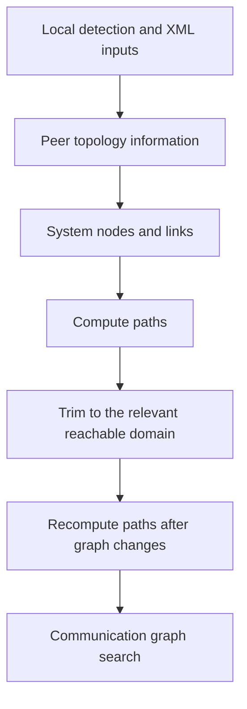

import Source from '../../../../components/Source.astro';

## Turn hardware placement into usable paths

A collective may cross NVLink, PCIe switches, CPU interconnects, and network interfaces. NCCL needs to understand those relationships before deciding how ranks should exchange data. Topology discovery builds a **system graph** of devices and paths for later planning.

The important question is which paths the runtime can use under the current device visibility and access configuration. A physical link is one input; software access and deployment policy also matter.

## Follow the model-building pipeline

Communicator initialization discovers devices, computes paths, trims the local model, rebuilds paths, and initializes communication graph search:

Trimming changes the system graph, so path computation runs again before search. These stages prepare planning inputs; per-operation algorithm selection happens later.

<Source project="nccl" path="src/init.cc" lines="1380-1408" label="Discovery, trimming, path rebuilding, and search setup" />

`ncclTopoGetSystem` combines detected local information with topology XML and peer information. XML can describe virtual or overridden topology. Its purpose is to shape the runtime's model of the machine; the actual devices and access mechanisms still have to support the resulting connections.

<Source project="nccl" path="src/graph/topo.cc" lines="1989-2047" label="Topology input and device discovery" />

## Understand a path, not just a device list

Paths carry type and bandwidth-related information. Path computation also checks whether GPU peer access and GPU/network access are usable. A pair that cannot use direct GPU access may need an intermediate path or another transport.

For example, consider two nodes with two NVLink-connected GPUs and one NIC per node. Local GPU exchanges can follow NVLink; cross-node exchanges need GPU-to-NIC paths and the remote network. NIC placement matters because reaching a distant NIC can involve different PCIe or CPU links.

<Source project="nccl" path="src/graph/paths.cc" lines="754-812" label="Path computation and access-dependent routing" />

The model retains the relevant locally reachable GPU domain. If that domain contains two GPUs while the communicator has four ranks, all four still participate. Remote ranks are represented through inter-node planning and connections. Local topology scope and communicator membership answer different questions.

<Source project="nccl" path="src/graph/paths.cc" lines="900-940" label="Local-domain trimming and inter-node state" />

## Make the consequential decisions visible

Three choices shape this stage:

- **Rank placement:** the framework maps ranks onto GPUs and hosts. That determines which communication edges are local or remote.
- **Deployment access:** device visibility, peer access, containers, and driver support determine which modeled paths can be used.
- **Topology overrides:** operators can supply model inputs for a deployment, and should compare those inputs with the selected runtime paths when diagnosing a change.

Check this layer before forcing a collective algorithm. Tuning a ring versus a tree cannot repair an inaccessible GPU or an incorrect view of NIC placement. Conversely, modeled bandwidth is a planning estimate; workload timing is needed to evaluate performance.

## Read the code

Follow initialization into `ncclTopoGetSystem`, `ncclTopoComputePaths`, and `ncclTopoTrimSystem`. Then move to [communication graphs](/architecture/nccl/communication-graphs/), where NCCL embeds rank-exchange patterns into those paths.

<Source project="nccl" path="src/graph/search.cc" lines="1151-1200" label="Path properties consumed by graph search" />
