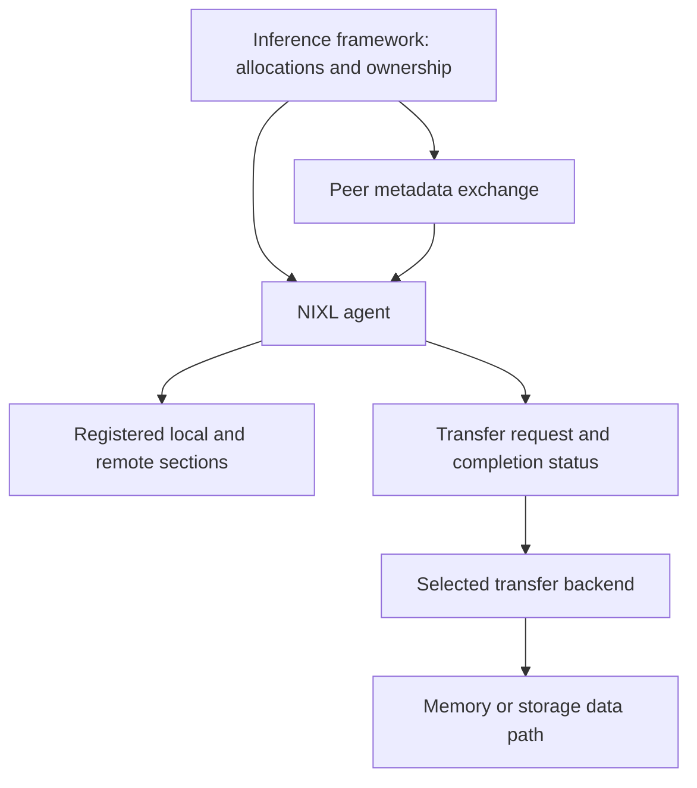

import SystemMap from '../../../components/SystemMap.astro';
import Source from '../../../components/Source.astro';

## Why it exists

An inference system may run prompt processing and token generation on different
workers. The generation worker then needs the prompt worker's **KV cache**:
attention state accumulated while processing the prompt. Moving that state
efficiently becomes a separate problem from deciding which request to run.

NIXL supplies a common interface for moving registered memory and storage ranges.
It lets the inference framework reuse one transfer lifecycle while a selected
**backend** implements the actual movement. UCX, libfabric and storage plugins are
alternative paths with different capabilities and prerequisites.

## Where it fits

<SystemMap current="nixl" />

The framework chooses the objects and peers, allocates buffers, and coordinates
GPU computation with transfers. NIXL manages registrations, peer metadata and
transfer requests. The backend handles transport or storage access.

The caller describes bytes through **descriptors**: address or offset, byte length,
and memory/device identity. NIXL can move those ranges without knowing their model
layout or cache meaning. Metadata exchange uses an application side channel or a
configured metadata service; etcd is one option.

## Architecture overview

The agent is the main source-reading spine. It coordinates local registrations,
cached peer sections and requests, then delegates work to one compatible backend.
Registrations establish access to caller allocations; the framework retains
ownership and safe reuse of those allocations.

## Follow an operation

The two-agent C++ example illustrates the normal path with host buffers:

1. Create named agents and initialize a suitable backend on each side.
2. Allocate and register source/destination ranges. Registration makes them usable
   through successful backend registrations.
3. Exchange the destination's metadata so the initiator can address its ranges.
4. Pair source and destination descriptors and create a READ or WRITE request.
   Request preparation selects a compatible registered backend path.
5. Post the request and observe completion through status/progress. An associated
   notification can inform the target, which validates and publishes its object.
6. Retire requests before removing registrations and freeing the storage they use.

GPU transfers add producer and consumer dependencies around this same lifecycle.
Submission, transfer completion and application consumption remain distinct stages.

## Decision gates

| Decision | Effect on the path |
| --- | --- |
| Memory or storage domains | Determine which backend capabilities apply. |
| Backend constraints | Select a usable implementation for both registered sides. |
| Ordinary or prepared requests | Trade simple construction for reusable descriptor preparation. |
| Peer metadata lifecycle | Refresh can preserve cached state; invalidation requires rebuilding affected handles. |
| Completion and publication | Define when bytes can be reused and when an application object becomes visible. |

Begin with the [repository map](/architecture/nixl/repository-map/) and follow the
chapters through one transfer. The final [code walkthrough](/architecture/nixl/code-labs/)
connects the abstractions to the actual example.

## Explore the code

<Source project="nixl" path="examples/cpp/nixl_example.cpp" label="A complete two-agent transfer" />
<Source project="nixl" path="src/core/nixl_agent.cpp" label="Registration, metadata and request lifecycle" />
<Source project="nixl" path="src/plugins/ucx/ucx_backend.cpp" label="A concrete transfer backend" />
