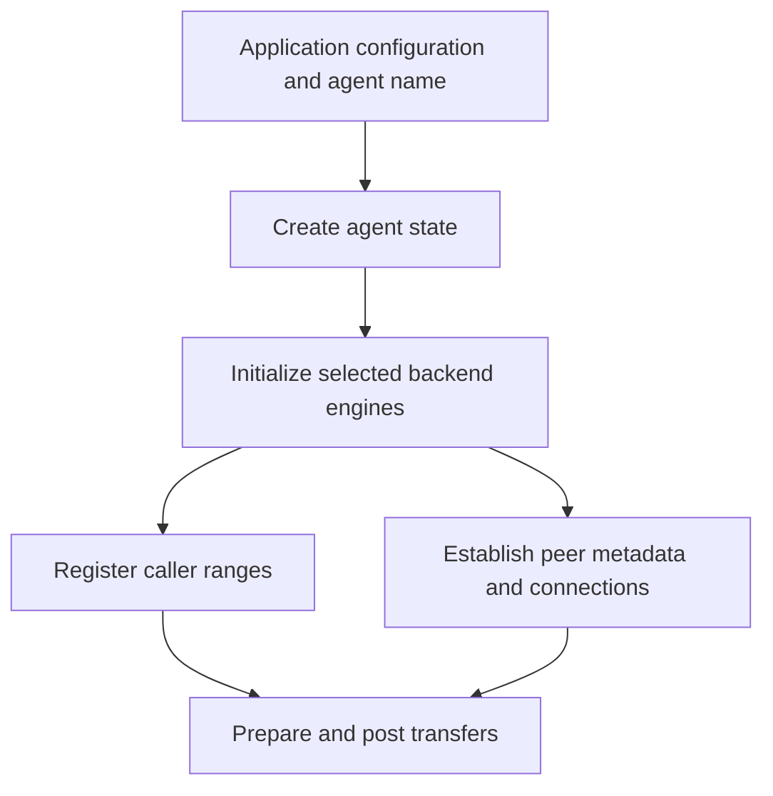

import Source from '../../../../components/Source.astro';

## An agent is a local transfer coordinator

The framework creates a named agent to hold transfer-related state for its
process. The agent coordinates initialized backend engines, local registrations,
cached peer metadata and active requests. Applications can then use that stable
context for many transfers.

Agent construction and backend readiness are separate stages. An application
first creates the coordinator, then initializes the engines it intends to use.
Successful backend creation makes its advertised capabilities available to later
registration and request selection.

## Follow startup into usable transfers

The graph shows the main prerequisites. Registration and peer discovery may be
organized differently by an integration, but both must establish the information
needed by the chosen request.

## Backend initialization defines available capabilities

The plugin manager loads an implementation and calls its engine factory. The
engine reports supported memory types, local/remote operation support and other
capabilities. The agent uses that information to populate its candidate maps.

For example, a network-memory engine and a local-file engine expose different
contracts even though both are created through the same agent. Choose engines
from the actual source/target domains and deployment requirements. Installing a
plugin alone is not the same as having an initialized engine for a usable path.

## Configure progress and concurrency deliberately

Asynchronous work needs progress. The selected backend can provide a progress
thread or rely on caller-driven status/progress operations. Metadata exchange
can also involve agent-managed background work. Synchronization configuration
must protect the shared state those activities access.

The agent implementation establishes its state before starting metadata work and
stops that work before destroying reachable resources. For application design,
the corresponding rule is to stop new operations and retire outstanding users
before tearing down their agent context.

## Keep cleanup aligned with ownership

Retire transfer and prepared handles while their registrations and agent remain
valid. Then remove registrations, disconnect/invalidate peer state as appropriate,
and release application allocations after their users are safe.

The exact backend teardown differs by engine. The shared architectural boundary
is that background work, requests and access metadata must not outlive the state
they reference. This is why a process-wide agent commonly outlives individual
inference requests and buffer suballocations.

## Read the code

<Source project="nixl" path="src/core/nixl_agent.cpp" label="Agent construction, backend creation and destruction" />
<Source project="nixl" path="src/core/nixl_plugin_manager.cpp" label="Plugin loading and engine construction" />
<Source project="nixl" path="src/api/cpp/nixl_params.h" label="Agent and backend configuration" />
