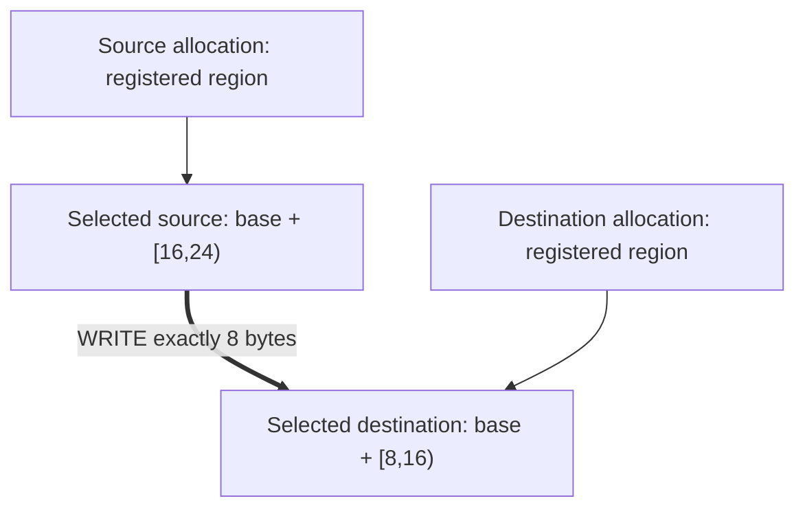

import Source from '../../../../components/Source.astro';

## Follow one example from allocation to retirement

The two-agent C++ example is a compact way to connect NIXL's public abstractions
to an actual operation. It creates two agents in one process, uses host-memory
buffers and selects UCX by default. The framework in a serving deployment adds
its worker placement and GPU dependencies around the same lifecycle.

Read the example once in execution order. Then enter the agent and backend only
where a handoff needs explanation. This keeps the source trace centered on one
operation rather than a catalog of possible branches.

## Identify the exact mapping

The selected source bytes are `[16,24)` relative to the first allocation; the
destination is `[8,16)` relative to the second. Registration covers larger regions,
while the request selects just these eight bytes. Device/resource identity and
byte length complete the descriptors.

That separation is the same one a cache connector uses: a pool registration can
be stable while individual operations choose different blocks or subranges.

## Walk the four main handoffs

**Setup.** The example creates named agents and initialized backends, allocates
storage, and registers it. Each successful registration establishes backend access
without transferring allocation ownership.

**Peer metadata.** The target serializes its metadata and the initiator loads it.
Passing the value directly is possible because both agents are in the same
process here. A distributed framework supplies its own exchange mechanism or
configured metadata service.

**Transfer.** `createXferReq` pairs ranges and resolves registered backend state.
`postXferReq` starts the WRITE. The example observes initiator status and drains
the target's notifications until both observations are satisfied.

**Retirement.** The request is released before registrations and allocations are
removed. The application can then retire peer metadata and storage through the
appropriate ownership order.

## Connect the example to a serving integration

A serving framework first chooses the destination worker and reserves storage.
Its connector expresses the selected cache layout as descriptors, then performs
the transfer. The receiver associates notification or completion evidence with
the reserved logical object and establishes the dependency for its consumer.

For stable pools, [prepared requests](/architecture/nixl/request-preparation/)
amortize repeated descriptor work. For worker or registration replacement,
[metadata lifecycle](/architecture/nixl/metadata-and-connections/) determines
which access state needs rebuilding. These are the two useful next traces after
the ordinary example is understood.

## Read the code in this order

<Source project="nixl" path="examples/cpp/nixl_example.cpp" label="The complete eight-byte WRITE example" />
<Source project="nixl" path="src/core/nixl_agent.cpp" label="registerMem, metadata, createXferReq, post and status" />
<Source project="nixl" path="src/plugins/ucx/ucx_backend.cpp" label="Concrete movement and associated notification" />
<Source project="nixl" path="src/plugins/ucx/ucx_backend_req.h" label="Tracked backend work and retirement" />
