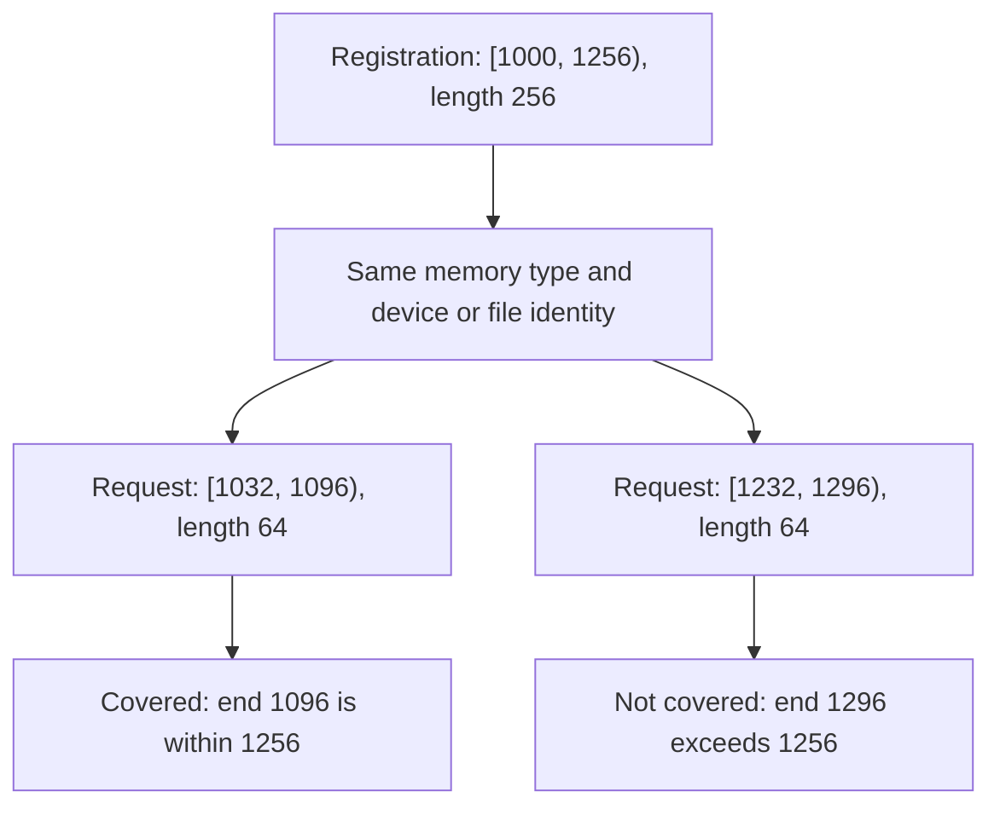

import Source from '../../../../components/Source.astro';

## Describe the bytes the framework wants to move

A **descriptor** identifies a memory or storage range. It supplies the address or
offset, byte length and device/resource identity that the selected backend needs.
The framework translates its tensor or cache layout into these byte ranges.

Descriptors refer to storage; the allocation's owner retains that storage through
the transfer lifecycle. A correct descriptor therefore combines both valid range
information and an application lifetime that keeps the range usable.

## Read the three fields in context

The basic descriptor fields are:

```cpp
uintptr_t addr;
size_t len;
uint64_t devId;
```

`addr` can mean a memory address or an offset in a storage domain. `len` is a byte
length. `devId` distinguishes the relevant device or resource identity. The list's
memory type completes the interpretation: DRAM, VRAM and file ranges do not have
identical addressing semantics.

For example, 128 two-byte tensor elements occupy 256 bytes. A descriptor length
of 128 would select only half that storage. NIXL can faithfully move a wrong
range without knowing the framework intended a different model layout.

## Registration covers transfer subranges

Registration describes accessible ranges. An operation selects subranges within
those registrations, preserving their memory type and identity:



The diagram uses illustrative addresses. A 64-byte range starting at 1032 fits
inside the registered interval `[1000,1256)`, while one starting at 1232 exceeds
its end. Coverage includes resource identity as well as these bounds.

On both sides of a transfer, corresponding descriptors define the source-to-target
mapping. Compatible per-pair lengths matter; equal total bytes alone cannot
describe an arbitrary reshaping or permutation.

## Choose a useful range layout

An application can describe scattered blocks with multiple ranges. Strided
representations compact repeated layout, and prepared descriptors can amortize
population for stable pools. Select a representation that preserves the actual
payload mapping before optimizing descriptor count.

Memory types guide backend selection. A compatible network engine can access
registered host/device ranges; a storage engine interprets file identity and
offsets under its own contract. The backend's registration metadata supplies
details needed to turn the generic range into access through that path.

When tracing a descriptor, write down its units, start, byte length, resource
identity and covering registration. That small ledger connects model-level
intent to the exact bytes the backend receives and catches many mistakes before
network diagnosis is needed.

## Read the code

<Source project="nixl" path="src/api/cpp/nixl_descriptors.h" label="Descriptors, lists, strides and coverage" />
<Source project="nixl" path="src/api/cpp/nixl_types.h" label="Memory domains and transfer operations" />
<Source project="nixl" path="src/core/nixl_agent.cpp" label="Registered-range lookup during request creation" />
