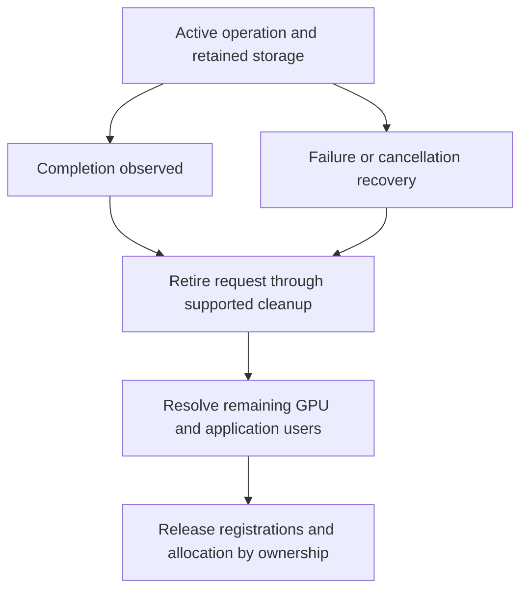

import Source from '../../../../components/Source.astro';

## Recover the operation without losing its owners

A transfer error can occur before submission, during backend work, or while the
framework is publishing a destination object. Recovery starts by identifying
which stage failed and which resources remain in use.

The main invariant is unchanged by errors: storage and access metadata must
outlive the operations that reference them. A failure report is a reason to
follow cleanup ownership, not automatically free every object in an exception
handler.

## Follow the retirement boundary

The graph describes application ordering. A cleanup attempt can fail while
leaving the native request live. Retain its handle and storage obligations until
the supported retirement path succeeds.

## Separate the resources that can become stale

| Resource | Recovery question |
| --- | --- |
| Allocation and registration | Are the original bytes and backend access still valid? |
| Prepared metadata and request | Were they built against the current peer section? |
| Logical destination object | Does the framework still want this object in this reservation? |

Successful additive metadata refresh can preserve prepared handles. Invalidation
retires the cached section, so affected preparation must be rebuilt using current
metadata. Reloading the same peer name does not reconnect old handles to a new
registration lifetime.

This is a local access-state guard, not a distributed lease proving the peer will
retain its allocation forever. The framework coordinates resource replacement
and shutdown with the participating workers.

## Distinguish cleanup from application rollback

Releasing backend request resources does not reconstruct destination bytes that
may already have changed. A retry therefore has two parts: establish a valid
transfer path and decide whether publication of that logical operation is still
appropriate.

Destination reservation identity, abandonment and duplicate handling belong to
the application protocol. They prevent a late successful transfer or notification
from publishing stale work into a reused slot.

For a practical failure trace, keep request identity, peer, selected backend,
metadata lifecycle and destination owner together. Then follow the failing API
through its backend cleanup and the framework's publication decision.

## Read the code

<Source project="nixl" path="src/core/transfer_request.h" label="Request and prepared-state references" />
<Source project="nixl" path="src/core/nixl_agent.cpp" label="Metadata guards and request release" />
<Source project="nixl" path="src/api/python/_api.py" label="Wrapper ownership after release errors" />
<Source project="nixl" path="src/plugins/ucx/ucx_backend_req.h" label="Backend request cleanup" />
