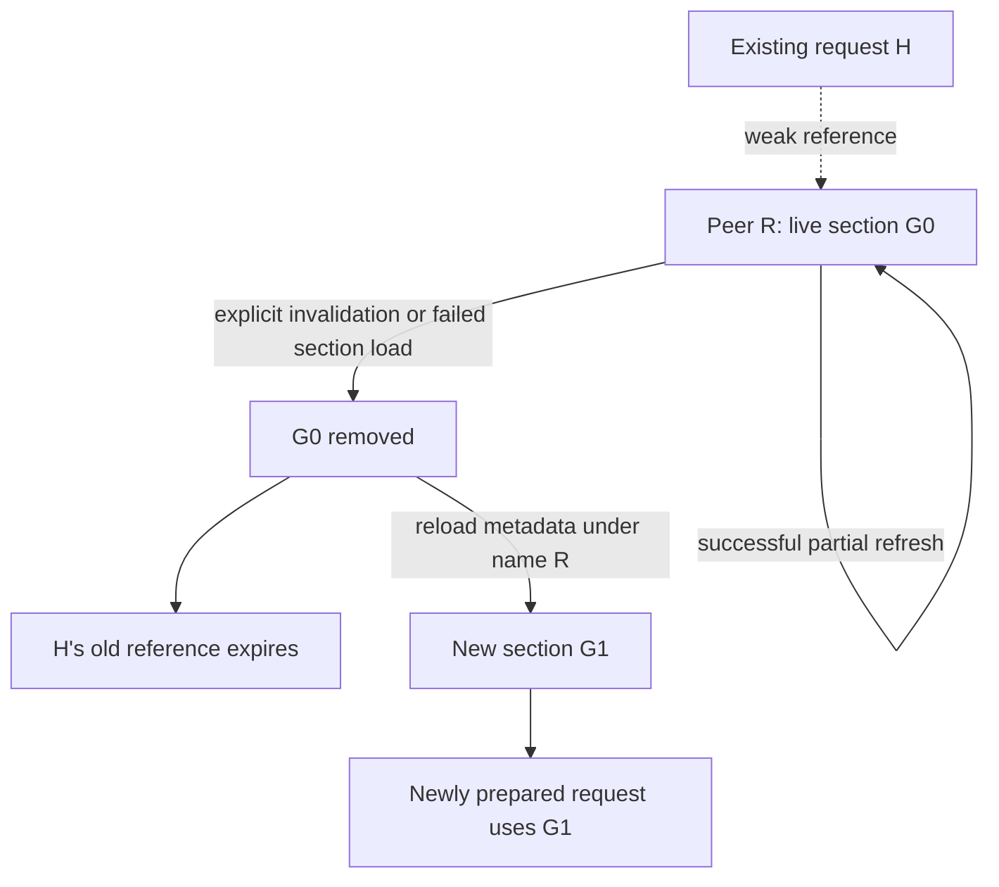

import Source from '../../../../components/Source.astro';

## Peers exchange access information before payload

The initiator needs more than a peer name and numerical address to access another
agent's registered ranges. NIXL exchanges backend-specific registration and
connection information, then caches it in remote sections used during request
preparation.

That metadata describes how to reach bytes. Payload movement remains a separate
backend operation, and the framework still identifies which logical object those
bytes represent.

## Follow export, load and request preparation

A target registers its ranges and exports metadata. The framework passes it
through a side channel, or a configured NIXL metadata service exchanges it. The
initiator loads compatible connection information and registered-range metadata
for the peer, then uses that cached state to populate requests.

The agent stores connection information by peer/backend and retains the remote
section holding usable registered ranges. Request and remote prepared-list handles
refer to that section's lifetime. This connects exported access information to
the concrete operations authorized by it.

## Refresh and invalidation serve different purposes

G0 and G1 in the diagram name successive cached section lifetimes, rather than a
serialized global generation protocol.

A successful partial **refresh** merges metadata into the existing section. It
supports incremental discovery without retiring every already prepared handle.
**Invalidation** removes the cached section and associated connection state.
Existing weak references expire, so subsequent work must use newly loaded
metadata and newly prepared handles. A failed section load can also retire the
cached peer state through this recovery path.

Keeping that distinction clear prevents two mistakes: rebuilding everything on
every additive update, or assuming a familiar peer name revives handles created
against retired registrations.

## Coordinate resource replacement at the framework boundary

When a worker or registered allocation is replaced, the framework must coordinate
outstanding transfers, metadata retirement and new publication. Local metadata
guards prevent use of a retired cached section; they do not independently discover
every remote allocator change or establish application object freshness.

The metadata transport affects how updates arrive. Direct exchange, a name-based
store and a watch-capable service can have different discovery/removal behavior.
Choose one that fits the deployment's coordination model and follow its update
path into the same agent cache.

For diagnosis, retain both the application worker/object identity and the NIXL
peer/registration state. A stale mapping can resemble a transport failure even
when both processes have valid new allocations.

## Read the code

<Source project="nixl" path="src/api/cpp/nixl.h" label="Metadata and connection API" />
<Source project="nixl" path="src/core/nixl_agent.cpp" label="loadConnInfo, loadRemoteSections and invalidation" />
<Source project="nixl" path="src/core/nixl_md_manager.cpp" label="Configured metadata exchange" />
