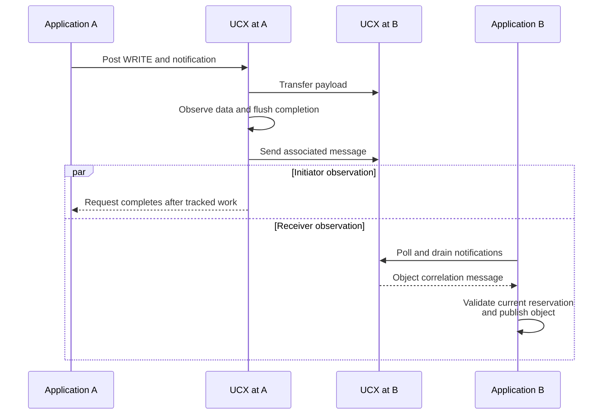

import Source from '../../../../components/Source.astro';

## Connect transferred bytes to application publication

The initiator needs a transfer result; the receiving framework needs to know which
object is ready to use. NIXL notifications provide a message channel that an
integration can use to connect those responsibilities.

The message payload belongs to the application protocol. It can identify a
request, block or destination reservation, allowing the receiver to validate
readiness before publishing transferred state to consumers.

## Follow an associated UCX notification

The parallel branches impose no order between the two applications' observations.
The associated message send can itself be asynchronous and remains part of the
UCX request's tracked work.

## Choose associated or standalone messages

A request can carry an associated notification through a notification-capable
backend. Backend implementation defines the relationship between data completion
and message sending; the diagram above is specifically the UCX path.

`genNotif` sends a standalone message through a suitable engine. It is useful
for separate control signaling, but any relationship to a preceding transfer must
be established by the surrounding protocol. The common API does not assign
model-level meaning to either form.

The receiver calls `getNotifs` to collect messages grouped by sending agent.
Collection can drive backend progress as well as drain received messages. A
progress thread advances communication, while application code still decides how
each message changes its object table.

## Validate identity at the receiving boundary

Reusable destination pools need correlation beyond a raw address. A delayed
message can refer to a slot that the application has already reassigned. Including
an object/request identity and reservation generation lets the receiver decide
whether publication is still valid.

The framework also defines duplicate handling, abandonment and timeout policy.
Those choices belong beside the destination ownership protocol: transport delivery
alone does not decide which inference request should now consume the bytes.

Use this separation when debugging a transfer that completed but did not unblock
generation. Trace transport status first, then notification consumption, validation
and the consumer dependency instead of treating them as one callback.

## Read the code

<Source project="nixl" path="src/core/nixl_agent.cpp" label="getNotifs and genNotif routing" />
<Source project="nixl" path="src/plugins/ucx/ucx_backend.cpp" label="Associated notification ordering" />
<Source project="nixl" path="src/plugins/ucx/ucx_backend_req.h" label="Message-send request ownership" />
