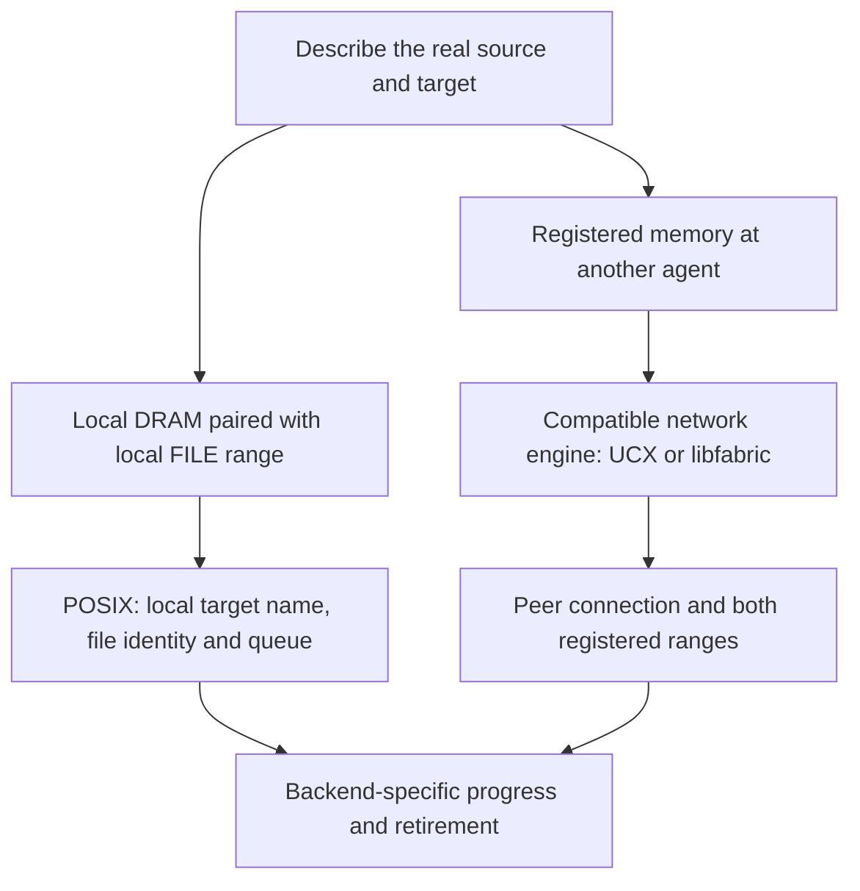

import Source from '../../../../components/Source.astro';

## Compare backends by their operation contract

NIXL's common lifecycle covers implementations with different capabilities.
A network engine accesses registered peer memory; a local-file engine interprets
storage identity and offsets. Start with those source/target domains before
comparing implementation or performance choices.

UCX, libfabric and storage plugins are alternatives for suitable operations. An
application initializes the engines it needs, and request preparation finds a
compatible registered path.

## Follow the memory domains

The graph compares two operations rather than defining an exhaustive selector.
Changing a backend name cannot turn a local-file offset into a registered memory
address at another process.

| Boundary | Libfabric backend | POSIX backend |
| --- | --- | --- |
| Main path | Remote memory through OFI | Local host-memory/file I/O |
| Access state | Peer connections and memory registrations | File identity and queue-backed requests |
| Progress | Active-rail progress or a configured thread | Submission and completion polling on the I/O queue |
| Notification | Backend-supported signaling | No notification service |

## Trace the libfabric implementation

The engine creates transport access information for registered ranges and
maintains peer connection state. It can use network **rails**: device/path choices
that carry the operation. Memory locality and supported device-memory mechanisms
affect registration and placement within that backend.

Request preparation uses the established connection and populated range metadata.
Posting creates transport work; status advances active rails when caller-driven
progress is needed and reports the backend's completion or error result.

This is where to investigate topology and OFI behavior after the generic NIXL
path is understood. Device-memory support and prerequisites depend on the
selected build, provider and environment.

## Trace the POSIX implementation

The local side describes DRAM and the target side describes FILE ranges under
the local agent identity. A READ fills memory from a file range; a WRITE copies
memory to that file range. File identity distinguishes the same offset in two
different files.

For example, a 4 KiB host buffer paired with file offset 8192 names one 4 KiB
operation at that offset. Registration establishes the file resource and access
metadata. A queue-backed request then submits I/O and observes its completions.

Some registration modes let the backend open and close file state; the caller's
DRAM allocation retains its own lifetime. Queue implementation is a deployment
choice within this path, rather than a requirement for network-only applications.

## Read the code

Compare capability declarations, then registration, preparation and completion:

<Source project="nixl" path="src/plugins/libfabric/libfabric_backend.h" label="Libfabric capabilities" />
<Source project="nixl" path="src/plugins/libfabric/libfabric_backend.cpp" label="Network registration, rails and request progress" />
<Source project="nixl" path="src/plugins/posix/posix_backend.h" label="POSIX local-file capabilities" />
<Source project="nixl" path="src/plugins/posix/posix_backend.cpp" label="File registration and queue-backed operations" />
