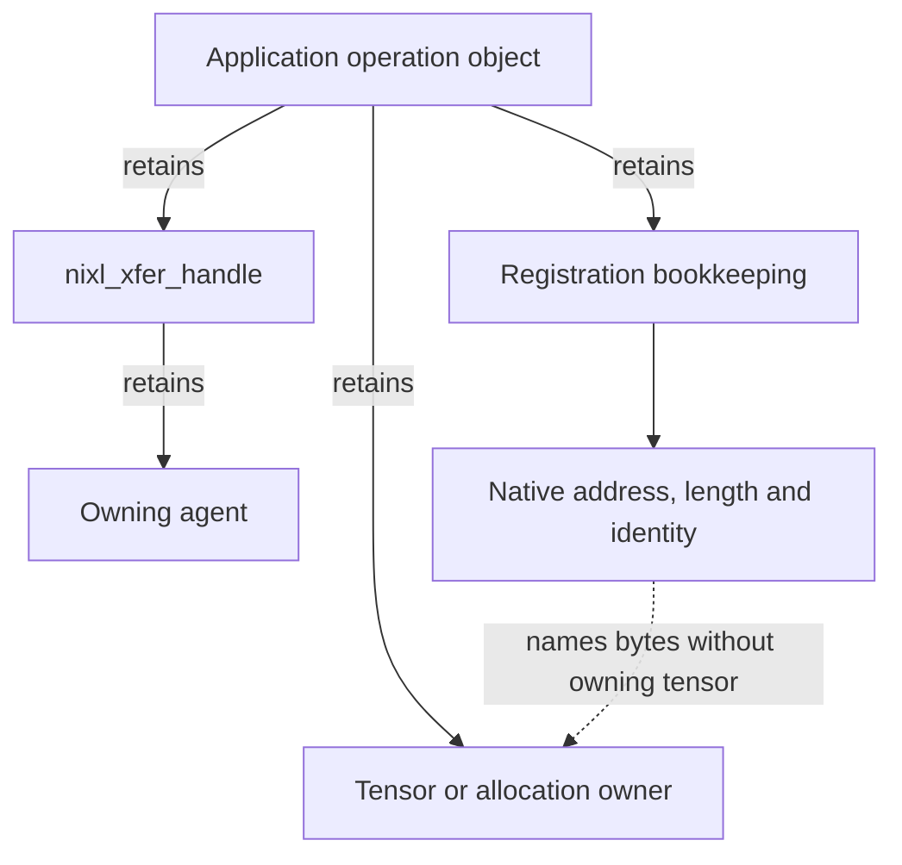

import Source from '../../../../components/Source.astro';

## Python exposes the same asynchronous ownership boundary

The Python wrapper converts application ranges and configuration into native
NIXL objects. It provides convenient backend names, descriptor creation, opaque
handles and Python-facing states while retaining the native transfer lifecycle.

Start at `src/api/python/_api.py`, then cross the pybind bridge into the C++ agent.
These files implement runtime behavior behind the packaged namespace.

## Follow an ordinary operation

The application creates `nixl_agent`, initializes suitable backends and registers
its storage. It builds local/remote transfer descriptors and uses
`initialize_xfer` to construct a request. `transfer` posts work and
`check_xfer_state` observes the execution.

The wrapper maps native success and pending states to `DONE` and `PROC`; native
errors cross the binding as exceptions. Keep the owner and operation record
available through that return path so errors can be handled without losing the
references needed for cleanup.

Stable pools can instead use `prep_xfer_dlist` and `make_prepped_xfer` to reuse
descriptor preparation. That changes construction overhead, while posting,
completion and storage ownership follow the same model.

## Retain more than the request handle

The solid application edges show a useful ownership design. The wrapper supplies
the handle-to-agent retention, while descriptors name bytes by address and length
without retaining their Python tensor owners.

An integration can therefore keep an operation object containing the tensor or
allocation owner, registration bookkeeping and transfer handle. That object
survives until communication and any relevant consumer dependencies allow
retirement. Returning only a native address or opaque handle to another coroutine
does not provide ownership of all storage it names.

## Complete, publish and release deliberately

After the selected transfer completion, release the request through the wrapper's
explicit API. Prepared lists and registrations have separate release operations;
the application allocation is retired after its remaining users are safe. A
release error must preserve the references needed to recover the active request.

The wrapper also provides notification collection and convenience matching.
Use application-level request/object correlation for destination validation,
especially when slots are recycled or a consumer request has been abandoned.
The [notification chapter](/architecture/nixl/notifications/) shows where that
check belongs relative to transport completion.

This ownership discipline is the important Python-specific lesson. GIL behavior,
wrapper convenience and garbage collection do not replace a protocol for when
native asynchronous access has ended.

## Read the code

<Source project="nixl" path="src/api/python/_api.py" label="Runtime wrapper, handles and transfer methods" />
<Source project="nixl" path="src/bindings/python/nixl_bindings.cpp" label="Native API bridge and error translation" />
<Source project="nixl" path="src/core/transfer_request.h" label="Underlying request lifetime" />
