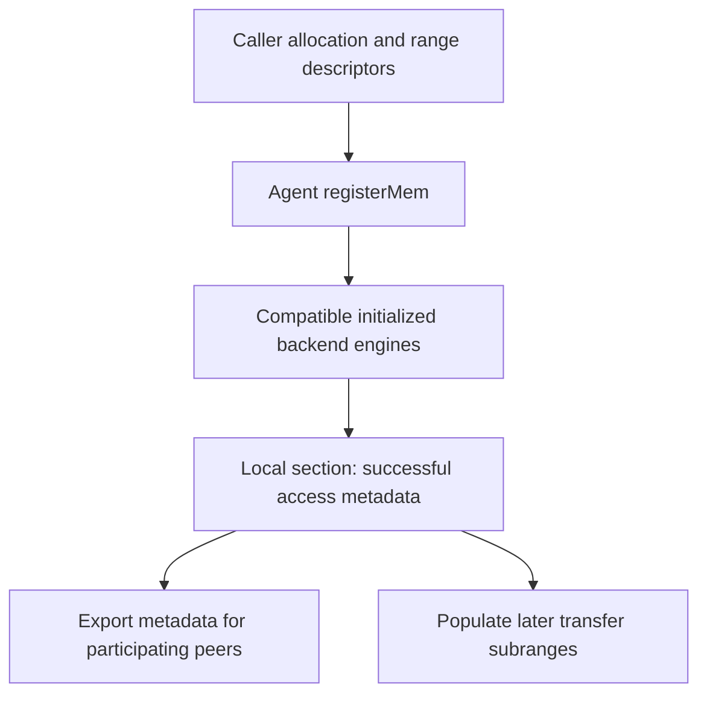

import Source from '../../../../components/Source.astro';

## Make caller-owned storage usable by a backend

The framework allocates a tensor, buffer pool or storage resource. Registration
then establishes the backend access metadata needed to transfer ranges within it.
The application retains allocation ownership and controls when its contents may
be produced, consumed or reused.

This separates a potentially expensive setup operation from the many requests
that later select subranges of a stable pool.

## Follow registration through the agent

The agent uses the descriptor memory type and optional backend constraints to
select candidates. Each backend registers the range under its own access model.
The local section retains the resulting metadata for request construction.

Registration uses a best-effort aggregation rule: success means at least one
candidate succeeded. A later request still needs a compatible successful
registration on both participating sides. Constrain or inspect the intended
backend when a specific path matters.

## Registration and transfer have different sizes

A framework can register a large pool once, then describe only the blocks needed
by an individual request. For example, a 512-byte range starting 1024 bytes into
a registered 4096-byte allocation is a covered subrange. Request preparation
resolves it through the section and derives the backend metadata for that access.

The registration does not reserve application capacity inside the pool. The
framework still tracks which request owns each slot and prevents conflicting
reads, writes or allocator reuse.

## Retire access before replacing storage

Transfer handles, prepared metadata, backend registrations and the allocation have
related but distinct lifetimes. A simple ownership order is to finish or safely
retire active transfers, release dependent handles, deregister ranges, then free
the allocation.

Peers also need coordinated metadata updates when registered resources change.
An allocator returning the same address for a new allocation does not make old
remote access information current. The [metadata chapter](/architecture/nixl/metadata-and-connections/)
explains the cached-section boundary used by prepared requests.

Different backends attach different resources to registration: UCX creates
transport-facing memory state, while a storage backend may manage an opened
file. The common API organizes lifetime without making those access mechanisms
identical.

## Read the code

<Source project="nixl" path="src/core/nixl_agent.cpp" label="registerMem, local sections and deregisterMem" />
<Source project="nixl" path="src/api/cpp/nixl_descriptors.h" label="Range coverage" />
<Source project="nixl" path="src/plugins/ucx/ucx_backend.cpp" label="A backend's registration implementation" />
