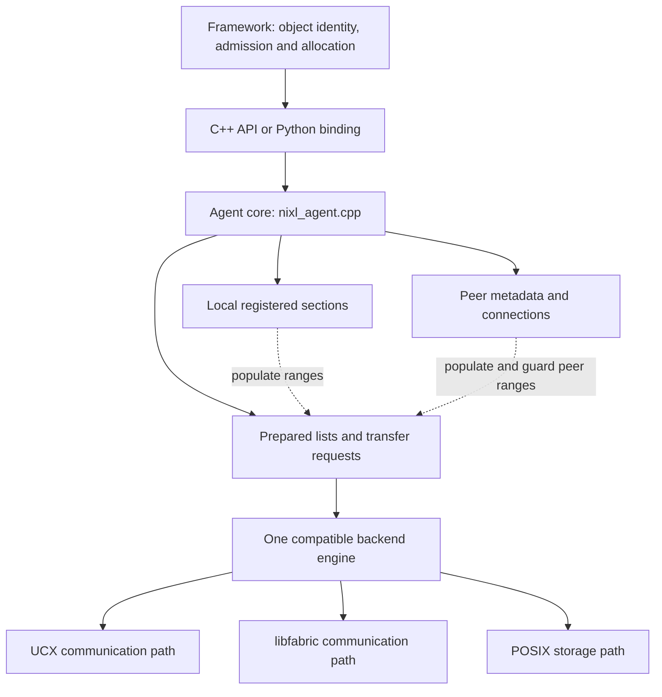

import Source from '../../../../components/Source.astro';

## Find the owner before following a transfer

NIXL separates application policy from reusable transfer machinery. The framework
chooses which logical object to move, where it belongs and when its storage can
be reused. NIXL coordinates the ranges, registrations and request. A backend
implements the selected transport or storage path.

This chapter gives a reading order for those boundaries so a source search does
not stop at a public wrapper or wander through unrelated plugins.

## The source map

Backend leaves are alternatives. A transfer follows a compatible selected path;
the presence of several plugins does not make them consecutive layers.

## Trace from the public API to one backend

Start at `src/api/cpp/nixl.h`. The agent API exposes backend creation, memory
registration, metadata exchange, request preparation, posting, status and release.
`nixl_descriptors.h` defines the byte ranges passed between those stages.

The implementation spine is `src/core/nixl_agent.cpp`. It coordinates three
important kinds of state:

| State | Why the agent needs it |
| --- | --- |
| Initialized engines and local sections | Know which backends can access registered caller ranges. |
| Remote sections and connection metadata | Resolve registered peer ranges through a compatible backend. |
| Transfer/prepared handles | Retain populated metadata and operation state across asynchronous calls. |

The selected engine then prepares and posts concrete backend work. For an initial
network-memory trace, follow UCX registration, `postXfer` and `checkXfer`, then its
backend request object. Progress and completion live below the same interface
that the generic agent calls.

## Locate the Python boundary

The runtime wrapper is `src/api/python/_api.py`; the native bridge is
`src/bindings/python/nixl_bindings.cpp`. The wrapper converts application ranges,
maps backend names, retains native handles and exposes Python-facing states.
Packaging shims route imports, while these files implement the runtime behavior.

A Python tensor's address crosses this boundary as range metadata. The
application must still retain the tensor owner while the native operation uses
its storage. The [binding chapter](/architecture/nixl/python-bindings/) develops
that ownership model.

## Use the map for a concrete question

For a request that stays pending, first identify the handle and selected engine.
Then follow the agent's status call into that engine's progress and completion
path. For a request rejected before posting, inspect descriptors, registrations
and peer metadata instead. These are different stages with different owners.

Read one ordinary operation end to end before comparing backend alternatives.
That establishes the common contract and makes later differences in topology,
notifications or storage interpretation easier to recognize.

## Read the code

<Source project="nixl" path="src/api/cpp/nixl.h" label="Public agent contract" />
<Source project="nixl" path="src/core/nixl_agent.cpp" label="Core coordination" />
<Source project="nixl" path="src/core/transfer_request.h" label="Request and prepared-list state" />
<Source project="nixl" path="src/plugins/ucx/ucx_backend.cpp" label="UCX implementation path" />
