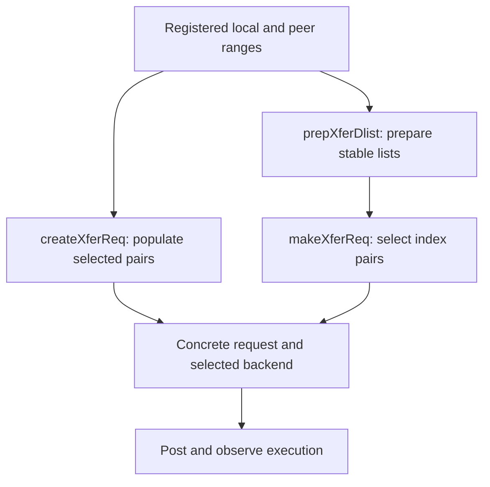

import Source from '../../../../components/Source.astro';

## Separate reusable access information from one transfer

An inference framework often moves different subsets of the same registered
buffer pool. Revalidating and populating every range for every operation can add
control overhead. NIXL offers ordinary request construction and reusable prepared
descriptor lists for these two workloads.

Both paths ultimately create a concrete transfer request with a selected backend,
paired ranges and operation state. Neither path moves payload until posting.

## Choose the construction path

**Ordinary creation** is the simplest route. `createXferReq` validates corresponding
descriptor counts and lengths, finds a compatible backend, populates registered
metadata and prepares that backend's request.

**Prepared lists** save populated access information for stable ranges. A local
list describes the initiator's storage; a remote list also depends on the cached
peer registration. `makeXferReq` selects matching index pairs and builds one
request using a backend common to both prepared sides.

## Understand the reuse being saved

Imagine a registered pool of 4096 slots, with each operation selecting 32 slots.
Preparing the pool amortizes range population while allowing selections to change.
Each request still defines its exact source-to-destination mapping.

If every execution uses the same mapping, reusing a completed request can avoid
constructing another request. That is a different optimization from prepared-list
reuse: one reuses access information for changing selections; the other reuses
one concrete operation.

The implementation can compact compatible consecutive ranges. The important
contract is that compaction preserves selected pairs and byte lengths. It does
not reshape model data or reserve destination slots for the application.

## Keep preparation tied to resource lifetime

Prepared lists retain access metadata, while the framework retains the underlying
allocations and their ownership protocol. Remote prepared state also depends on
the peer section against which it was populated. Invalidation retires that cached
section, requiring affected preparation to be rebuilt before new work.

Release prepared lists and transfer requests through their respective APIs.
Registration and allocation cleanup remain separate. This distinction makes the
performance choice safe: reuse saves control work because access stays valid,
not because the library owns the pool's future contents.

## Read the code

<Source project="nixl" path="src/core/nixl_agent.cpp" label="createXferReq, prepXferDlist and makeXferReq" />
<Source project="nixl" path="src/core/transfer_request.h" label="Prepared metadata and concrete request ownership" />
<Source project="nixl" path="src/api/python/_api.py" label="Python ordinary and prepared transfer APIs" />
