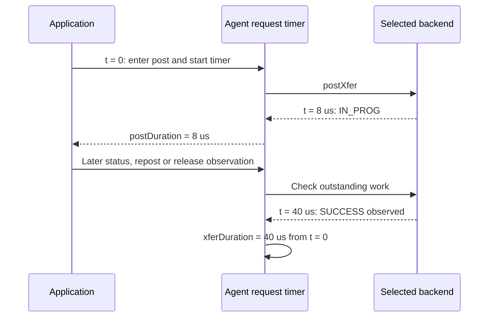

import Source from '../../../../components/Source.astro';

## Measure the stage you intend to improve

Transfer latency can include range construction, registration, metadata exchange,
request preparation, posting, progress and receiver consumption. Improving one
stage does not automatically improve the others. Start by identifying the
boundaries behind a measured value.

NIXL offers request telemetry and optional trace backends. The framework adds
the allocation, scheduling and consumer observations needed to explain useful
end-to-end inference work.

## Posting and transfer timing overlap

The numbers are illustrative. `postDuration` describes the post call's elapsed
work, while `xferDuration` runs from that same posting origin to the agent's
observation of completion. The initial eight microseconds are inside the forty,
so adding them would double count part of the interval.

The completion observation includes progress and polling effects. It therefore
describes this software-visible request boundary, rather than pure wire latency
or the receiver's later GPU consumption.

## Follow one request across repeated executions

A reusable request can be posted several times. Trace identity distinguishes the
request from its executions, connecting each post with its corresponding outcome.
Use that identity when correlating preparation, backend phases and completion,
instead of collapsing every execution onto the handle's lifetime.

Backend phase events provide another level of detail when an architectural stage
is the bottleneck. Their emitting code defines the observation point; interpret
them alongside the selected backend and the caller's own readiness timestamps.

## Choose an experiment that matches the workload

For stable mappings, compare repeated completed-request reuse with constructing
new requests. For changing subsets of a stable pool, compare ordinary construction
with prepared lists. Those experiments save different control work, so they
should be distinguished from a throughput experiment that actually posts payload.

Measure a few stages consistently:

| Stage | Useful question |
| --- | --- |
| Registration/preparation | How much setup is amortized over repeated work? |
| Posting/completion | Who advances communication and when is completion observed? |
| Receiver publication | When can the framework release a waiting consumer? |

Keep payload size, selected engine, memory placement and concurrency visible when
comparing results. A smaller preparation cost can matter for many tiny transfers
while being negligible beside a large payload movement.

## Read the observation path

Telemetry capture and exporting are separate parts of instrumentation. Choose
collection and trace output appropriate to the experiment, then inspect the
timing updates and selected backend phases. Instrumentation observes the transfer
path; it is not a required dependency of every successful transfer.

<Source project="nixl" path="src/core/nixl_agent.cpp" label="Posting timers and completion observations" />
<Source project="nixl" path="src/core/telemetry/telemetry.cpp" label="Telemetry collection and exporters" />
<Source project="nixl" path="src/core/tracing/tracer.cpp" label="Optional trace backends" />
<Source project="nixl" path="test/python/prep_xfer_perf.py" label="A focused preparation-overhead experiment" />
