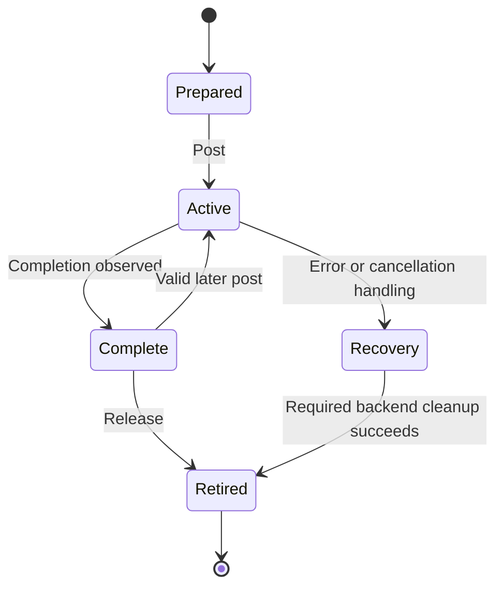

import Source from '../../../../components/Source.astro';

## A prepared request can have several executions

A transfer handle retains the selected backend, populated range metadata and
backend request state. Creating it prepares work. Posting starts an execution;
status observes that execution; release retires the handle.

The framework retains source and destination storage while the backend may
access it. Keeping that ownership separate from the handle makes asynchronous
use and later reuse understandable.

A WRITE moves local bytes toward the target; a READ fills local storage from the
target. In either direction, one request identifies the paired ranges while the
framework orders the producers and consumers around it.

## Follow the operation states

This is a conceptual lifecycle. An execution can complete during the post call
or remain pending for later observation. Reposting does not create a second
concurrent execution on the same handle.

## Trace post, status and progress

`postXferReq` checks the request's cached remote-section reference and delegates
to the selected engine. A pending result means backend work remains outstanding.
`getXferStatus` checks that backend request and can drive progress on its path.

The public result distinguishes success, pending and error. Integrations should
preserve that distinction: a permanent error requires recovery rather than an
indefinite polling loop. A status result describes the execution being observed,
while valid registration and peer metadata authorize a future post.

On UCX, the tracked work can include payload operations, flush and an associated
notification send. The [backend chapter](/architecture/nixl/ucx-path/) connects
those pieces to the generic lifecycle.

## Decide when to reuse or retire

Repost a completed request when its mapping and access metadata remain suitable.
Use a new request when the intended ranges or peer registration have changed.
Both cases require application dependencies that prevent concurrent incompatible
use of the payload storage.

For retirement, finish work or follow the backend's supported cleanup path, then
release the request. A refused active release leaves a live handle that the caller
must retain for recovery; it is not permission to free referenced storage.

The target has a separate application lifetime. A notification or successful
transport result must be connected to the framework's validation and publication
step before consumers use the object. The [notification chapter](/architecture/nixl/notifications/)
shows those two observers.

## Read the code

<Source project="nixl" path="src/core/transfer_request.h" label="Retained request state" />
<Source project="nixl" path="src/core/nixl_agent.cpp" label="postXferReq, getXferStatus and releaseXferReq" />
<Source project="nixl" path="src/api/cpp/nixl_types.h" label="Operation and status vocabulary" />
