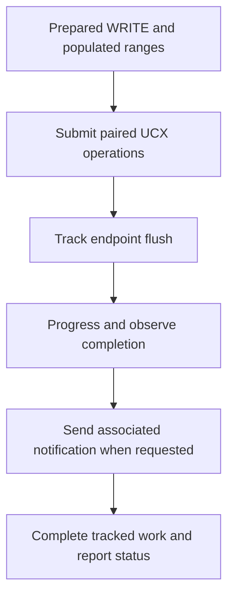

import Source from '../../../../components/Source.astro';

## Follow one network-memory backend

The UCX plugin translates NIXL's registered ranges and request lifecycle into
UCX communication. UCX supplies the transport machinery; NIXL's backend adapts
registration, peer connections, posting, progress and notifications to the common
agent interface.

This is one selected backend path. Its UCX dependency belongs to that path rather
than every possible NIXL deployment.

## Registration and metadata prepare the path

The engine advertises host and device memory support for compatible environments.
Local registration establishes access state, while exported metadata lets the
peer construct the corresponding remote access information. Connection metadata
resolves the peer into UCX endpoints used by the engine's workers.

The generic agent has already paired the intended ranges when it calls backend
preparation. The backend request then retains the state needed to execute those
ranges through the selected endpoint.

## Follow an ordinary WRITE

The graph follows the successful path. Data, flush and message-send work can each
keep the backend request pending. The request object groups that work under the
one handle the generic agent observes.

## Progress connects asynchronous work to status

`postXfer` submits work and checks the resulting request state. Later `checkXfer`
evaluates outstanding UCX requests. The request's status path can run worker
progress, retire completed operations and retain pending ones.

A configured progress thread can advance transport independently. The application
still observes results and handles its own object publication. Choosing caller
polling or background progress changes who spends CPU time advancing communication;
it does not transfer ownership of model buffers to the backend.

For an associated notification, the UCX backend waits for successful data/flush
completion before submitting the message. That send can add tracked asynchronous
work. A standalone notification has its own submission path and needs any desired
relationship to payload movement established by the application.

## Keep transport and framework completion separate

The backend completion contract tells the initiator about its operation. The
receiver must still consume notifications, validate the intended destination
object and establish dependencies for its GPU consumer. Cancellation similarly
needs backend cleanup plus framework-level recovery for any bytes already moved.

These boundaries are the useful comparison points when reading another backend:
how it registers ranges, represents connections, tracks work and reports a safe
completion boundary.

## Read the code

<Source project="nixl" path="src/plugins/ucx/ucx_backend.h" label="UCX engine capabilities" />
<Source project="nixl" path="src/plugins/ucx/ucx_backend.cpp" label="Registration, posting and checkXfer" />
<Source project="nixl" path="src/plugins/ucx/ucx_backend_req.h" label="Tracked requests, flush and progress" />
