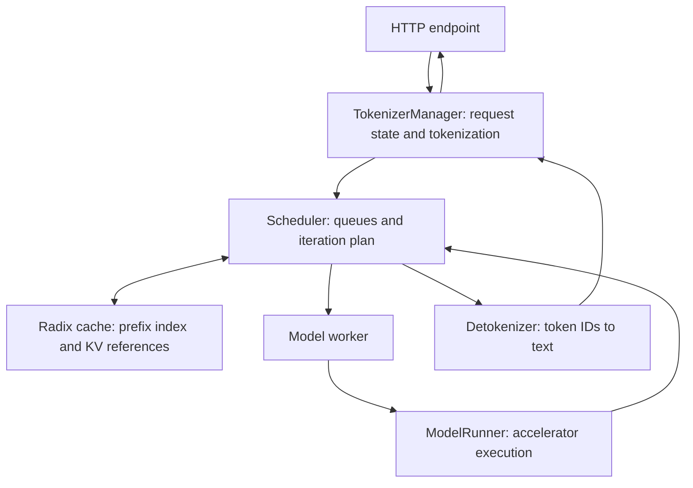

import SystemMap from '../../../components/SystemMap.astro';
import Source from '../../../components/Source.astro';

## Why it exists

Applications often reuse a long system prompt, tool definitions or conversation
history while generating a short answer. Recomputing that prefix wastes GPU work.
Fixed batches also leave capacity idle as short requests finish ahead of long ones.

SGLang's **SRT** model-serving runtime coordinates incoming requests, reusable
attention state and accelerator execution. This guide follows text generation
through that runtime, starting with one engine and a local prefix cache.

## Where it fits

<SystemMap current="sglang" />

SGLang can serve directly or sit behind an optional orchestrator. It accepts
prompts and generation parameters, then returns generated text. **Tokens** are
integer model inputs; the **KV cache** holds attention keys and values computed
for their context. Reusing KV avoids repeated model computation rather than
replaying a previously completed answer.

Parallel workers, external cache tiers and separated prefill/decode are extensions
of this local serving path. Each adds a specific coordination boundary.

## Architecture overview

The frontend's TokenizerManager owns input preparation and response waiters.
The scheduler owns waiting/running requests, prefix reuse and the next iteration's
work. A model worker translates that work for ModelRunner, which performs model
execution. Results return through scheduler updates and detokenization.

A **continuous batch** changes membership between iterations. The **radix cache**
indexes shared token prefixes and references their KV locations. Cache locks
protect state used by active requests; unprotected cached state can supply
reclaimable capacity.

These ownership boundaries are the main source-navigation map. Request identity
survives even though each stage uses a different representation.

## Follow an operation

1. TokenizerManager normalizes and tokenizes input, retains frontend request state,
   and dispatches a tokenized message to scheduling.
2. The scheduler creates persistent request state and matches a compatible cached
   prefix. The uncached suffix still needs prefill computation.
3. Scheduling chooses feasible work under token and KV-capacity budgets, then
   constructs a batch for the model worker and ModelRunner.
4. Model execution and sampling produce token progress. The scheduler reconciles
   results, checks stopping and updates cache/resource ownership.
5. Detokenization turns output IDs into incremental text. The frontend delivers
   response chunks while decode continues for active requests.

Cancellation travels back to the scheduler once work has been dispatched. Local
response lifetime and accelerator resource retirement remain separate boundaries.

## Decision gates

| Choice | Effect on the path |
| --- | --- |
| Prefix reuse and admission policy | Balance avoided computation against capacity for active work. |
| Normal or overlap scheduling | Trade a simpler result order for pipelined CPU/GPU work. |
| Replicas or cooperating ranks | Scale independent requests or divide model execution. |
| Cache tiers or separated stages | Add transfer, readiness and ownership protocols. |

Begin with the [repository map](/architecture/sglang/repository-map/) and
[startup](/architecture/sglang/startup/). Read deeper chapters when their boundary
matches the operation you are tracing.

## Explore the code

<Source project="sglang" path="python/sglang/srt/managers/tokenizer_manager.py" label="Frontend request and response ownership" />
<Source project="sglang" path="python/sglang/srt/managers/scheduler.py" label="Normal scheduling and result loop" />
<Source project="sglang" path="python/sglang/srt/mem_cache/radix_cache.py" label="Prefix index and ownership" />
<Source project="sglang" path="python/sglang/srt/model_executor/model_runner.py" label="Model execution" />
