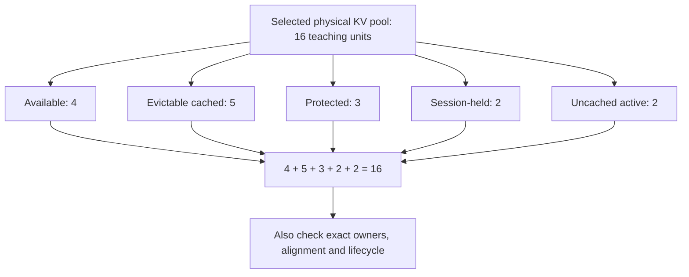

import Source from '../../../../components/Source.astro';

## Diagnose the state transition that stopped progressing

An SGLang symptom can originate in request preparation, scheduling, execution,
cache ownership or response delivery. Start by identifying the last successful
handoff and the owner of the next one.

Keep request ID and the selected configuration with that trace. They connect
logs and metrics to the implementation actually running, including its overlap,
parallel and cache choices.

## Follow observations along the request path

Frontend timing covers preparation and delivery boundaries. Scheduler timing
describes waiting, admission and iterations. Execution and transfer timing describe
the selected work inside those stages. A visible output gap can span several of
them, so locate the measurement before naming the bottleneck.

For one request, ask: was it dispatched, admitted, launched, reconciled and
delivered? Compare its state at adjacent owners instead of changing unrelated
configuration options until a symptom disappears.

## Use ownership to explain memory capacity

Physical KV tensors can remain allocated while logical capacity inside them
changes. A pool can hold active, cached, protected or session-owned locations.
The allocator and cache therefore provide more useful ownership evidence than
device allocation totals alone.

The numbers are a teaching partition, not measured proportions. Conservation
helps identify missing ownership, while exact request/location identity is still
needed to establish correct release.

After an aborted prompt, for example, trace dispatch cleanup to scheduler
retirement, prefix protection and mapping release. Remaining allocated tensors
may be expected; lost allocatable capacity calls for finding which owner still
retains it.

## Choose evidence at the responsible boundary

**A localized state bug:** read the owner and its focused unit assertions. A
cache-lock, request-retirement or detokenizer assertion can explain the local
contract without requiring a tour of every fixture.

**A cross-process failure:** trace IPC identity, result handling and cleanup across
the participating owners. Component success alone leaves that handoff untested.

**A performance problem:** verify the selected execution/transfer mechanism, then
measure the stage matching the question. Payload correctness and useful serving
throughput are related evidence with different scopes.

Keep the resulting incident record short: selected path, request identity, last
successful transition, retained resource owner and the observation that proves
the next transition is missing. That is enough to choose a deeper source or test
route without an exhaustive option checklist.

## Read the code

<Source project="sglang" path="python/sglang/srt/observability/req_time_stats.py" label="Request observation boundaries" />
<Source project="sglang" path="python/sglang/srt/managers/scheduler_components/memory_usage.py" label="Logical memory ownership" />
<Source project="sglang" path="python/sglang/srt/managers/scheduler_components/invariant_checker.py" label="Pool conservation and ownership checks" />
<Source project="sglang" path="test/registered/unit/managers/scheduler_components/test_invariant_checker.py" label="Focused accounting assertions" />
