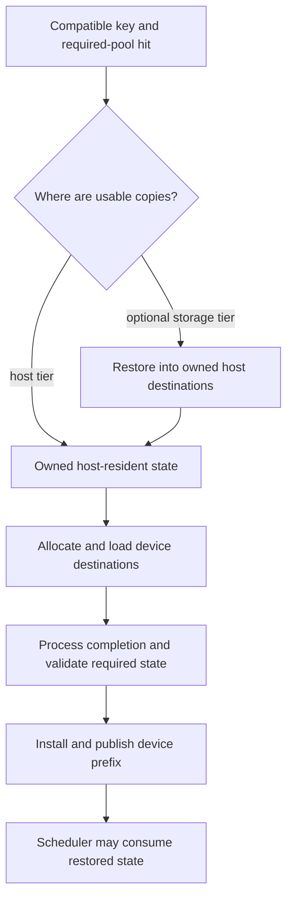

import Source from '../../../../components/Source.astro';

## Reuse depends on where state resides

A compatible cached prefix can live in device memory, host memory or an optional
external storage tier. Those copies have different restoration costs and readiness
conditions. Finding a key is the beginning of reuse; model execution needs valid
state in the selected device representation.

Hierarchical caching coordinates the index, destinations, transfers and
publication that connect those tiers.

## Follow a hit into executable device state

The graph shows logical dependencies. Implementations can pipeline work or already
have a device-resident copy, but pending destinations become usable only after
their required transfer and validation conditions hold.

The storage interface exposes lookup and movement over registered host pools.
The unified radix cache tracks indexed state, while controllers coordinate the
selected pool transfers. Scheduler processing observes the completion events
needed before later work consumes restored state.

## Keep copy location and ownership separate

A host copy can avoid an external storage read while still requiring device
load-back. An external object can exist before a host/device destination has been
allocated. These states have different owners and capacity needs.

Writeback creates another retained copy. Eviction relinquishes capacity in a
tier. Source storage must stay valid while transfers read it, and destinations
must remain owned while transfers write them. The same buffer cannot be recycled
solely because its higher-level request has stopped waiting.

Models with several required state pools also need a jointly valid restoration
boundary. Main-KV existence alone is insufficient when auxiliary state or another
required participant is missing. The runtime must validate the complete state
needed at the boundary it publishes.

## Decisions that matter for the architecture

**Tier selection:** retaining more device state reduces restoration work but uses
scarce accelerator capacity. Host and storage tiers expand retained state while
adding transfer latency and resources.

**Usable prefix:** lookup evidence must become a compatible, complete restored
prefix before scheduling adopts it. Partial transfer success is interpreted at
that publication boundary.

**Eviction and movement:** reclamation must account for active readers and pending
I/O. Follow transfer ownership before changing a retention or eviction policy.

For a concrete trace, follow one key from lookup through destination allocation,
transfer completion, index installation and eventual consumption. That captures
the essential architecture without cataloging every storage backend and its
individual options.

## Read the code

<Source project="sglang" path="python/sglang/srt/mem_cache/hicache_storage.py" label="Registered pools, transfers and restoration contract" />
<Source project="sglang" path="python/sglang/srt/mem_cache/unified_radix_cache.py" label="Index state and load-back lifecycle" />
<Source project="sglang" path="python/sglang/srt/mem_cache/hybrid_cache/hybrid_cache_controller.py" label="Host/device transfer coordination" />
