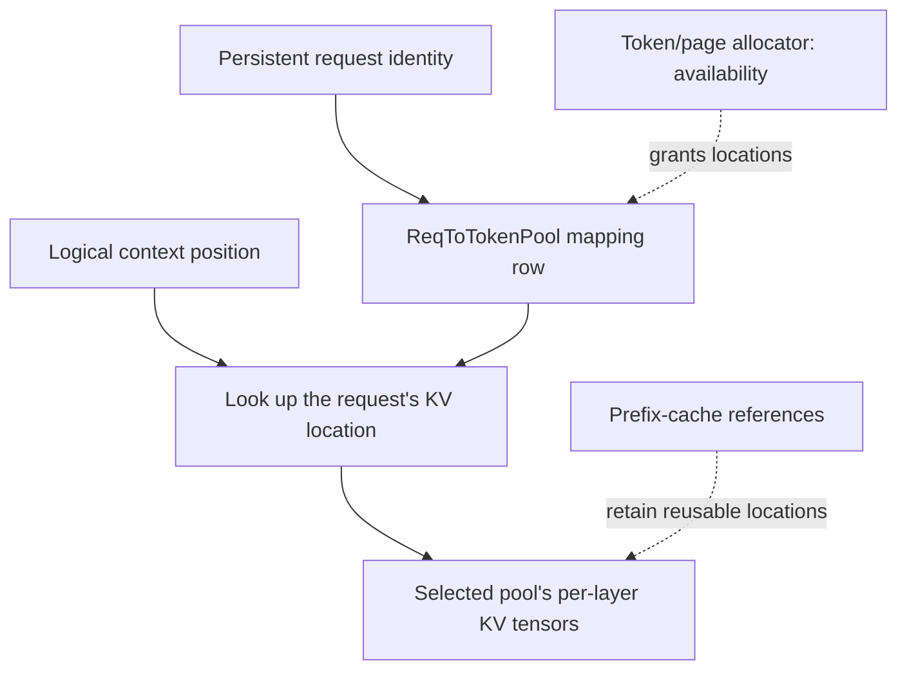

import Source from '../../../../components/Source.astro';

## Follow the indirection from request to KV

An active request needs stable access to its context while batches change around
it. SGLang separates a request's mapping row, allocation of token/page locations,
and the actual per-layer KV tensors.

Those layers answer different questions: which locations belong to this request,
which locations are available, and where the attention payload is stored.

## See the three responsibilities

The mapping row stores indices rather than the K/V payload. The allocator manages
availability; model-specific pools expose the tensors execution reads and writes.
Following these edges is more useful than treating one free-memory figure as a
complete account of ownership.

## Trace allocation through execution

When scheduling admits work, the request obtains the mapping and KV locations
needed for its context. Batch preparation gathers those locations into execution
metadata, including the destinations for newly computed state.

The worker/attention backend uses that metadata to find earlier context and write
new K/V. A chunked prompt retains its mappings between chunks. Continuing decode
extends the logical context while keeping earlier locations available.

When a request completes, ownership determines what returns to the allocator.
Some locations can remain referenced by reusable prefix state; active or pending
users retain others. Freeing a request row and freeing every payload location are
therefore different operations.

## Decisions that shape the layout

**Allocation granularity:** token and paged allocators expose different allocation
units. Page boundaries influence capacity accounting, alignment and reclamation.

**Model representation:** the selected KV pool determines physical tensors and
the metadata required to access them. Different attention/model layouts can use
different storage representations while preserving the request-level mapping.

**Reuse and reclamation:** cache ownership and outstanding execution must agree
before locations are recycled. Returning storage early can make a valid-looking
index refer to another request's payload.

For diagnosis, trace a concrete request from its row to the allocator and pool,
then identify which active, cached or pending owner retains each location. This
connects logical capacity changes to their real storage consequences.

## Read the code

<Source project="sglang" path="python/sglang/srt/mem_cache/memory_pool.py" label="ReqToTokenPool and KV pool implementations" />
<Source project="sglang" path="python/sglang/srt/mem_cache/allocator/token.py" label="Token allocation" />
<Source project="sglang" path="python/sglang/srt/mem_cache/allocator/paged.py" label="Paged allocation and release" />
