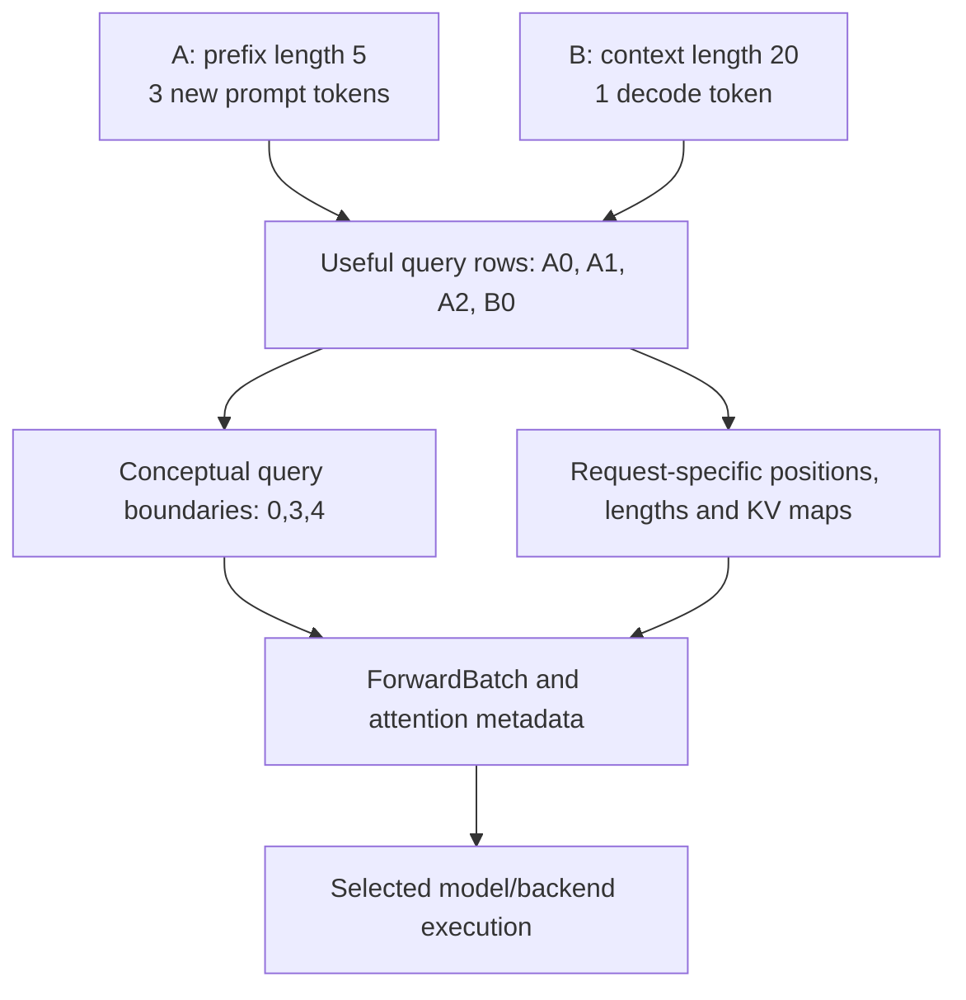

import Source from '../../../../components/Source.astro';

## Turn logical work into model inputs

The scheduler decides which requests and token positions should advance. Model
execution needs flattened token tensors, positions, context lengths and KV access
metadata. The model worker bridges those representations before ModelRunner
invokes the selected model and attention backend.

The important boundary is logical request progress becoming an executable
`ForwardBatch`.

## Follow batch preparation into the runner

`ScheduleBatch` prepares extend or decode work on the scheduler side. The model
worker converts the selected execution representation, and `ForwardBatch` carries
the mode, request mappings, sequence information and output KV locations the
runner/backend need.

Some data is persistent request state, some belongs to the current iteration, and
some is device execution metadata. Follow where each is assembled rather than
assuming a batch is a list of complete request objects copied to the GPU.

## See why request count and query rows differ

In this illustrative mixed-work layout, A contributes three new prompt positions
and B one decode position. There are two requests but four useful query rows.
Each request still has its own earlier context and KV mapping. The conceptual
boundaries `0,3,4` describe the new rows, rather than all context tokens read by
attention.

The exact admitted batch depends on scheduling configuration. This layout teaches
the representation problem: flattened work must preserve the request-specific
metadata needed to interpret every row.

## Execution choices and the return path

**Attention backend:** ModelRunner selects an implementation and prepares its
metadata against the chosen KV representation. The backend connects query rows to
the correct context and write locations.

**Eager or captured execution:** supported graph capture reduces launch overhead
for compatible shapes. Captured execution can introduce padding and buffer
constraints, so useful rows and execution capacity need distinct accounting.

**Result handling:** forward results feed sampling and scheduler reconciliation.
The current iteration's row identity must survive until its result is processed,
especially when overlap launches later work first.

When output is wrong or memory use is surprising, inspect the representation
boundary before changing kernels: request mapping, useful row count, context
length, write destinations and selected backend should describe the same work.
Then follow the resulting tokens back into scheduler ownership.

## Read the code

<Source project="sglang" path="python/sglang/srt/managers/schedule_batch.py" label="Extend/decode preparation" />
<Source project="sglang" path="python/sglang/srt/managers/tp_worker.py" label="Worker execution bridge" />
<Source project="sglang" path="python/sglang/srt/model_executor/forward_batch_info.py" label="ForwardBatch representation" />
<Source project="sglang" path="python/sglang/srt/model_executor/model_runner.py" label="Model/backend invocation and results" />
