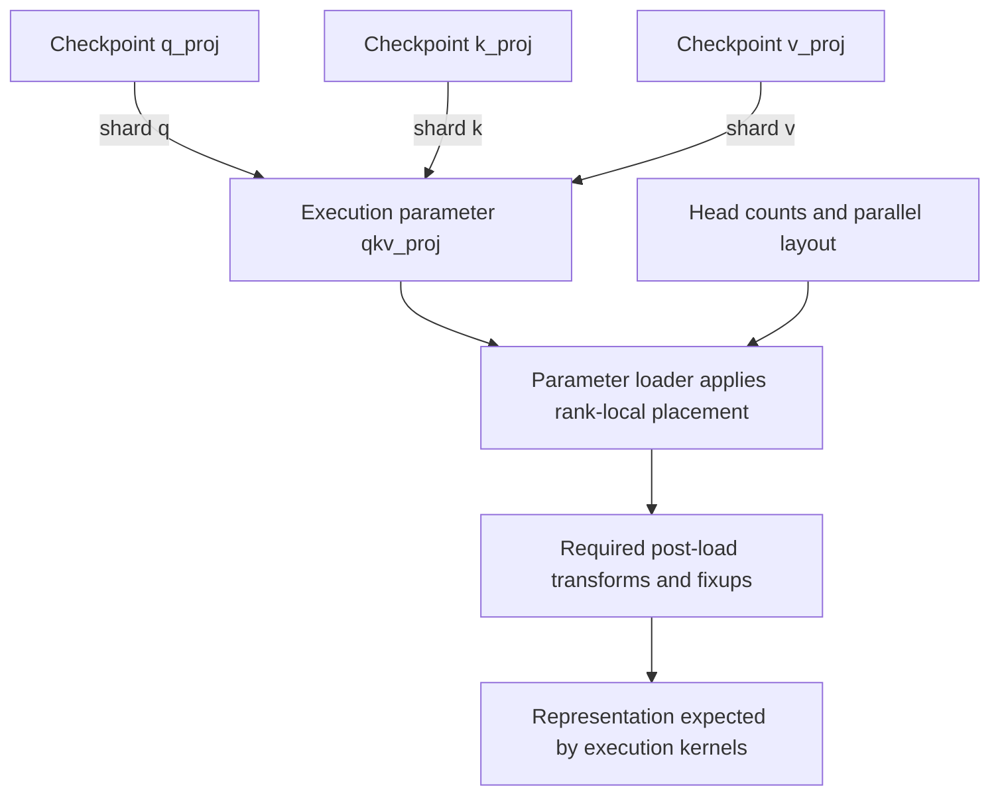

import Source from '../../../../components/Source.astro';

## Resolve a model into execution-ready parameters

A model name must become a model implementation, loaded parameters and the
representation expected by execution kernels. SGLang separates architecture
resolution from the loader that obtains and installs checkpoint tensors.

ModelRunner coordinates loading within startup, then performs the preparation
needed by the chosen model, backend and KV layout.

## Follow architecture, artifacts and placement

The model-loader entrypoint selects a loader and calls its `load_model` method.
Architecture helpers resolve the execution model class. The default loader
prepares weight files/iterators, constructs the model, and delegates named tensor
installation to the model's loading logic.

That delegation is the key source boundary. Model code knows how checkpoint names
map into execution parameters; parameter loaders know which part belongs to the
local parallel rank. Post-load transformations then establish the layout consumed
by kernels.

## See one checkpoint-to-parameter mapping

Qwen2 illustrates separate query, key and value checkpoint names converging on a
packed execution QKV parameter. The shard identity and head/parallel layout tell
the parameter loader where each tensor belongs. The diagram shows named regions,
rather than assuming three equally sized pieces.

This example explains why successfully reading files is only part of loading.
Correct names, local partitions and required representation transformations must
agree before execution uses the parameters.

## Decisions that change loading

| Choice | Architectural consequence |
| --- | --- |
| Model implementation | Defines modules and expected parameter semantics. |
| Artifact/loader path | Determines how tensors arrive and which loading lifecycle runs. |
| Dtype, quantization and parallel layout | Determine stored representation, placement and preparation. |

Alternative loaders can change artifact format or transport. They still owe the
post-load state ModelRunner and kernels expect. Remote weight loading adds a
service/transfer lifetime; it is a different concern from moving per-request KV.

## Connect readiness to memory ownership

Weights, KV storage and temporary workspaces share device capacity but have
different lifetimes. Loading parameters can succeed while later cache/execution
setup has insufficient serving capacity. Diagnose the stage that failed.

Likewise, a loading optimization may overlap transfers and transformations.
Readiness must follow the required dependencies before consumers observe partially
prepared parameters. To trace a quality problem, follow one real checkpoint
tensor through its name mapping, rank-local installation and post-load use.

## Read the code

<Source project="sglang" path="python/sglang/srt/model_loader/__init__.py" label="Model loader entrypoint" />
<Source project="sglang" path="python/sglang/srt/model_loader/loader.py" label="Artifact loading lifecycle" />
<Source project="sglang" path="python/sglang/srt/models/qwen2.py" label="Model-specific named weight mapping" />
<Source project="sglang" path="python/sglang/srt/layers/linear.py" label="Parameter loading and parallel placement" />
<Source project="sglang" path="python/sglang/srt/model_executor/model_runner.py" label="Execution preparation after loading" />
