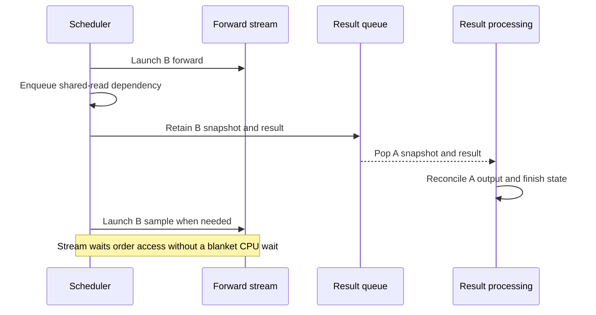

import Source from '../../../../components/Source.astro';

## Pipeline host work with accelerator execution

In the normal scheduler loop, the runtime runs a batch and processes its result
before moving on. Overlap scheduling keeps the GPU busy by launching newer work
while the host reconciles an older result.

The architecture still needs the same request identity and ownership. Overlap
changes when results are observed, making their interpretation and storage
lifetimes explicit.

## Follow two adjacent batches

Here A is the previous batch and B the current one. The illustrated late-processing
path launches B before reconciling A. Dependencies can require earlier processing
instead; the invariant is that each result is interpreted with its own metadata
and the required ordering remains intact.

The scheduler queues a batch snapshot together with the forward result. When it
pops that pair, it can update the right requests even though current mutable
scheduler state already describes later work.

## Preserve three different forms of safety

**Interpretation:** retained batch metadata identifies the requests and rows to
which an old result belongs. Current batch positions are insufficient when
membership has changed.

**Ordering:** a write-after-read hazard arises when result handling mutates or
releases state still read by newer device work. The scheduler's shared-read
dependency orders that mutation behind the required reads. Stream waits enqueue
dependencies rather than imposing one blanket CPU wait for all model computation.

**Storage lifetime:** retained references keep buffers alive while device work
uses them. Copying batch metadata does not imply deep-copying every tensor or
retiring every reader. Reclamation follows the owning resource's completion
conditions.

These responsibilities explain the overlap helpers better than treating every
returned Python object as completed device work.

## Decisions that change the flow

**Normal or overlap loop:** the simpler normal loop is a useful baseline for
tracing the control spine. Supported overlap can reduce host gaps but requires
correct asynchronous result handling.

**Forward versus sampling:** sampling may depend on accepted prior output, such
as constraint state. The scheduler preserves that dependency even while forward
execution is pipelined.

**Finish or cancellation:** a request can become logically finished while launched
work still references its state. Follow reconciliation and retained ownership
before assuming its slot or memory is reusable.

When debugging an overlap-only failure, label each queued result with its batch
and request identities, then check the mutation and release dependencies around
it. This locates the boundary without tracing every specialized scheduling gate.

## Read the code

<Source project="sglang" path="python/sglang/srt/managers/scheduler.py" label="event_loop_overlap and shared-read barrier" />
<Source project="sglang" path="python/sglang/srt/managers/overlap_utils.py" label="Retained state and overlap helpers" />
<Source project="sglang" path="python/sglang/srt/managers/deferred_output.py" label="Deferred output dependencies" />
