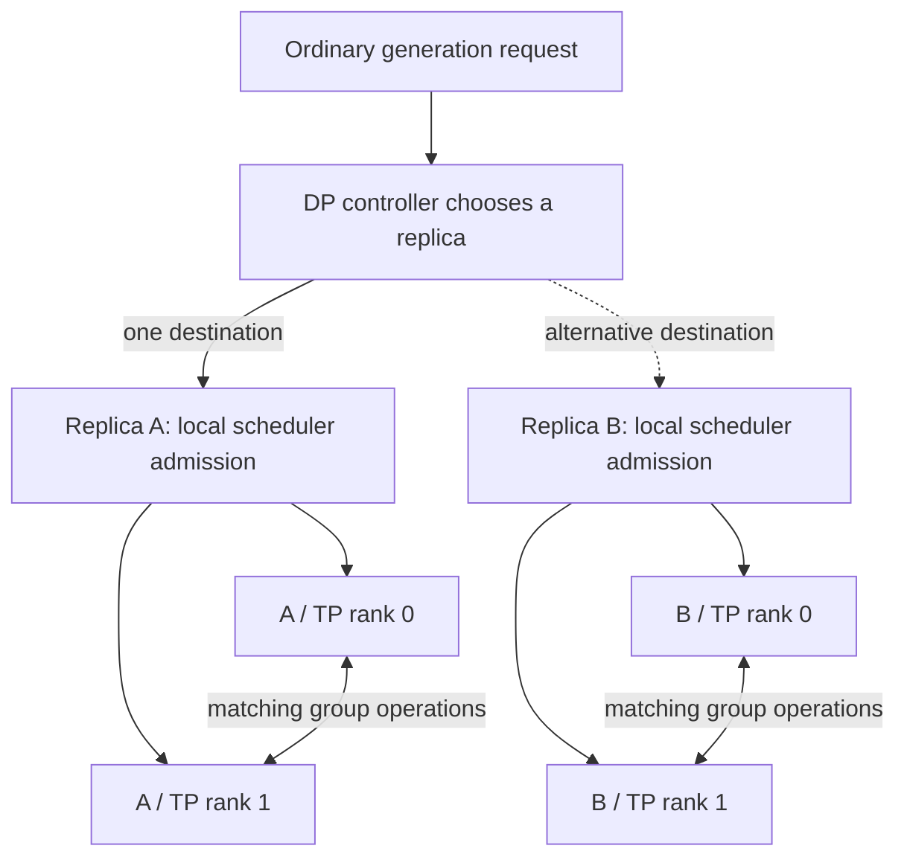

import Source from '../../../../components/Source.astro';

## Separate placement from cooperation

Several model replicas can serve independent requests. Several cooperating ranks
can also divide one model operation. These solve different problems and introduce
different owners into a request trace.

**Data parallelism** places work across replicas. **Tensor parallelism** divides
model operations among ranks that participate together. A replica can itself use
multiple tensor-parallel ranks.

## Follow a request into one replica

For ordinary generation, the data-parallel controller chooses a destination
replica. Its local scheduler then decides when work can run. The replica's
tensor-parallel workers execute compatible partitions and group operations.

The picture shows logical responsibilities rather than a physical GPU layout.
Placement does not itself admit a request, and ordinary request routing has a
different purpose from distributing control messages.

## Follow a model operation across ranks

`TpModelWorker` bridges the scheduler to ModelRunner. Parallel group setup tells
layers which ranks cooperate, and tensor-parallel layers use those groups for
their local partitions and communication.

Group membership is part of execution correctness. Participants must agree on
the selected operation and compatible shapes; independent-looking local launches
can still depend on matching collective work on peers.

**Pipeline parallelism** adds model stages with different responsibilities. An
intermediate stage passes activations onward, while the final stage has the
output role. Context parallelism divides attention context work; expert parallelism places
routed expert work across ranks. These add their own cooperation groups; see
[parallelism](/concepts/parallelism/) for the shared vocabulary.

## Choose the layout for the actual bottleneck

| Need | Architectural choice |
| --- | --- |
| More independent request capacity | Add replicas and decide placement policy. |
| A model operation spanning devices | Use supported tensor-parallel groups and account for communication. |
| A model split into stages | Trace activation handoff and pipeline scheduling. |
| Distributed context or experts | Follow the selected attention/expert groups and their specialized data movement. |

These choices can compose, so a rank identifier alone is insufficient to explain
what a worker owns. Record replica, group and stage context when following a
request through logs or source.

Layout also affects startup and failure handling: every required participant must
initialize compatible resources, and one missing participant can stall group
progress. Diagnose placement, local admission and cooperative execution as
separate stages.

## Read the code

<Source project="sglang" path="python/sglang/srt/managers/data_parallel_controller.py" label="Replica placement" />
<Source project="sglang" path="python/sglang/srt/managers/tp_worker.py" label="Cooperating model workers" />
<Source project="sglang" path="python/sglang/srt/distributed/parallel_state.py" label="Group creation and identity" />
<Source project="sglang" path="python/sglang/srt/managers/scheduler_pp_mixin.py" label="Pipeline scheduling and stage outputs" />
