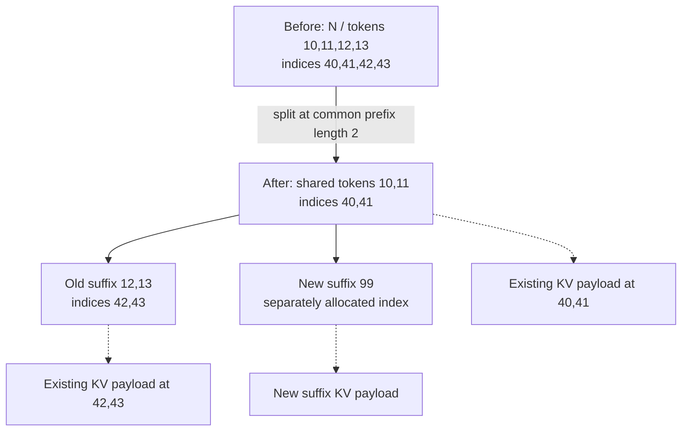

import Source from '../../../../components/Source.astro';

## Index reusable attention state by token prefix

A repeated prompt can reuse KV already computed for a compatible leading token
sequence. SGLang's radix cache indexes that state in shared prefix segments,
letting requests avoid recomputing context while retaining separate continuations.

The tree stores token identity and references to KV locations. The pool holds the
actual attention payload. This index-versus-storage distinction is the main
architectural idea to carry into source.

## Follow a shared-prefix split

The teaching example starts with tokens `[10,11,12,13]` referencing KV locations
`[40,41,42,43]`. Matching `[10,11,99]` splits the index at the shared prefix.
The old suffix keeps its existing locations; the new continuation needs its own
computed state. Splitting index tensors does not copy all GPU K/V payload.

`RadixKey` includes the token sequence and an optional namespace. Matching must
respect that identity before reuse. A common-looking prompt is reusable only when
its cache key and represented model state are compatible.

## Follow ownership from lookup to reuse

The scheduler looks up a request's longest compatible prefix, attaches the result
to request preparation and admits work for the uncached suffix. Active requests
protect the referenced path through lock references.

As requests finish or change ownership, the cache updates those references and
can retain useful state for future lookups. A protected segment remains live for
its users; unprotected eligible leaves can become eviction candidates.

This explains how a cache can contain reusable data yet have limited immediately
reclaimable capacity. Residency, active protection and eviction eligibility are
different properties of the same state.

## Decisions that affect reuse

**Compatibility:** token identity, namespace and the selected cache layout define
the matching boundary. Trace the key before diagnosing a miss as failed storage.

**Computation versus capacity:** a hit avoids computing part of the prompt, but
the shared KV still occupies memory. Admission must account for existing state
and the new suffix together.

**Retention versus eviction:** keeping more prefixes can benefit later requests,
while reclaiming unprotected state supplies capacity for current work. The runtime
applies the selected policy within ownership constraints.

The [memory-pool chapter](/architecture/sglang/memory-pools/) continues from an
index value to physical payload. [Hierarchical cache](/architecture/sglang/hierarchical-cache/)
adds another question: where a reusable copy resides and what must finish before
the device can consume it.

## Read the code

<Source project="sglang" path="python/sglang/srt/mem_cache/radix_cache.py" label="RadixKey, matching, split, locks and eviction" />
<Source project="sglang" path="python/sglang/srt/managers/schedule_policy.py" label="Prefix-aware admission" />
<Source project="sglang" path="python/sglang/srt/mem_cache/memory_pool.py" label="The payload storage behind cache references" />
