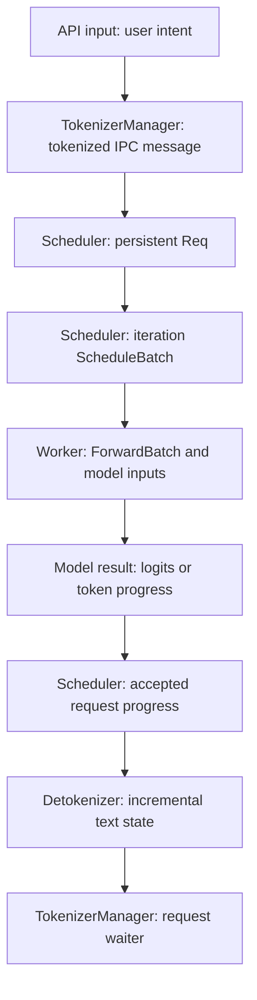

import Source from '../../../../components/Source.astro';

## Find the owner of the operation

SGLang's serving runtime separates frontend request handling, scheduling and model
execution. The fastest source-reading route follows one request through those
owners, rather than searching for a familiar class name across the whole tree.

The baseline here is Python SRT text generation with a local prefix cache. Other
model tasks and optional deployment features extend the same repository but need
their own entrypoints.

## Follow identity across representations

TokenizerManager holds frontend input and response state. The scheduler holds
persistent `Req` objects and constructs a `ScheduleBatch` for an iteration. The
worker builds the `ForwardBatch` needed by execution. Scheduler result handling
then updates the original requests before output returns to their waiters.

These objects carry related identity, but each representation serves its owner.
A current batch row is temporary; the request it represents can continue across
many batches, move between queues, or finish while neighbors remain active.

## Use the source tree as a responsibility map

| Area under `python/sglang/srt/` | What to follow there |
| --- | --- |
| `entrypoints/` | Engine/server setup and process launch |
| `managers/` | Tokenization, IPC messages, scheduling, workers and detokenization |
| `mem_cache/` | Prefix indexes, request mappings, allocators and KV pools |
| `model_executor/` | Forward metadata and model/backend execution |
| `model_loader/`, `models/`, `layers/` | Checkpoint installation and model operations |
| `disaggregation/` | Optional handoff between separated stages |

Start at the entrypoint to establish process boundaries, then read the manager
that owns the state changing at the symptom. Follow a worker/runner call when the
trace crosses from scheduler decisions to model computation.

## Let the question choose the next boundary

For a repeated prompt that misses reuse, trace tokenized input into the scheduler's
prefix lookup, then inspect the radix key and retained KV references. Compatible
token identity, cache namespace and resident state jointly determine reuse.

For an output stall, distinguish request preparation, scheduler admission,
execution, detokenization and frontend delivery. Each stage can retain work even
while the preceding stage appears complete.

For unexpected memory use, separate physical KV allocations from logical ownership
inside them. Cache nodes, active requests and pending transfers can keep different
references to the same backing pool.

Configuration selects the active path: model/backend, parallel groups, overlap and
cache integrations determine which implementation is used. Establish that context
once, then follow its normal flow before exploring optional branches.

## Read the code

<Source project="sglang" path="python/sglang/srt/entrypoints/engine.py" label="Runtime process model and launch" />
<Source project="sglang" path="python/sglang/srt/managers/io_struct.py" label="Messages crossing ownership boundaries" />
<Source project="sglang" path="python/sglang/srt/managers/scheduler.py" label="Scheduler state and event loops" />
<Source project="sglang" path="python/sglang/srt/model_executor/forward_batch_info.py" label="Execution representation" />
