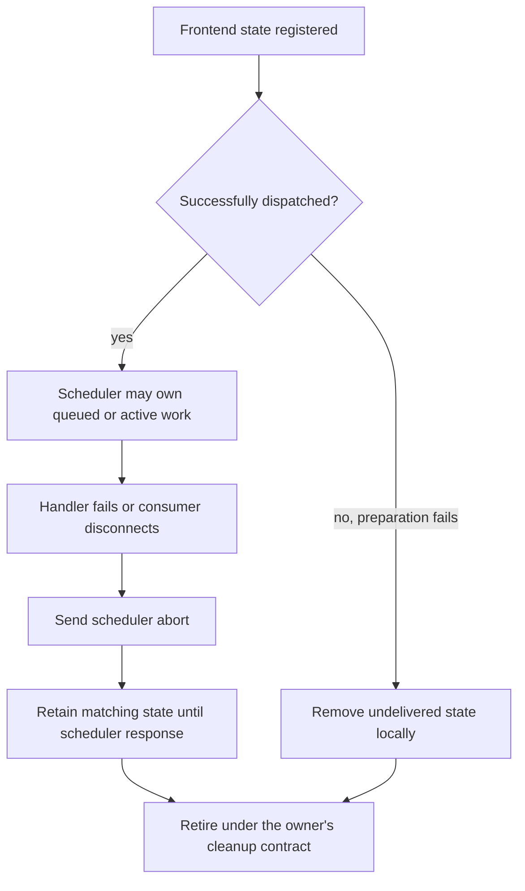

import Source from '../../../../components/Source.astro';

## A request crosses owners before it reaches the model

An API request begins as user input and generation parameters. TokenizerManager
turns it into a tokenized message, the scheduler creates persistent request state,
and later iterations produce accepted token progress and response text.

The frontend owns the response waiter; the scheduler owns queued and active model
work. That distinction explains both ordinary completion and cancellation.

## Follow the ordinary request path

TokenizerManager normalizes input, validates it against resolved limits, prepares
tokenization and creates state keyed by request ID. It dispatches the resulting
message to the scheduler, which creates its own `Req` representation.

The scheduler performs prefix lookup and admission before selecting model work.
Several iterations can contribute to one request: prefill computes missing prompt
state, and decode continues generation. Result handling advances the request,
applies stopping and updates cache/resource ownership.

Output IDs flow through detokenization to the frontend. The frontend delivers
chunks to the original consumer and removes finished request state when its
completion path permits it. Stable request identity connects these transitions
even while batch membership and row positions change.

## Dispatch changes cancellation ownership

Before delivery, a failed frontend preparation can remove its own undelivered
state. After successful dispatch, scheduler work may exist, so cleanup asks the
scheduler to abort and retains matching frontend state until the response removes
it. The graph captures the ownership transition, rather than every error return.

This is an important architectural boundary: a client disconnect or dropped
response waiter does not by itself retire accelerator/cache resources. The owner
of that work must observe cancellation and run the corresponding cleanup.

## Decisions that affect what the caller observes

**Admission:** frontend acceptance and scheduler execution are different stages.
A valid request can wait for token, request-slot or KV capacity.

**Output mode:** incremental and cumulative responses can expose different chunk
shapes. Model token progress, detokenized text and network chunks have distinct
boundaries, so diagnose a delay at the stage that owns it.

**Cancellation:** identify whether the request reached scheduling before selecting
the cleanup path. After dispatch, follow abort through result/retirement handling
instead of inferring completion from the API handler's lifetime.

The [scheduling chapter](/architecture/sglang/scheduling/) follows admission and
iteration planning; [sampling and output](/architecture/sglang/sampling-and-output/)
follows the return path.

## Read the code

<Source project="sglang" path="python/sglang/srt/managers/tokenizer_manager.py" label="generate_request, dispatch and failure cleanup" />
<Source project="sglang" path="python/sglang/srt/managers/io_struct.py" label="Frontend/scheduler message representations" />
<Source project="sglang" path="python/sglang/srt/managers/scheduler.py" label="Scheduler request handling and result loop" />
<Source project="sglang" path="python/sglang/srt/managers/scheduler_components/request_retirer.py" label="Resource retirement" />
