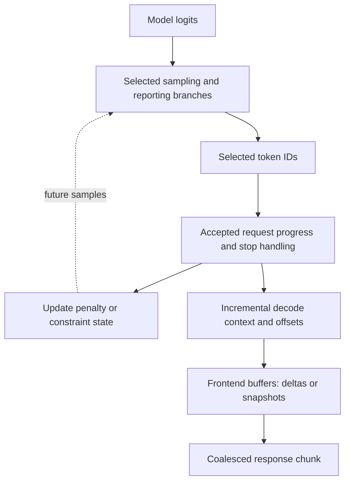

import Source from '../../../../components/Source.astro';

## Scores become tokens, then text, then response chunks

Model execution produces scores for possible tokens. Sampling chooses output IDs
under the request's generation policy. Scheduler result handling accepts progress,
applies stopping and updates state before detokenization and frontend delivery.

These are different representations with different observation points. A completed
model call need not correspond to an immediately visible network chunk.

## Follow the return path

The graph shows data dependencies rather than requiring one universal helper-call
order. Token IDs feed accepted request progress; incremental decoding maintains
the context needed to produce text; frontend buffering determines the chunks
delivered to the caller.

Sampling parameters begin as request choices, then `SamplingBatchInfo` gathers
the per-row state used by execution. The sampler applies the selected policy to
produce token IDs and requested reporting information.

As requests finish or batches change, temperatures, penalty histories and other
row-indexed state must follow the same request identity. A new row position must
not inherit the sampling state of the request that previously occupied it.

## Accepted progress controls continuation

The scheduler reconciles results with request state, checks stopping and updates
the histories used by later samples. Under speculative or deferred execution,
intermediate token work and accepted output remain different frontiers.

That dependency also matters to overlap: a later sample can depend on earlier
accepted output or constraint state. Pipelined forward work preserves the
corresponding result-processing order.

Detokenization then interprets output IDs with incremental context and offsets.
Token boundaries do not always line up with visible text boundaries. The frontend
can buffer or coalesce the resulting text according to its response mode.

## Decisions that change visible output

**Generation policy:** greedy/stochastic choices, penalties and supported
constraints affect token selection. Follow the resolved request policy before
diagnosing unexpected IDs as a model-execution failure.

**Reporting:** scores or log-probability information describe a selected reporting
contract, which is distinct from the final rendered text.

**Delivery mode:** incremental deltas and cumulative snapshots expose different
chunk shapes. Locate latency at model execution, reconciliation, detokenization
or frontend delivery rather than using one timestamp for the whole path.

For an output mismatch, carry a concrete request identity through its score row,
selected/accepted IDs, decode state and response chunk. This connects the symptom
to the owner that can explain it.

## Read the code

<Source project="sglang" path="python/sglang/srt/sampling/sampling_batch_info.py" label="Per-request state in batch rows" />
<Source project="sglang" path="python/sglang/srt/layers/sampler.py" label="Token selection and reporting" />
<Source project="sglang" path="python/sglang/srt/managers/incremental_detokenize.py" label="Incremental text conversion" />
<Source project="sglang" path="python/sglang/srt/managers/tokenizer_manager.py" label="Frontend buffering and response delivery" />
