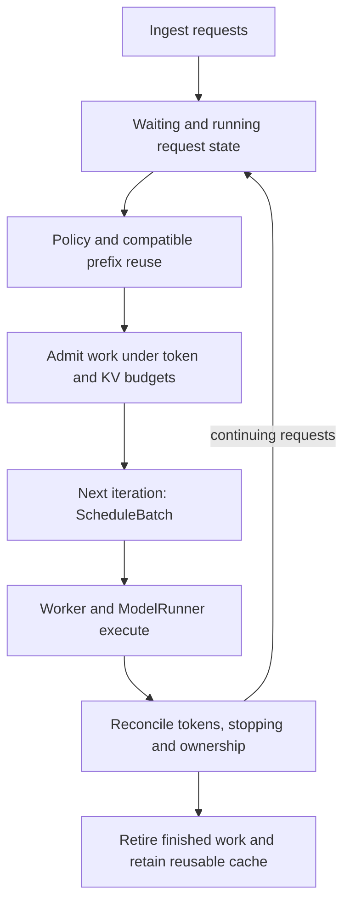

import Source from '../../../../components/Source.astro';

## Choose work that can run now

SGLang's scheduler turns persistent requests into feasible model iterations. Queue
policy orders candidates; admission checks the token and memory resources needed
to execute them. The scheduler then reconciles results before deciding how those
requests continue.

**Prefill** computes missing prompt context. **Decode** advances ongoing generation.
Both consume execution capacity and KV storage, but their preparation differs.

## Follow the normal event loop

In `event_loop_normal`, the code ingests requests, gets a `NextBatchPlan`, runs its
selected batch and processes the result. This is the clearest control spine before
studying overlap.

`NextBatchPlan` separates the maintained running set from the batch executed now.
An iteration can process prompt work while existing decode requests remain in
running state. Batch membership therefore needs its own interpretation alongside
request queue membership.

## Keep request progress and batch preparation separate

A persistent `Req` carries identity, prompt/output progress, sampling choices,
prefix references and pool mappings. `ScheduleBatch` gathers selected work and
prepares execution metadata for extend or decode.

Long prompts can be chunked across iterations. Their partial context and mappings
remain live until prefill finishes and the request can join ordinary decode.
Filtering and merging batches must keep request identity aligned with every
row-indexed field.

## Decisions that materially change a batch

**Ordering:** configured policy chooses which waiting requests are preferred.
Prefix locality can reduce required computation while retaining existing KV.

**Admission:** prompt and decode work must fit the relevant budgets. A prefix hit
reduces uncached work but does not manufacture new memory capacity. Memory pressure
can require eviction of unprotected cache, deferral or supported retraction.

**Continuation:** result processing determines accepted progress, stopping and
retirement. Planned work and the request's reconciled outcome are different parts
of the loop; overlap changes their timing without removing the dependency.

These decisions explain the architecture without predicting one universal batch
composition. To trace a particular iteration, record its persistent requests,
selected token work and the resource owner at the return path.

## Read the code

<Source project="sglang" path="python/sglang/srt/managers/scheduler.py" label="event_loop_normal and get_next_batch_to_run" />
<Source project="sglang" path="python/sglang/srt/managers/schedule_policy.py" label="Queue policy and PrefillAdder admission" />
<Source project="sglang" path="python/sglang/srt/managers/schedule_batch.py" label="Req and ScheduleBatch preparation" />
<Source project="sglang" path="python/sglang/srt/managers/scheduler_components/request_retirer.py" label="Finished-request resource retirement" />
