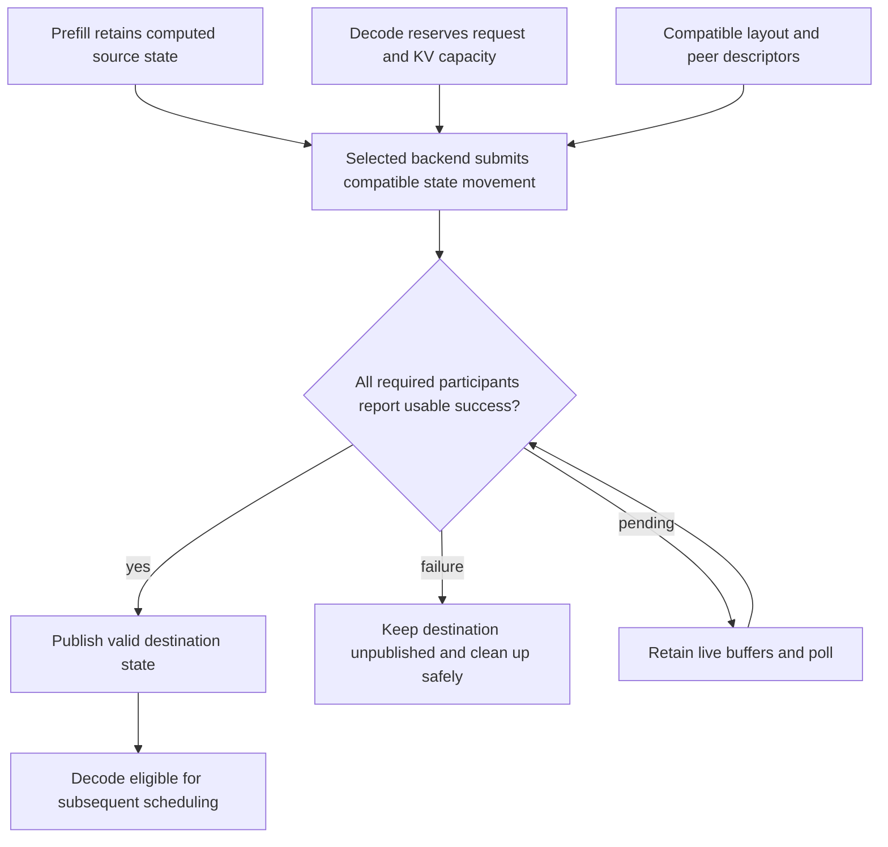

import Source from '../../../../components/Source.astro';

## Separate prefill and decode by transferring state

Prefill computes prompt context; decode repeatedly advances generation. Running
them on different workers permits different resource and scaling choices, but it
adds a handoff of the model state decode needs to continue.

The architecture has two coordinated paths: metadata identifies requests, layouts
and destinations, while the selected backend moves payload bytes.

## Follow reservation through publication

Prefill retains computed source state while decode reserves request and KV
capacity. Compatible peer/layout information enables transfer. Required
participants must establish usable success before the destination is published
and decode becomes eligible for scheduling.

Reservation, transfer submission and execution readiness are distinct stages.
This is the central ownership model for tracing a separated request.

## Connect each stage to its owner

Prefill-side queues manage work and the source state it makes available. Decode
queues coordinate preallocation, transfer status and admission into ordinary
execution. Shared connection structures communicate the metadata needed by both
sides.

The backend implements transport-specific registration, descriptors and progress.
NIXL and Mooncake are configured alternatives in this integration area; the
architecture does not require installing both for every deployment.

SGLang still owns model layout, request identity and publication. A transport can
move the requested ranges while the engine must determine when they represent
complete, usable context.

## Decisions that change the handoff

**Capacity and placement:** decode must reserve an appropriate destination before
the chosen transfer uses it. Successful reservation is preparation for movement,
rather than authorization to run attention immediately.

**Layout and participants:** source and destination must agree on the required
state representation. Completion must cover the participants whose state is
needed before publication.

**Direct destinations or staging:** a staging path introduces another buffer
lifetime between source and final placement. Assigned space becomes safely
reusable only after the previous consumers and transfer dependencies retire.

**Cancellation or failure:** keep an incomplete destination unpublished and clean
up through the queue/backend owners. A stopped client or failed transfer result
does not automatically remove outstanding accesses to source, destination or
metadata buffers.

Once these dependencies are clear, trace one selected backend's implementation.
Detailed descriptor formats and staging-ring arithmetic belong to that deeper
source pass rather than the initial architecture route.

## Read the code

<Source project="sglang" path="python/sglang/srt/disaggregation/prefill.py" label="Prefill-side ownership and queues" />
<Source project="sglang" path="python/sglang/srt/disaggregation/decode.py" label="Reservation, transfer readiness and continuation" />
<Source project="sglang" path="python/sglang/srt/disaggregation/base/conn.py" label="Shared transfer metadata" />
<Source project="sglang" path="python/sglang/srt/disaggregation/nixl/conn.py" label="One concrete backend boundary" />
<Source project="sglang" path="python/sglang/srt/disaggregation/common/staging_buffer.py" label="Staging lifetime and reuse" />
