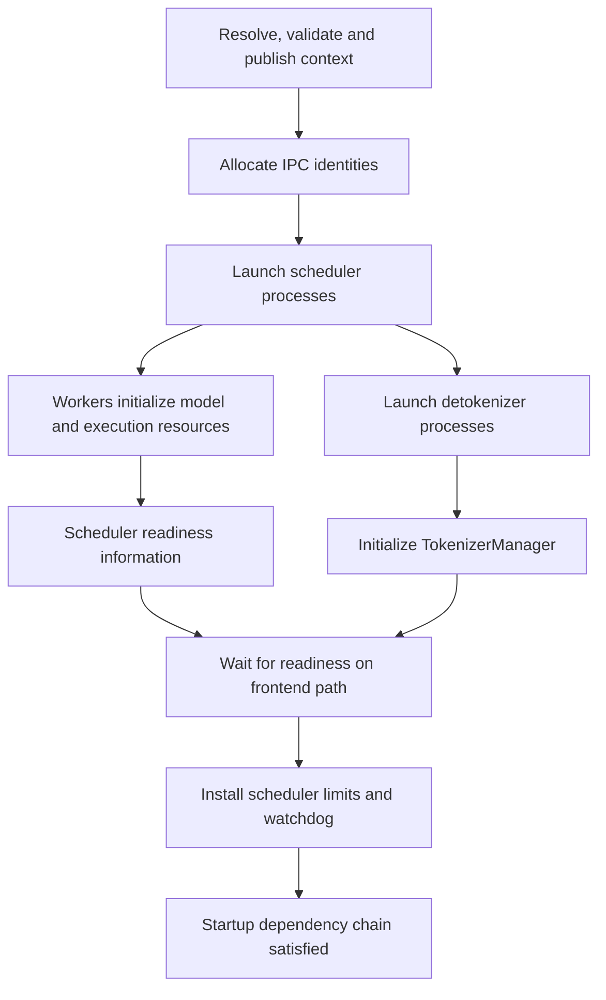

import Source from '../../../../components/Source.astro';

## Readiness joins frontend and execution setup

Launching a server creates more than an HTTP listener. A usable SGLang engine
needs resolved configuration, communication endpoints, initialized model workers,
tokenizer/output state and compatible execution limits.

`Engine._launch_subprocesses` connects those pieces. Follow its baseline Python
frontend path before reading alternate launch arrangements.

## Trace the startup dependencies

The arrows show dependencies. Scheduler workers initialize the execution side
while the launcher constructs the frontend/output path. Serving readiness joins
both and uses information reported by the workers.

First the launcher resolves and validates configuration, loads selected extensions
and establishes the runtime context. It allocates IPC identities for messages
between frontend, scheduler and detokenizer. These internal channels have different
roles from the public listening port.

Scheduler processes then create scheduler state, model workers and ModelRunner.
Readiness information reports the capabilities and limits of that initialized
execution side. The frontend installs those limits, rather than validating
requests against an unrelated estimate.

The launcher also starts detokenization, creates TokenizerManager and installs
child-process monitoring. Frontend availability and worker availability must
agree for requests to succeed.

## Follow ModelRunner into executable state

ModelRunner prepares the selected model/backend environment, loads weights and
applies required post-load transformations. KV representation, cache capacity and
execution setup depend on the resulting model state.

Weights, KV storage and workspaces share device capacity but have different owners
and lifetimes. Successful weight loading is one stage of readiness; useful serving
also requires enough resources and valid setup for model iterations.

Optional features add their own initialization and readiness requirements. The
baseline dependency chain stays the best reference for identifying what a feature
adds and which component must finish it.

## Decisions that shape startup

**Process and parallel layout:** the operator selects workers and groups. The
launcher resolves that intent into processes, endpoints and required participants.
Distributed follower nodes need not host the same frontend arrangement as the
frontend-owning node.

**Model and execution backend:** the selected model class, weights and backend
determine loading, memory and execution preparation. These choices are explained
in [model loading](/architecture/sglang/model-loading/).

**Failure ownership:** partial startup can leave live child processes or device
resources. Follow the launcher's cleanup owner when initialization fails instead
of interpreting a raised exception as completed teardown.

## Read the code

<Source project="sglang" path="python/sglang/srt/entrypoints/engine.py" label="Launch, readiness join and cleanup" />
<Source project="sglang" path="python/sglang/srt/managers/tp_worker.py" label="Model worker construction" />
<Source project="sglang" path="python/sglang/srt/model_executor/model_runner.py" label="Model and execution preparation" />
<Source project="sglang" path="python/sglang/srt/managers/tokenizer_manager.py" label="Frontend state and channels" />
