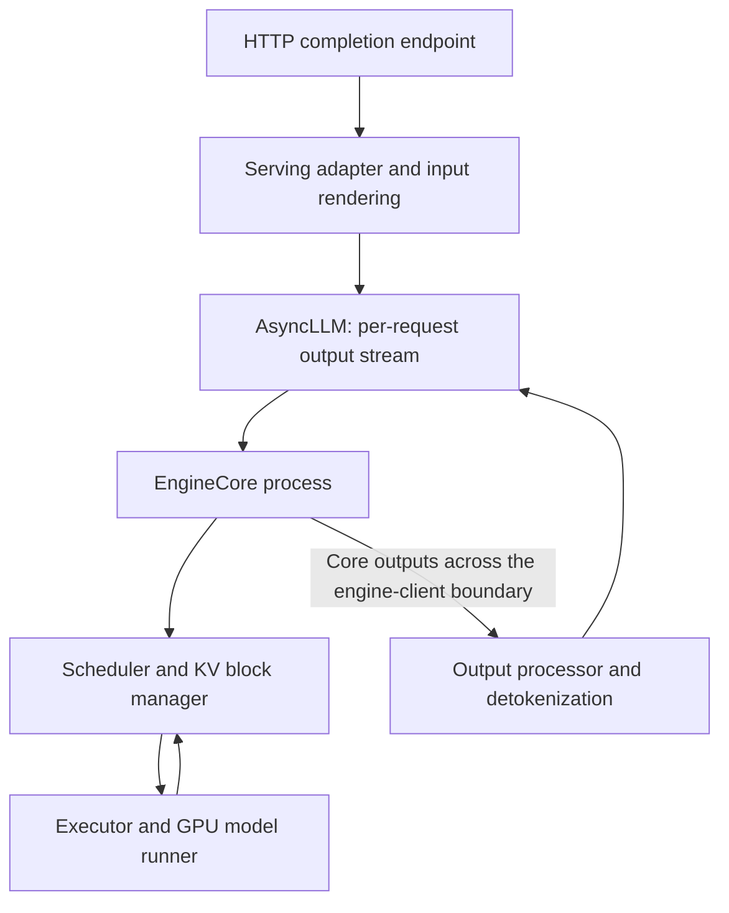

import SystemMap from '../../../components/SystemMap.astro';
import Source from '../../../components/Source.astro';

## Why it exists

An inference service shares expensive GPU capacity among users whose prompts and responses vary in length. vLLM keeps the model loaded, batches token work across requests, and manages attention state so the service can sustain concurrent generation.

Its central loop is straightforward: choose token work, provide the required memory, execute the model, and return results. This guide follows that loop through the V1 text-generation implementation. Start with the [repository map](/architecture/vllm/repository-map/) to locate its owners or [startup](/architecture/vllm/startup/) to see how they are constructed.

## Where it fits

<SystemMap current="vllm" />

vLLM owns model execution and engine scheduling, with an HTTP serving layer above them. It can run independently. Dynamo adds fleet orchestration; NIXL and Mooncake are optional ways to move or share KV state. Multi-GPU execution introduces communication between model workers through the selected parallelism backend.

## Architecture overview

Follow requests downward and results back to the caller:

The serving adapter translates API inputs and responses. `AsyncLLM` connects asynchronous callers to the engine core. The core's scheduler owns logical request progress and KV block allocation; workers own model tensors and execute the selected work. Their messages carry different representations of the same request.

<Source project="vllm" path="vllm/v1/engine/async_llm.py" label="AsyncLLM" />
<Source project="vllm" path="vllm/v1/engine/core.py" label="EngineCore" />

## Follow an operation

For ordinary text generation on one GPU:

1. **Render the request.** The serving adapter validates inputs and turns text into token IDs, with sampling and stop parameters.
2. **Register it.** `AsyncLLM` creates an output collector and sends the request to the core. The API coroutine waits for that request's output while the engine batches work from many callers.
3. **Choose work and memory.** The scheduler assigns token positions within its iteration budget. The KV manager finds reusable prefixes and reserves additional blocks.
4. **Execute.** The executor dispatches the plan to the worker. The model runner updates its batch, builds tensors and attention metadata, runs the model, and samples token IDs.
5. **Reconcile and return.** The core updates request progress and stop state. Output processing detokenizes results, and the serving adapter frames streamed responses. The loop continues until completion or cancellation.

Cancellation travels back into the core so abandoned requests stop consuming scheduled work. Cache references retire under their own rules: a completed request can leave useful prefix data available for another request.

<Source project="vllm" path="vllm/entrypoints/openai/completion/serving.py" label="Serving adapter" />
<Source project="vllm" path="vllm/v1/core/sched/scheduler.py" label="Scheduler" />
<Source project="vllm" path="vllm/v1/worker/gpu_model_runner.py" label="GPU model runner" />

## Decision gates

| Engineering question | Main decision and consequence |
| --- | --- |
| Does the model fit? | Model representation and tensor/pipeline parallelism determine memory use and communication. |
| How should requests share capacity? | Token budgets, admission policy and KV capacity balance prompt progress against decode latency. |
| Can prior work be reused? | Prefix identity and completed KV determine safe reuse; cache capacity controls how long it survives. |
| Should prefill and decode be separated? | Compare saved interference with transfer cost and the extra handoff lifecycle. |

Operators choose the configuration; the scheduler, memory manager and execution layers apply it to each iteration.

## Explore the code

Read the serving adapter → `AsyncLLM.generate` → `EngineCore.step` → `Scheduler.schedule` → `KVCacheManager.allocate_slots` → GPU runner. Then follow the output back through `OutputProcessor`.

The chapters on [request ownership](/architecture/vllm/request-lifecycle/), [scheduling](/architecture/vllm/scheduling/), [KV memory](/architecture/vllm/kv-memory/) and [execution](/architecture/vllm/gpu-execution/) explain the core path. Use the parallelism, connector and speculative chapters when your deployment needs those mechanisms. The [diagnosis guide](/architecture/vllm/diagnosis-and-tests/) maps symptoms back to these owners.
