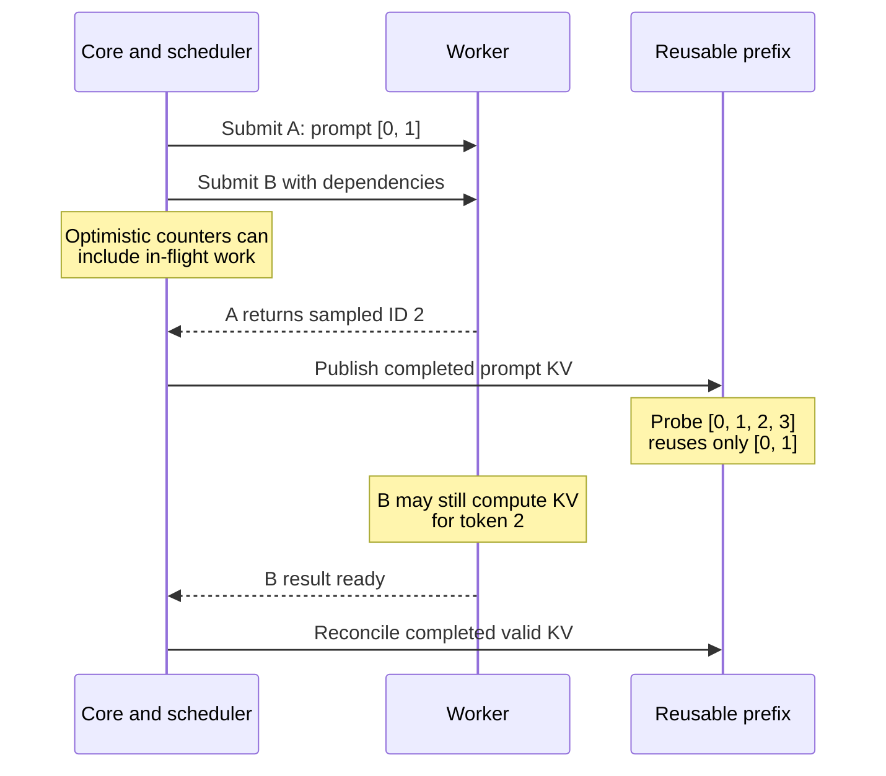

import Source from '../../../../components/Source.astro';

## Overlap separates planned and completed progress

The simplest engine loop schedules work, waits for execution and reconciles results before starting again. Asynchronous scheduling overlaps those phases to reduce host-side gaps. Speculative decoding additionally proposes token positions before verification determines which output to accept.

Both mechanisms need a clear distinction between planned work, in-flight execution, accepted output and KV safe for reuse. That distinction is the core of this chapter.

## Follow the queued iteration path

`EngineCore.step_with_batch_queue` can submit work while the queue has capacity, then consume an outstanding result when required. Each execution result remains associated with the scheduler plan that produced it. Reconciliation applies accepted tokens, aborts and stop conditions to the right request state.

`AsyncScheduler` uses placeholders to describe output that has not returned to the host. `Request.num_computed_tokens` can include in-flight work optimistically, while `num_in_flight_tokens` records progress whose result has not yet been processed. These fields support planning; their names alone do not authorize cache publication.

<Source project="vllm" path="vllm/v1/engine/core.py" label="Synchronous and batch-queue iteration paths" />
<Source project="vllm" path="vllm/v1/core/sched/async_scheduler.py" label="Asynchronous scheduling bookkeeping" />
<Source project="vllm" path="vllm/v1/request.py" label="Request progress frontiers" />

## A returned token is not its completed KV

Suppose iteration A processes prompt `[0, 1]` and samples token `2`, while B is already in flight:

After A returns, the prompt KV can be complete even though processing token `2` is still outstanding. Returning that token ID gives the next input; it does not establish the KV produced by executing that input. Reusable prefixes must stop at the completed valid frontier.

This is the important memory consequence of overlap. Scheduling can run ahead while publication and reclamation remain tied to actual execution dependencies.

## Speculation adds an acceptance boundary

Speculative decoding proposes a sequence and verifies it against the target model. Some proposals may be rejected, so reserved positions and proposed tokens can exceed accepted output. Result processing reconciles that difference before the request's committed progress and reusable state advance.

Structured generation adds a related dependency. A current forward pass can finish before prior accepted output advances the grammar state. Sampling must wait for the correct mask even when logits are ready. The [structured-generation chapter](/architecture/vllm/structured-generation/) explains that accepted-output loop.

Outstanding results also explain why logical completion does not always release resources immediately. Execution and connector users must finish with storage before it can be reassigned.

## Decisions and code-reading route

| Decision | Main tradeoff |
| --- | --- |
| Scheduling overlap | Reduce host gaps while tracking more in-flight state |
| Speculative method and length | Spend proposal/verification work to obtain useful accepted tokens |
| Publish or reclaim KV | Wait for completed, valid state rather than optimistic progress |

Read ordinary `EngineCore.step` first, then `step_with_batch_queue` → `AsyncScheduler` → request progress fields → runner sampling/verification → scheduler reconciliation. Keep each result paired with its plan and follow the completed/accepted frontier back into [KV memory](/architecture/vllm/kv-memory/).
