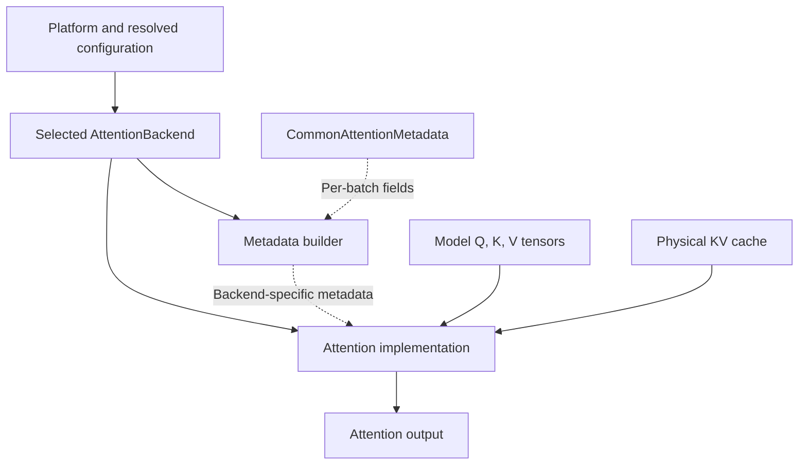
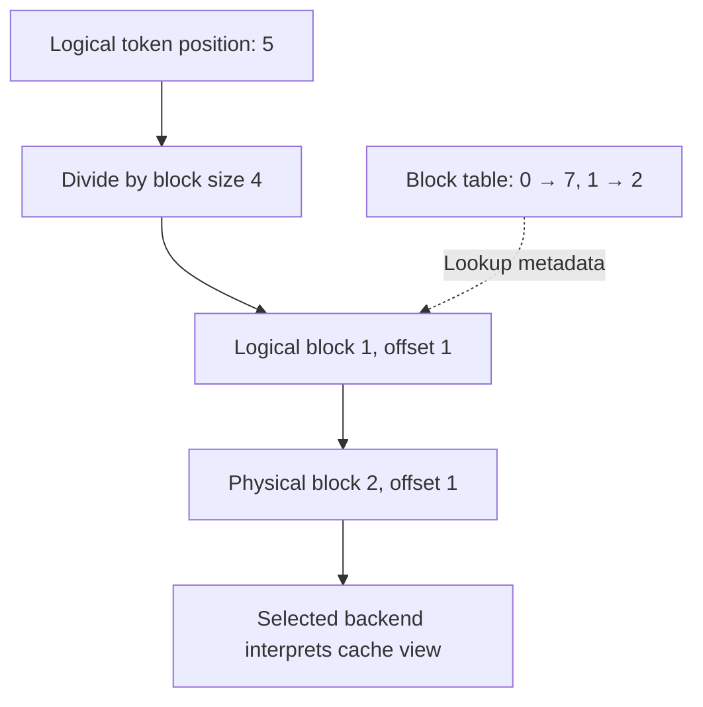

import Source from '../../../../components/Source.astro';

## Why attention has a backend interface

Attention combines new query/key/value tensors with a request's earlier KV state. Efficient kernels depend on hardware, model dimensions, data types and cache layout. vLLM separates that variability behind a backend contract so the execution loop can prepare batches without embedding every kernel implementation.

Follow three roles: the selected backend describes capabilities, its metadata builder prepares a batch, and its implementation performs attention.

## Selection, preparation and execution



`get_attn_backend` gathers model and cache requirements and delegates platform-specific selection. The returned backend supplies implementation and metadata-builder classes. Its selection-time contract must match the model, device and resolved layout before batches run.

For each batch, the builder translates common metadata into the structures its implementation needs. The model supplies Q/K/V tensors; the implementation combines them with the physical cache and that metadata.

<Source project="vllm" path="vllm/v1/attention/selector.py" label="Attention selection" />
<Source project="vllm" path="vllm/v1/attention/backend.py" label="Backend, builder and implementation interfaces" />

## Metadata connects requests to storage

A batch contains more than a request count. `CommonAttentionMetadata` describes query boundaries, sequence lengths, block tables and slot mappings. These fields tell the backend which new rows belong together, how much prior context is valid, where to read it and where to store new KV.

For a conceptual four-token block size, logical position five is logical block one, offset one. A block table mapping `[7, 2]` redirects that position to physical block two:



The address walk illustrates the indirection; the selected backend defines its actual tensor layout. This separation lets blocks be allocated and shared without requiring every request's full context to occupy contiguous physical storage.

An important interface rule survives backend differences: kernels need valid lengths and mappings for their operation. Planning fields can be upper bounds under overlapping/speculative execution, whereas a kernel may require exact context lengths. The builder owns that translation.

## Trace one concrete cache update

The FlashAttention backend's `do_kv_cache_update` turns combined KV storage into key/value views and calls `reshape_and_cache_flash` with current tensors and their slot mapping:

```python
key_cache, value_cache = kv_cache.transpose(1, 2).split(self.head_size, dim=-1)
```

These are views into allocated storage. The slot mapping controls which current token rows are written, while block tables later locate prior context for attention. Padding in execution inputs does not automatically describe additional valid KV rows.

<Source project="vllm" path="vllm/v1/attention/backends/flash_attn.py" label="FlashAttention cache update and forward path" />
<Source project="vllm" path="vllm/v1/worker/block_table.py" label="Block-table and slot-mapping construction" />

## Decisions and code-reading route

| Decision | Architectural effect |
| --- | --- |
| Backend selection | Matches model/platform requirements to a supported implementation |
| Cache layout | Connects allocation and addressing to the kernel's storage contract |
| Metadata construction | Converts the current ragged batch into valid kernel inputs |
| Cache update and attention | Store new state and read the request's valid context |

Read selector → `AttentionBackend` → `CommonAttentionMetadata` → selected builder → cache update → forward implementation. For incorrect attention, inspect the prepared metadata before assuming the kernel's arithmetic is responsible. The [GPU execution chapter](/architecture/vllm/gpu-execution/) explains where that metadata comes from.
