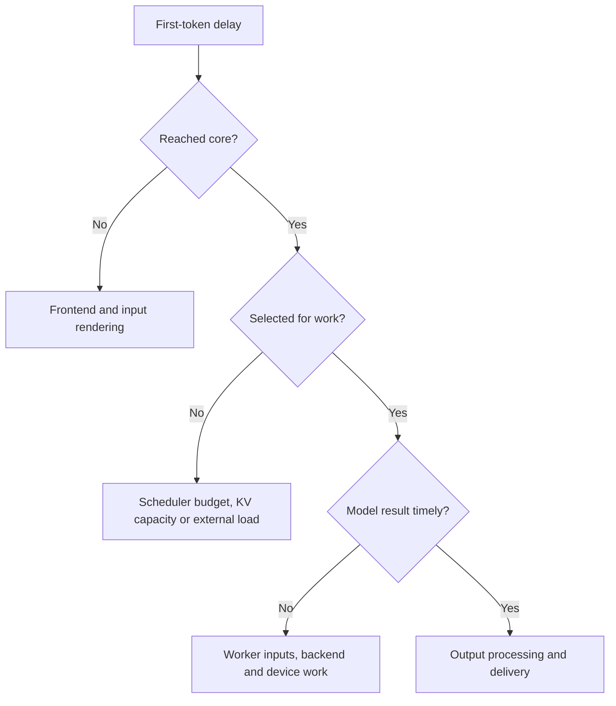

import Source from '../../../../components/Source.astro';

## Trace the affected request through its owners

Start with a concrete observation: a long prompt waits while decode continues, selected work runs slowly, or the client receives text after the engine has produced it. A request ID and its resolved configuration connect evidence across serving, scheduler, worker and output boundaries.

This chapter uses first-token latency to show the method. The same approach applies to memory pressure and incorrect output.

## Locate the waiting boundary

These branches choose an investigation, not a diagnosis from one counter. A busy GPU can serve other requests while the affected prompt waits for admission.

## Connect metrics to the event they measure

Client time to first token includes input handling and delivery as well as engine work. Engine timestamps begin and end at their own events. Compare measurements at the same boundary and hold workload/model configuration stable when evaluating a change.

`stats.py` defines request and iteration statistics; logger/export code exposes them. Follow a useful metric back to its update site so its meaning is tied to the actual lifecycle event. Cache statistics help distinguish avoided prompt computation from faster execution of the same computation.

<Source project="vllm" path="vllm/v1/metrics/stats.py" label="Request, prefill and iteration statistics" />
<Source project="vllm" path="vllm/v1/metrics/loggers.py" label="Metric logging and export" />

## Separate capacity, execution and delivery problems

| Observation | Main source path |
| --- | --- |
| Prompt remains waiting | Scheduler selection and KV admission |
| Prefix reuse falls | Cache identity, occupancy and eviction |
| Selected work slows | Worker batch shape, attention backend and device trace |
| Client lags engine output | Detokenization, collector and serving stream |
| External KV waits | Connector transfer results and scheduler reconciliation |

For memory pressure, distinguish logical KV exhaustion from physical allocation failure. The scheduler can run out of allocatable blocks while its physical cache tensors remain unchanged. Cached zero-reference blocks can retain useful content until reused; outstanding execution or transfer users can delay reclamation.

For failures, locate the first meaningful request, worker or core error. The core's execution error report captures resolved configuration, the iteration plan and scheduler statistics. That context explains more than a later communication failure after the core has stopped.

<Source project="vllm" path="vllm/v1/engine/core.py" label="Iteration execution and error context" />
<Source project="vllm" path="vllm/v1/engine/exceptions.py" label="Request and engine failure scope" />

## Use a focused test to confirm the mechanism

Choose the smallest test boundary that matches the question. Scheduler tests explain admission, preemption and publication; output-processor tests explain text assembly and stopping. End-to-end behavior also needs the serving boundary represented.

<Source project="vllm" path="tests/v1/core/test_scheduler.py" label="Scheduler state examples" />
<Source project="vllm" path="tests/v1/engine/test_output_processor.py" label="Output assembly examples" />

Read the relevant metric → update site → responsible scheduler/worker/output decision → focused test. This produces a short causal trace you can use to change one component and check the intended behavior.
