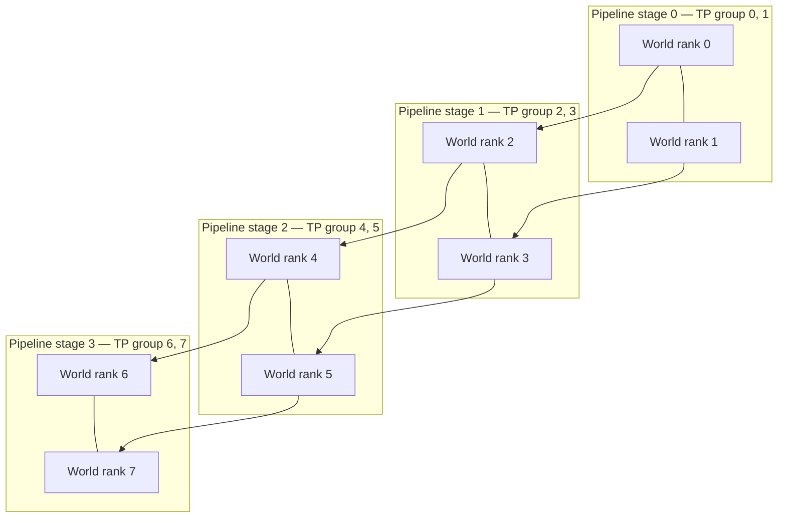
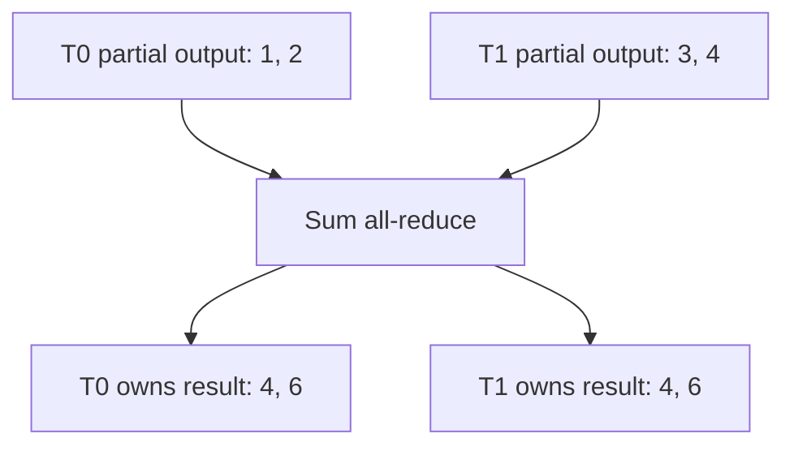

import Source from '../../../../components/Source.astro';

## Separate worker placement from model partitioning

The executor determines how the core dispatches work to workers. Parallelism determines how those workers divide model computation. These choices meet during startup but answer different architectural questions.

A local executor runs the simple path. A multiprocessing executor creates workers, sends execution/RPC requests and gathers responses. The core schedules logical requests through that executor contract.

<Source project="vllm" path="vllm/v1/executor/abstract.py" label="Executor selection" />
<Source project="vllm" path="vllm/v1/executor/multiproc_executor.py" label="Multi-worker dispatch and lifecycle" />

## Rank groups describe cooperation

A **rank** is a participant in a communication group. Tensor parallelism (TP) divides a layer's computation; pipeline parallelism (PP) places successive model stages on different ranks. Data parallelism runs replicas that serve different work. The [parallelism concepts](/concepts/parallelism/) explain the wider set of layouts.

The source's TP=2, PP=4 example shows why the group name matters:

World rank 2 cooperates with rank 3 inside its tensor group and with ranks 0, 4 and 6 along its pipeline. Those relationships describe computation, not physical network links. Adding other parallel dimensions changes the group geometry.

<Source project="vllm" path="vllm/distributed/parallel_state.py" label="GroupCoordinator and model-parallel initialization" />

## Model partitioning determines communication

A model layer decides what result its participants must combine. For example, a row-parallel linear layer produces partial contributions that require a reduction. Communication wrappers express that mathematical operation, while the group/device communicator selects a supported implementation.

In a two-rank teaching example, all-reduce combines `[1, 2]` and `[3, 4]` and leaves `[4, 6]` available at both participants:

Result ownership is part of the operation. Replacing all-reduce with reduce-scatter would leave different reduced pieces at different ranks and require a corresponding change to the consumer.

<Source project="vllm" path="vllm/model_executor/layers/linear.py" label="Parallel layer semantics" />
<Source project="vllm" path="vllm/distributed/communication_op.py" label="Collective operation wrappers" />

## Follow the selected communicator

`GroupCoordinator` routes collective work through the active device communicator. `PyNcclCommunicator` is one concrete NCCL boundary. Local optimizations and other supported implementations can satisfy the same layer contract, so a model-level reduction call alone does not identify the transport.

Device communication is ordered on a stream. Buffers remain valid until the relevant execution dependencies permit reuse. Pipeline stages similarly retain inputs/intermediate tensors while downstream work consumes them; the final stage has the output role used for generation.

<Source project="vllm" path="vllm/distributed/device_communicators/pynccl.py" label="NCCL communicator interface" />

## Decisions and code-reading route

| Decision | Consequence |
| --- | --- |
| Executor | Worker placement, dispatch and failure boundary |
| Parallel geometry | Model/memory partitioning and communication scope |
| Collective semantics | Which ranks own which results |
| Communicator implementation | How the required operation runs on the selected platform |

Read executor selection → group initialization → one parallel model layer → communication wrapper → `GroupCoordinator` → selected communicator. Use the [NCCL guide](/architecture/nccl/) for its implementation and the [AWS network walkthrough](/walkthroughs/aws-network/) only when that network path is selected.
