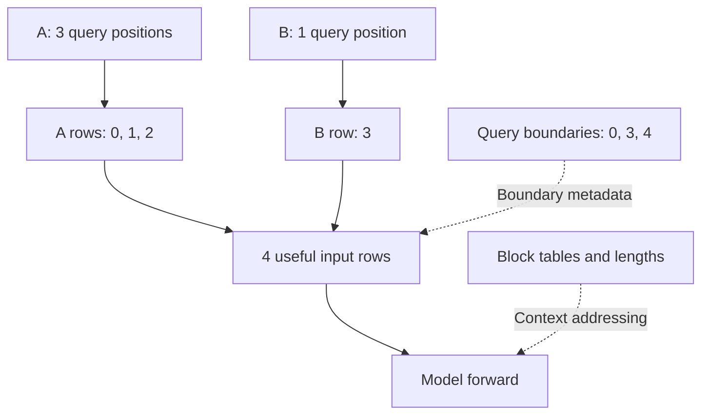
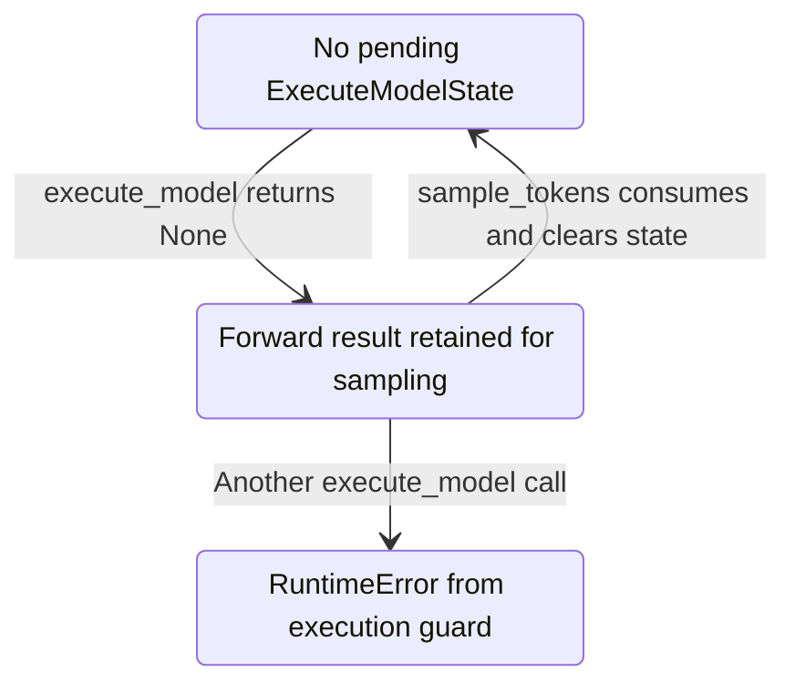

import Source from '../../../../components/Source.astro';

## Translate the plan into execution inputs

The scheduler chooses logical token work. The GPU model runner turns that plan into input tensors, positions, attention metadata and cache addresses. Its persistent batch avoids rebuilding every request's execution state on each iteration.

The executor is the dispatch boundary. The core submits `SchedulerOutput`; a local executor calls its worker, while a multi-worker executor coordinates the selected process layout. The following trace follows the ordinary decoder-generation path in `GPUModelRunner`.

<Source project="vllm" path="vllm/v1/worker/gpu_model_runner.py" label="GPUModelRunner" />
<Source project="vllm" path="vllm/v1/executor/uniproc_executor.py" label="Local executor contract" />

## Update persistent state, then build a batch

`_update_states` applies new, continuing, resumed and finished requests to the worker's `InputBatch`. Request IDs remain stable, but compacting or refilling the batch changes row indexes. Sampling restrictions and cache metadata must move with the corresponding request.

`_prepare_inputs` then gathers the scheduled tokens in the current batch order. With three prompt positions from A and one decode position from B, there are four token rows and two requests:

Query boundaries `[0, 3, 4]` identify each request's new rows. Per-request lengths and block tables describe the earlier context those rows attend to. This is a **ragged batch**: requests contribute different amounts of work to one flattened input.

<Source project="vllm" path="vllm/v1/worker/gpu_input_batch.py" label="InputBatch and CachedRequestState" />

## Address KV and choose the execution form

A block table locates earlier context in physical KV storage. A slot mapping selects the destinations for newly computed keys and values. Both must agree with request ordering and positions before attention executes.

The runner also chooses eager execution or a compatible captured CUDA graph, with padding where required. A captured graph reuses an execution structure for supported shapes. Padding can increase the execution shape beyond the useful scheduled-token count; those are distinct quantities when reading a trace.

<Source project="vllm" path="vllm/v1/worker/block_table.py" label="Block tables and slot mappings" />

## Forward results and sampling have a handoff

Generation paths can retain forward results in `ExecuteModelState` for a separate `sample_tokens` call:

In this contract, `execute_model` returning `None` means sampling must consume the pending state. `sample_tokens` uses the retained logits and metadata, then clears that state so another execution can proceed. The logical requests usually continue across many such iterations.

Pipeline stages and other model tasks have their own output roles. Follow the selected runner's return contract when extending this generation path rather than treating every execution as a local token result.

## Decisions and code-reading route

| Question | Read next |
| --- | --- |
| Which requests occupy these rows? | `_update_states` and `InputBatch` |
| Which tokens and context does the model receive? | `_prepare_inputs`, positions and attention metadata |
| Where is current KV written? | Slot mapping and selected attention backend |
| How is this shape executed? | Execution mode and padding selection |
| Where does the token result appear? | `ExecuteModelState` and `sample_tokens` |

Read `execute_model` → `_update_states` → `_prepare_inputs` → model forward → `sample_tokens`. This follows the full translation from scheduler intent to model result. Continue with [attention](/architecture/vllm/attention-backends/) and [sampling/output](/architecture/vllm/sampling-and-output/) for the two main execution interfaces.
