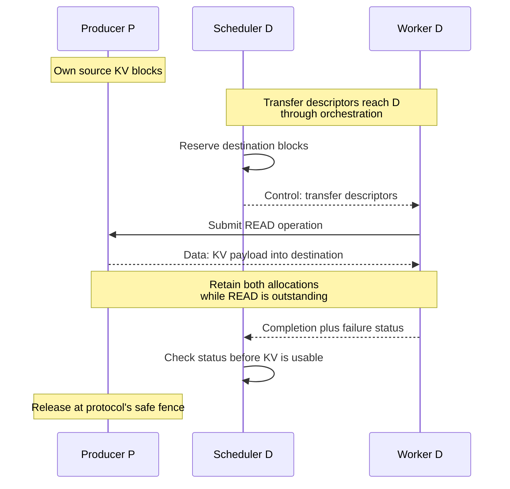

import Source from '../../../../components/Source.astro';

## Extend the engine with external KV

A KV connector lets an engine obtain attention state from another worker or shared store. It supports deployments such as separate prefill/decode engines and reuse beyond one engine's local cache. Ordinary local execution needs no connector.

The interface spans two owners. The scheduler decides which token positions can be satisfied externally and reserves logical blocks. Workers own physical KV tensors and perform the data movement. Metadata and status connect those responsibilities.

<Source project="vllm" path="vllm/distributed/kv_transfer/kv_connector/v1/base.py" label="Scheduler and worker connector contracts" />

## Follow a NIXL pull handoff

The selected NIXL pull path retrieves producer state with consumer-initiated READ operations:

The producer owns source KV. The decode scheduler reserves destinations and supplies transfer metadata to its worker. That worker registers/reaches the relevant ranges, submits the read and reports completion plus failure status. The scheduler then decides whether the loaded state is valid for execution.

Source and destination allocations must remain valid while transfer work references them. Returning handoff metadata and reserving destination blocks are setup steps; successful payload transfer and reconciliation establish usable KV.

<Source project="vllm" path="vllm/distributed/kv_transfer/kv_connector/v1/nixl/connector.py" label="NIXL connector mode selection" />
<Source project="vllm" path="vllm/distributed/kv_transfer/kv_connector/v1/nixl/pull_scheduler.py" label="Pull scheduler" />
<Source project="vllm" path="vllm/distributed/kv_transfer/kv_connector/v1/nixl/pull_worker.py" label="Pull worker" />

## Reconcile the outcome before execution

The scheduler can put a request in `WAITING_FOR_REMOTE_KVS` while its reserved blocks are filled. Worker transfer results distinguish finished receives from failed receives. An operation can finish unsuccessfully; the scheduler uses both pieces of information before advancing request progress or publishing a reusable prefix.

This is the main integration invariant: allocation describes capacity, transport completion describes an operation outcome, and scheduler reconciliation establishes valid engine state. Request finish and cancellation must also respect retained transfers before freeing their blocks.

<Source project="vllm" path="vllm/distributed/kv_transfer/kv_connector/v1/nixl/base_worker.py" label="Transfer results and retained worker state" />
<Source project="vllm" path="vllm/v1/core/sched/scheduler.py" label="Remote-KV waiting, completion and failure handling" />

## Direct transfer and shared storage are alternatives

NIXL's pull path depends on reaching retained producer state; a push connector uses a different initiation direction. The Mooncake Store connector instead lets producers and consumers interact through a shared KV pool, with its own object identity and placement lifecycle.

The shared store changes where state can be found and how long it survives independently of one producer. It adds lookup and store availability to the engine's transfer path. Both approaches must map the model's actual KV layout correctly and keep storage valid during use.

<Source project="vllm" path="vllm/distributed/kv_transfer/kv_connector/v1/mooncake/store/connector.py" label="Mooncake Store connector" />

## Decisions and code-reading route

| Decision | Main consequence |
| --- | --- |
| Local cache or external reuse | Avoid recomputation at the cost of lookup/transfer work |
| Peer transfer or shared store | Choose producer coupling versus storage indirection |
| When decode becomes eligible | Wait for valid loaded state and scheduler reconciliation |
| When blocks can retire | Retain every outstanding execution/transfer user |

Read base interface → selected connector facade → scheduler matching/allocation → worker submission/results → scheduler reconciliation → request cleanup. The [prefill/decode walkthrough](/walkthroughs/prefill-decode/) connects this engine contract to orchestration; the [NIXL](/architecture/nixl/) and [Mooncake](/architecture/mooncake/) guides explain the underlying systems.
