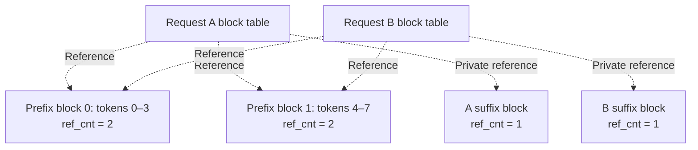
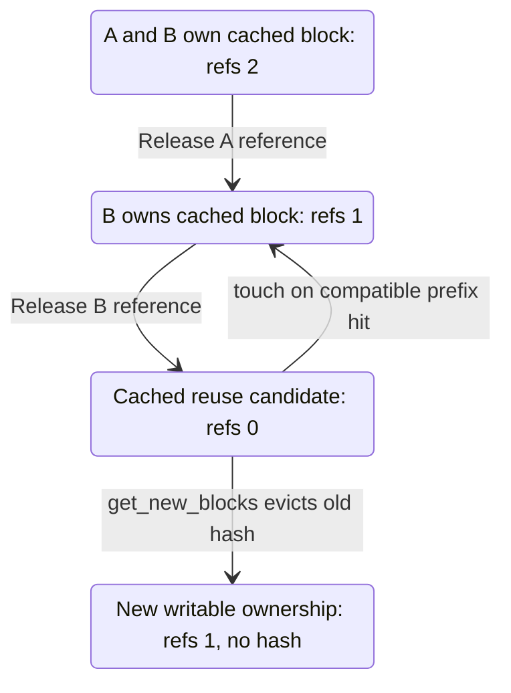

import Source from '../../../../components/Source.astro';

## The cache is both state and reusable capacity

Attention reuses keys and values for earlier token positions. vLLM keeps that state in blocks, shares compatible completed prefixes and allocates space for new work. The memory architecture separates four concepts:

| Concept | Role |
| --- | --- |
| Physical KV tensors | Worker-owned storage used by attention |
| Block tables | Map a request's logical context to that storage |
| Content identity | Identifies prefixes eligible for reuse |
| References | Track which active requests or operations retain blocks |

`KVCacheManager` coordinates requests and allocation. `BlockPool` manages block references, cache identities and reuse candidates.

<Source project="vllm" path="vllm/v1/core/kv_cache_manager.py" label="KVCacheManager" />
<Source project="vllm" path="vllm/v1/core/block_pool.py" label="BlockPool" />

## Reuse a prefix, allocate the remainder

`get_computed_blocks` finds compatible cached prefix state. `allocate_slots` combines that reuse with capacity for the request's new positions. Prefix matching follows token history and the cache's identity rules, so reuse applies to compatible computation.

Consider four-token blocks. A and B share an eight-token completed prefix but diverge afterward:



Each request references the same two prefix blocks and owns separate suffix capacity. Releasing A leaves B's references intact. Sharing saves both computation and duplicate prefix storage while preserving each request's independent continuation.

## Reclamation preserves useful content until reuse

Once both requests release a block, its reference count can reach zero while its content remains indexed. The block is now a reuse/eviction candidate. A compatible prefix hit can acquire it again; allocating it for unrelated work removes the old identity before writing new contents.



This lifecycle explains why completed requests can leave GPU memory allocated and useful. Logical free capacity is the pool's ability to hand blocks to new work, not necessarily memory returned to the device allocator.

Mutation also requires more than sole ownership. The pool's writable check is:

```python
return not block.is_null and block.ref_cnt == 1 and block.block_hash is None
```

The block must have private, unpublished ownership. Cached identity promises particular content and must be resolved before that storage is overwritten.

## Publish only completed KV

A sampled token ID and the KV produced by processing that token arrive at different steps. Prefix publication must follow completed valid KV, including accepted progress under speculative execution. Optimistic scheduler counters alone do not establish that boundary.

External loads introduce the same distinction: destination blocks can be reserved before transfer fills them. Publication waits for the load to complete successfully and for the scheduler to reconcile its outcome. The [async chapter](/architecture/vllm/async-and-speculative/) and [connector chapter](/architecture/vllm/kv-connectors/) trace those paths.

## Decisions and code-reading route

| Decision | Owner and effect |
| --- | --- |
| Reuse an existing prefix | KV manager matches compatible content and acquires references |
| Admit new work | Scheduler and KV manager require available capacity |
| Reclaim a cached candidate | Block pool evicts its old identity when reassigning storage |
| Publish new content | Completion/verification establishes a valid reusable prefix |

Read `get_computed_blocks` → `allocate_slots` → `BlockPool.touch`/`get_new_blocks` → cache publication → `free_blocks`. Track identity and references together: either one alone leaves the ownership story incomplete.

<Source project="vllm" path="vllm/v1/core/kv_cache_utils.py" label="Cache identity and block utilities" />
