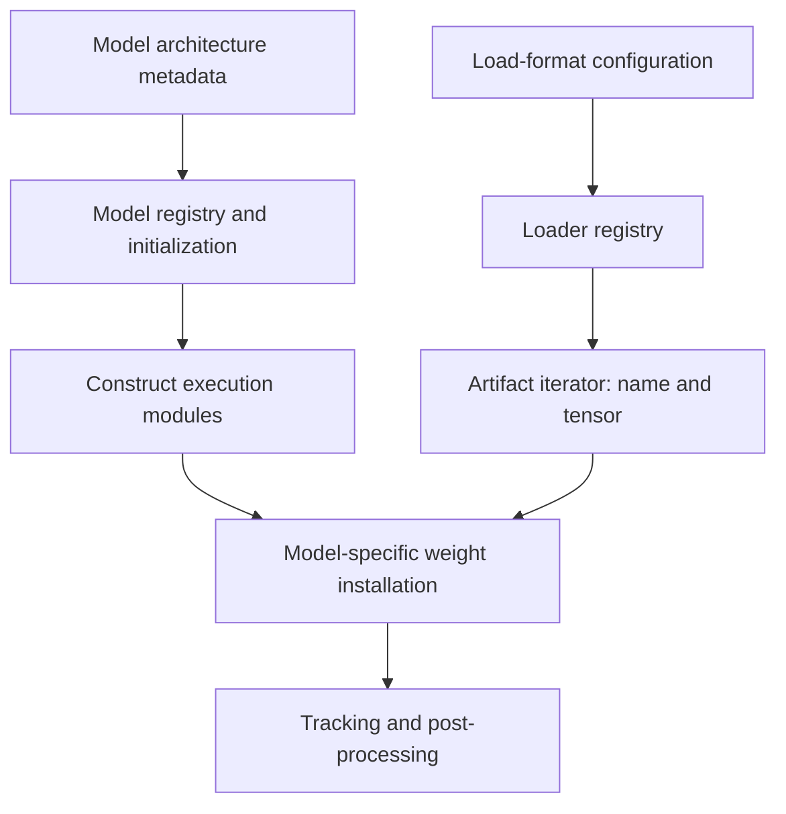
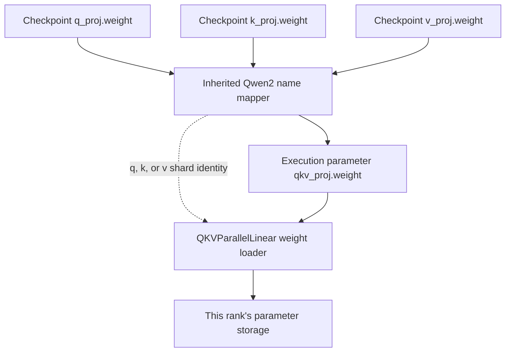

import Source from '../../../../components/Source.astro';

## From a model name to executable weights

Loading has two jobs: construct the model implementation and install checkpoint values into its parameters. The implementation determines the computation; the loader determines how artifacts become the representation that computation expects.

This chapter follows the default loader for a dense decoder model. Specialized formats and quantization use the same architectural separation, with their own loading and preparation steps.

## Architecture and format select different code

These two selections meet during weight installation:



Architecture metadata resolves through the model registry. Load-format configuration resolves through the loader registry. Changing a checkpoint format therefore addresses a different problem from selecting a supported model class.

<Source project="vllm" path="vllm/model_executor/models/registry.py" label="Model registry" />
<Source project="vllm" path="vllm/model_executor/model_loader/__init__.py" label="Loader registry" />

## Follow the loading lifecycle

`BaseModelLoader` establishes the sequence: create modules under the resolved device/dtype configuration, load their weights and finish preparation. Module creation allocates the parameter structure; loading gives it the checkpoint's contents.

The default loader locates artifacts and produces `(name, tensor)` items. The model-specific loader interprets those names and places the values:

```python
loaded_weights = model.load_weights(self.get_all_weights(model_config, model))
```

This boundary is useful when reading a large checkpoint path. Artifact iteration belongs to the loader. Mapping a checkpoint tensor to an execution parameter belongs to the model and layer implementation. Final checks and post-processing prepare the loaded representation for execution.

<Source project="vllm" path="vllm/model_executor/model_loader/base_loader.py" label="Base loading lifecycle" />
<Source project="vllm" path="vllm/model_executor/model_loader/default_loader.py" label="Default artifact iteration and weight loading" />

## A checkpoint tensor can fill part of a parameter

A checkpoint may store separate query, key and value projections while the execution model uses a packed `qkv_proj`. The Qwen mapping illustrates the translation:

```python
".q_proj": (".qkv_proj", "q"),
".k_proj": (".qkv_proj", "k"),
".v_proj": (".qkv_proj", "v"),
```



The mapper carries the destination name and shard identity. The layer's weight loader then places the corresponding local portion. Q, K and V need not occupy equal thirds: their head counts and tensor-parallel ownership determine the layout.

<Source project="vllm" path="vllm/model_executor/models/qwen2.py" label="Qwen checkpoint-name mapping" />
<Source project="vllm" path="vllm/model_executor/models/qwen3.py" label="Qwen3 loading through shared helpers" />
<Source project="vllm" path="vllm/model_executor/layers/linear.py" label="Parallel linear weight placement" />

## Decisions and code-reading route

| Question | Read the owner of |
| --- | --- |
| Is this architecture supported? | Model registry and initialization |
| Can these artifacts be loaded? | Loader selection and artifact iterator |
| Where does this named tensor go? | Model mapper and destination layer loader |
| Is the final representation executable? | Loaded-weight checks and post-processing |

For one weight, trace checkpoint name → mapped parameter → shard identity → local storage. This is more revealing than reading every format branch first. For a load failure, use the same stages to separate missing artifacts, incompatible naming and final preparation errors.

Read loader selection → `BaseModelLoader.load_model` → `DefaultModelLoader.load_weights` → model `load_weights` → destination layer loader. Then return to [startup](/architecture/vllm/startup/) to see how memory planning uses the loaded model.
