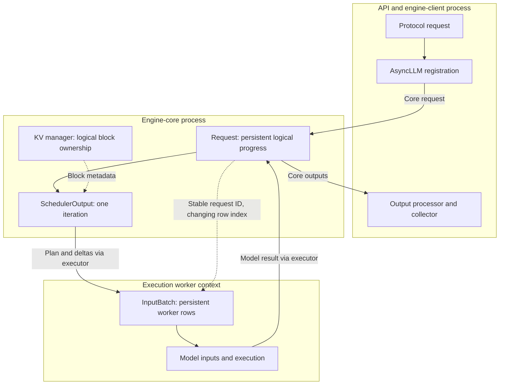

import Source from '../../../../components/Source.astro';

## Find the owner before following the call

A user submits a prompt and receives generated text, but the implementation crosses several owners: serving, engine coordination, scheduling, execution and output assembly. Identify the owner of the behavior you want to understand, then trace the messages crossing its boundary.

This guide uses ordinary decoder-only generation as the baseline. The same navigation method extends to parallel execution and optional cache connectors.

## A map of contracts

Solid arrows show request/result handoffs; dashed arrows show metadata relationships:

`Request`, `SchedulerOutput` and `InputBatch` describe different stages. The core's `Request` persists across iterations. `SchedulerOutput` describes work chosen for one iteration. The worker's `InputBatch` holds execution-oriented state and can rearrange its rows while request IDs remain stable.

<Source project="vllm" path="vllm/v1/request.py" label="Core request state" />
<Source project="vllm" path="vllm/v1/core/sched/output.py" label="Iteration plan" />
<Source project="vllm" path="vllm/v1/worker/gpu_input_batch.py" label="Worker batch state" />

## Follow the main path through the tree

| Source family | Responsibility | Start here when tracing |
| --- | --- | --- |
| `entrypoints/openai/` | API translation and response framing | Input validation, rendering, streaming |
| `v1/engine/` | Client/core coordination and output assembly | Registration, iteration loop, cancellation |
| `v1/core/` | Scheduling and logical KV allocation | Waiting work, token budgets, prefix reuse |
| `v1/executor/`, `v1/worker/` | Dispatch and physical execution | Worker placement, batch preparation, model calls |
| `model_executor/` | Model implementations and reusable layers | Weight loading and model computation |
| `v1/attention/`, `distributed/` | Backend and communication contracts | Attention selection, rank groups, KV transfer |

The completion serving adapter invokes `engine_client.generate`. `AsyncLLM` registers the operation and waits on its collector. Across the usual multiprocessing boundary, `EngineCore` schedules shared batches and dispatches them through the executor. A background client task processes core outputs and delivers each request's results to its collector.

<Source project="vllm" path="vllm/entrypoints/openai/completion/serving.py" label="Completion adapter" />
<Source project="vllm" path="vllm/v1/engine/async_llm.py" label="Engine client" />
<Source project="vllm" path="vllm/v1/engine/core.py" label="Core loop" />

## Use configuration to explain the selected path

`VllmConfig` gathers model, cache, parallel, scheduler and loading choices. Those choices connect subsystems: parallel configuration selects an executor and rank geometry; cache layout constrains attention execution; speculative decoding changes the work carried by each iteration.

Distinguish operator inputs from the resolved configuration consumed at runtime. Startup can derive limits from model requirements and available device memory. Follow the resolved value into its consumer when explaining why the engine chose a path.

<Source project="vllm" path="vllm/config/vllm.py" label="VllmConfig" />

## Trace a concrete question

Suppose a long prompt waits while other requests keep the GPU busy. Follow its stable ID from serving into the core, then inspect the scheduler's selected work and KV allocation. Only follow the plan into the worker after establishing that this request was selected. This separates admission delay from slow execution.

For other questions, use the same boundary test: did the input become a core request, did that request receive work, did execution produce the expected IDs, and did output processing deliver them correctly?

Read serving → `AsyncLLM.generate` → `EngineCore.step` → [scheduling](/architecture/vllm/scheduling/) → [GPU execution](/architecture/vllm/gpu-execution/). The [request lifecycle](/architecture/vllm/request-lifecycle/) adds the return and cancellation paths.
