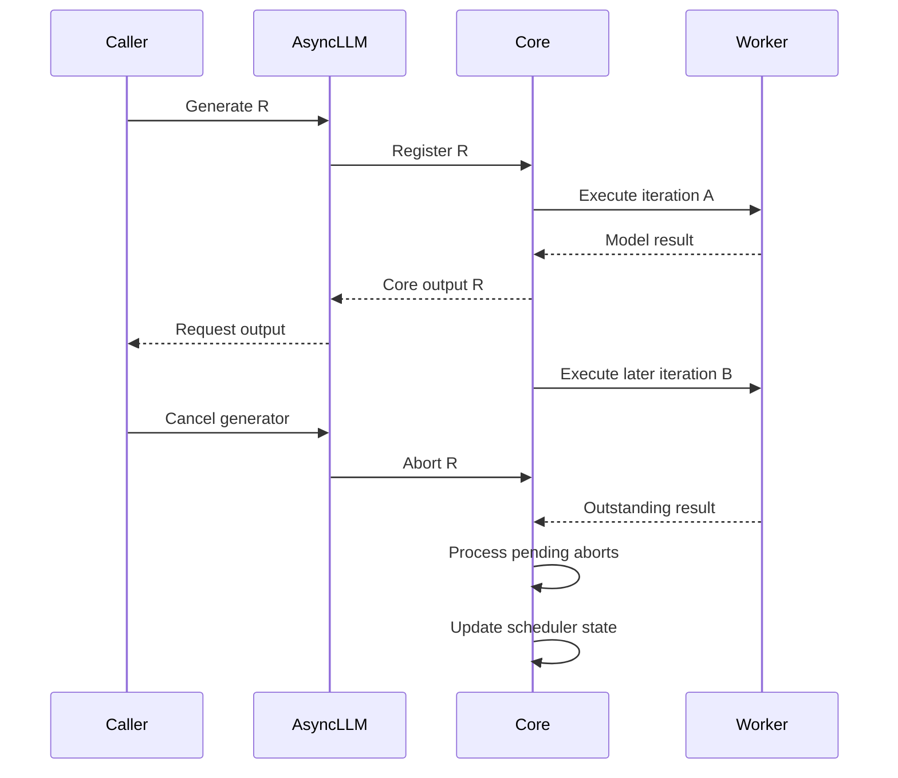

import Source from '../../../../components/Source.astro';

## One user operation crosses several owners

A completion moves from an API request into engine state, through repeated model iterations, and back into a response stream. Each layer has its own representation and lifetime. This chapter follows ordinary single-GPU text generation; optional transfer lifetimes are covered in [KV connectors](/architecture/vllm/kv-connectors/).

The serving adapter validates and renders input, prepares sampling/stop parameters and calls `engine_client.generate`. `AsyncLLM` registers the request with the core and creates a per-request output collector. Its caller can then await results while the core batches work from many users.

<Source project="vllm" path="vllm/entrypoints/openai/completion/serving.py" label="Completion request translation" />
<Source project="vllm" path="vllm/v1/engine/async_llm.py" label="Registration, streaming and abort" />

## From registration to streamed output

The core constructs a persistent `Request`, initially waiting for scheduling. The scheduler admits token work and reserves KV blocks. The executor runs the selected iteration, and the core reconciles results with request progress and stop conditions.

Core outputs return to the client's `OutputProcessor`, which assembles request-specific results and detokenized text. A background handler places those results in the correct collector; the waiting API coroutine formats them into response events.

The stable request ID connects these stages. Worker batch rows may move between iterations, so trace identity rather than assuming a fixed row index. A collector can merge output deltas when the producer gets ahead of the caller. One streamed event can therefore represent several internal updates.

<Source project="vllm" path="vllm/v1/request.py" label="Persistent core request" />
<Source project="vllm" path="vllm/v1/engine/output_processor.py" label="Output processing and collectors" />

## Cancellation is explicit propagation

A disconnect can arrive while the GPU is still working:

`AsyncLLM.generate` propagates cancellation as an engine abort. In the core's ordinary step, pending aborts are processed before `scheduler.update_from_output`. This keeps a late model result from being treated as continuing work for an abandoned request.

<Source project="vllm" path="vllm/v1/engine/core.py" label="Iteration result and abort ordering" />

The main lifecycle is therefore registration → waiting/admission → repeated execution and output → finish or abort. Cancellation needs a return path through the same ownership chain as successful completion.

## Output completion and memory completion differ

A final response ends generation for the caller. The scheduler releases the request's block references, while compatible prefix data can remain cached for another request. Physical cache tensors and model weights have longer engine lifetimes. With a connector, outstanding transfers can retain blocks beyond the logical finish point.

These distinctions explain why request counts and allocated GPU bytes need not fall together. Track the resource whose lifetime matters: collector, core request, block reference or physical allocation.

## Decisions and code-reading route

| Boundary | Main question |
| --- | --- |
| Serving → engine | Was input rendered into a valid engine request? |
| Registration → scheduling | When does shared compute and memory permit progress? |
| Result → response | Which request receives the output, and has it stopped? |
| Cancellation → cleanup | Has abandonment reached the core and its resource owners? |

Read serving → `AsyncLLM.generate`/`add_request` → core request construction → `EngineCore.step` → `OutputProcessor`. Continue with [scheduling](/architecture/vllm/scheduling/) for admission and [sampling/output](/architecture/vllm/sampling-and-output/) for response content.
