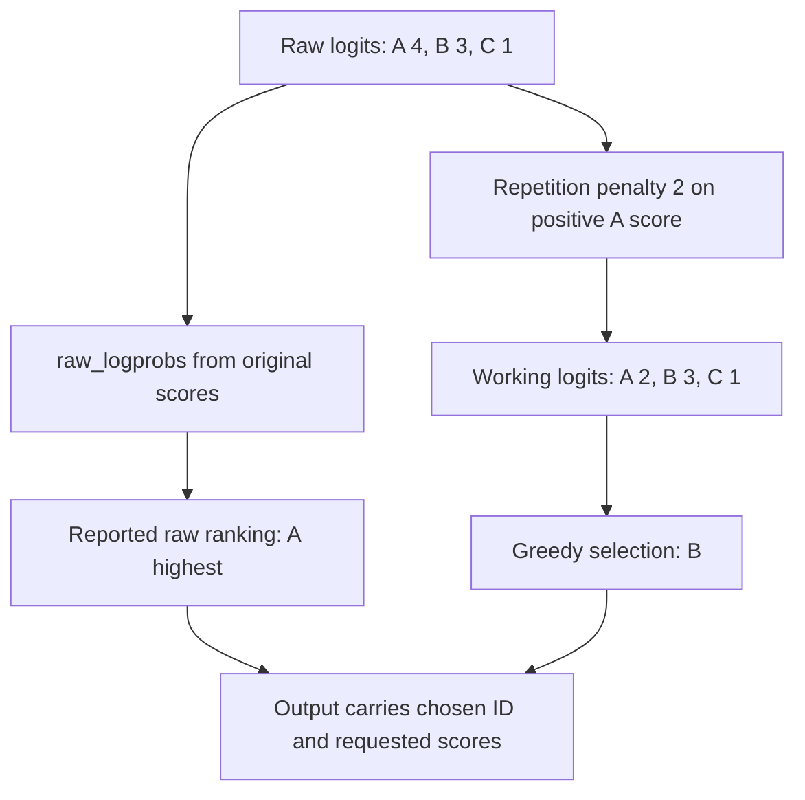

import Source from '../../../../components/Source.astro';

## From model scores to a response

The model returns logits: scores for vocabulary tokens. vLLM turns them into token IDs using each request's constraints and sampling parameters, then builds text and streamed responses. Sampling, stopping and output assembly are separate stages in this return path.

`SamplingMetadata` carries row-specific choices into `Sampler`. A shared batch can contain different temperatures, penalties and allowed tokens, so the relevant parameters belong to the request's row.

<Source project="vllm" path="vllm/v1/sample/metadata.py" label="SamplingMetadata" />
<Source project="vllm" path="vllm/v1/sample/sampler.py" label="Sampler.forward" />

## Follow token selection

The sampler applies constraints and score transformations, then selects a greedy or random path. Random sampling uses temperature and filters such as top-k/top-p to shape the candidate distribution. Greedy selection takes the best eligible working score.

The ordering matters because transformations change later choices. A repetition penalty can lower a previously generated token before selection. Structured generation supplies a valid-token mask through the [grammar interface](/architecture/vllm/structured-generation/).

Reported scores have their own contract. In raw-logprob mode, reporting uses the original logits before sampling transformations. The selected token and reported raw ranking can therefore differ correctly:

In this teaching example, a penalty halves A's positive score from four to two. B wins selection with score three, while A remains highest in the original scores. When investigating a token choice, read both sampling parameters and the selected score-reporting mode.

## Turn token IDs into text

`OutputProcessor` maintains request output and uses incremental detokenization to turn token IDs into text. Token boundaries can cut across visible character or word boundaries, so a new token need not produce an immediately usable standalone text fragment.

Output mode determines whether a caller receives accumulated text or new deltas. The serving adapter then frames these request outputs into protocol events. Collectors can merge deltas when a consumer falls behind, so an HTTP chunk is a delivery unit rather than a direct GPU-iteration counter.

<Source project="vllm" path="vllm/v1/engine/output_processor.py" label="Request output assembly" />
<Source project="vllm" path="vllm/v1/engine/detokenizer.py" label="Incremental detokenization" />
<Source project="vllm" path="vllm/entrypoints/openai/completion/serving.py" label="Response framing" />

## Stop at the right representation boundary

Token limits and stop-token rules concern generation progress. Stop strings concern decoded text and require output-processing state. Cancellation arrives independently through the request lifecycle. Together, these decide when generation ends and what text the caller receives.

This division gives a useful trace: investigate unexpected IDs in sampling, unexpected text or stop-string behavior in output processing, and late delivery in collectors/serving. The scheduler then retires request work and memory references through the [lifecycle path](/architecture/vllm/request-lifecycle/).

## Decisions and code-reading route

| Question | Main owner |
| --- | --- |
| Which tokens are eligible and selected? | Sampler plus request metadata/grammar mask |
| What do returned scores represent? | Sampler's raw or processed reporting mode |
| Which text is safe to emit? | Detokenizer and output processor |
| When does generation end? | Request stop state, output handling and abort propagation |

Read runner `sample_tokens` → `Sampler.forward` → selected sampling method → `OutputProcessor` → detokenizer → serving stream generator. This covers the return path from one model result to one user's response.
