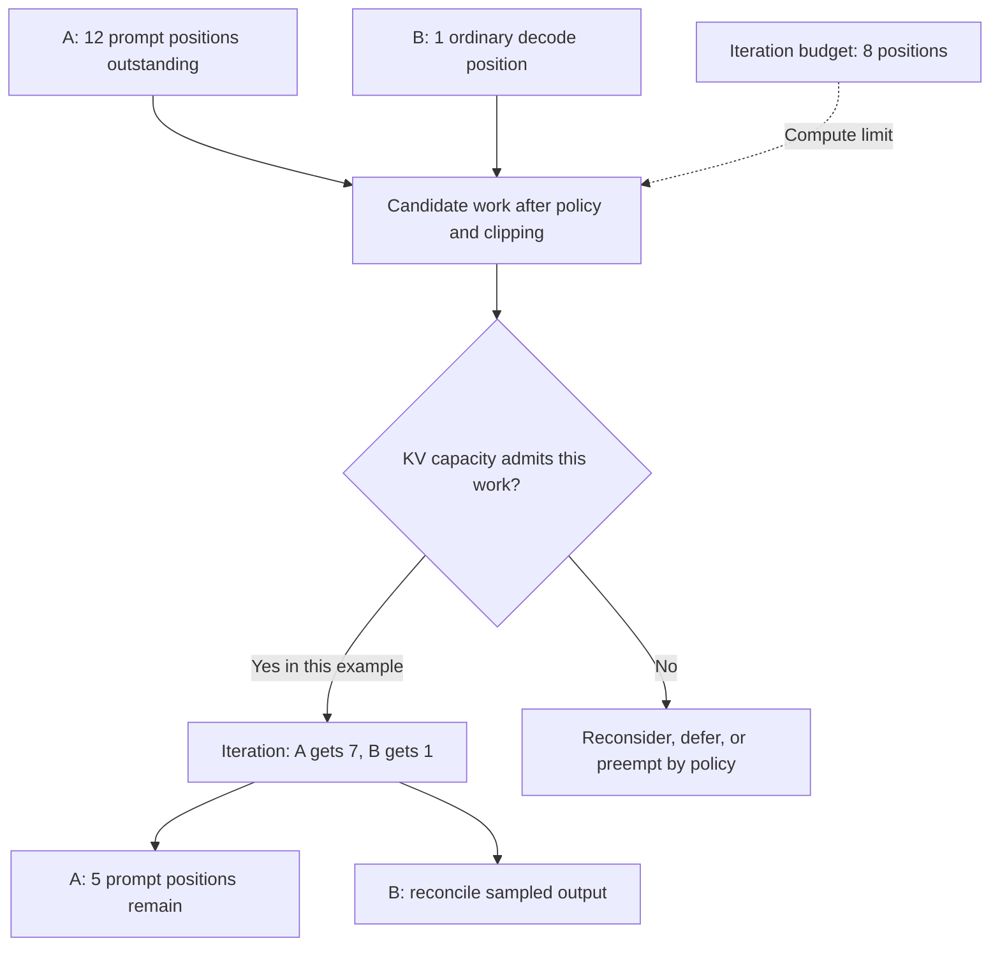

import Source from '../../../../components/Source.astro';

## Why a scheduler works in tokens

A long prompt and a one-token decode step consume different amounts of work. vLLM schedules token positions each iteration so it can share capacity across both. Its two main constraints are compute budget and KV memory capacity.

The scheduler owns persistent waiting/running requests. Each call produces a `SchedulerOutput` plan, which the worker turns into an executable batch. This separates the decision about what should run from the tensors used to run it.

<Source project="vllm" path="vllm/v1/core/sched/scheduler.py" label="Scheduler.schedule" />
<Source project="vllm" path="vllm/v1/core/sched/output.py" label="SchedulerOutput" />

## Follow one iteration

1. Determine the token positions each request still needs.
2. Select eligible work under the configured queue policy and iteration limits.
3. Reserve the required KV slots, reusing compatible prefixes where possible.
4. Send the resulting plan to execution.
5. Reconcile returned tokens, stop state and released resources before continuing.

The token-progress model unifies prompt processing and generation. A request can contribute a prompt chunk or a decode position to the same iteration. Its output-token limit describes how long generation may continue; it does not reserve all that future work immediately.

A core expression proposes new work from required positions and current progress:

```python
num_new_tokens = (
    request.num_tokens_with_spec
    + request.num_output_placeholders
    - request.num_computed_tokens
)
```

The scheduler clips that proposal to applicable budgets and limits, then checks memory admission. Under asynchronous execution, progress counters can include in-flight reservations. Result reconciliation remains necessary before work becomes confirmed output or reusable KV.

<Source project="vllm" path="vllm/v1/request.py" label="Request progress fields" />

## Share a budget between prompt and decode

With an illustrative eight-position budget, A has twelve prompt positions left and B needs one decode position. Seven positions for A and one for B is one feasible allocation:



The example illustrates shared capacity rather than a fixed queue policy. A still needs five prompt positions afterward. B's sampled token becomes input to a later step that computes its KV state.

## Memory admission can override compute availability

`KVCacheManager.allocate_slots` reserves storage for the proposed work. A request can fit the token budget yet lack allocatable KV blocks. The scheduler then delays work or preempts a request according to policy. Preemption can trade immediate capacity for recomputation when that request resumes.

This is a logical-capacity decision within the engine's cache allocation. It differs from failing to allocate a new GPU tensor. Blocks still held by outstanding execution or transfer work also cannot be counted as immediately reusable capacity.

<Source project="vllm" path="vllm/v1/core/kv_cache_manager.py" label="KV slot admission" />

## Decisions and code-reading route

| Decision | Practical consequence |
| --- | --- |
| Token and sequence budgets | Divide iteration work among active requests |
| Queue/admission policy | Determine who advances under contention |
| KV allocation and preemption | Trade cache capacity against waiting and recomputation |
| Result reconciliation | Turn planned work into accepted progress and stopping decisions |

Read `Scheduler.schedule` → `allocate_slots` → `SchedulerOutput` → `EngineCore.step` → `update_from_output`. The return path is part of scheduling: cancellation and speculative rejection can change what the launched work means for the request.

<Source project="vllm" path="vllm/v1/engine/core.py" label="Core iteration and reconciliation" />
