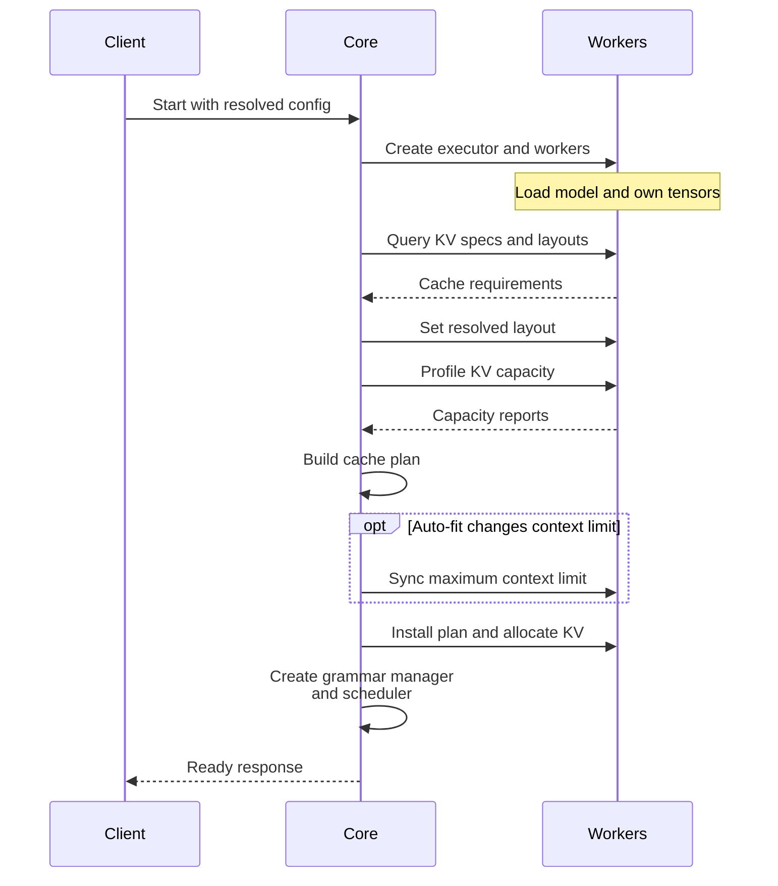

import Source from '../../../../components/Source.astro';

## What does “the server is ready” mean?

A usable engine needs workers, loaded weights, a physical KV allocation and a scheduler whose capacity agrees with that allocation. Opening the HTTP listener is only the frontend part of startup.

Follow the local executor first. It gives the simplest execution path, although the API client and engine core can still run in separate processes. Multi-worker executors extend the same core-facing contract.

## The core's dependency order

The startup sequence makes the capacity dependency visible:



Workers own model tensors and report their KV requirements. The core resolves a cache plan from those requirements and available memory, installs it in workers, then constructs scheduling state. A scheduler needs this plan to know which token work can fit.

The essential constructor statements are:

```python
self.model_executor = executor_class(vllm_config)
kv_cache_config = self._initialize_kv_caches(vllm_config)
self.structured_output_manager = StructuredOutputManager(vllm_config)
Scheduler = vllm_config.scheduler_config.get_scheduler_cls()
```

<Source project="vllm" path="vllm/v1/engine/core.py" label="EngineCore construction and KV initialization" />

## Configuration becomes concrete resources

`VllmConfig` collects the operator's model, parallelism, cache and scheduling choices. `Executor.get_class` resolves how execution workers will be managed. A local executor dispatches to its worker; a multiprocessing executor coordinates separate worker processes and their responses.

Cache planning then connects model semantics to capacity. The core obtains worker KV specifications, resolves supported layouts, profiles available memory and builds cache configurations. Model weights, temporary execution needs and cache representation all affect the result.

The worker allocation and scheduler bookkeeping describe the same capacity at different levels. The core manages logical blocks; workers allocate the tensors those block IDs address. Keeping the resolved plan consistent across them is a startup invariant.

<Source project="vllm" path="vllm/config/vllm.py" label="Resolved configuration" />
<Source project="vllm" path="vllm/v1/executor/abstract.py" label="Executor selection" />
<Source project="vllm" path="vllm/v1/executor/uniproc_executor.py" label="Local execution contract" />

## Which startup decisions matter?

| Decision | Owner | Architectural effect |
| --- | --- | --- |
| Worker placement and dispatch | Parallel configuration and executor | Creates the process and communication layout |
| KV layout and capacity | Core planning plus worker reports | Bounds context and concurrent work |
| Scheduling policy | Scheduler configuration | Determines how requests share the resolved capacity |
| Readiness | Client/core handshake | Makes the initialized engine available to the frontend |

For example, auto-fit planning can reduce the requested context limit. Workers already exist at that point, so the core explicitly propagates the resolved limit back to them before startup completes. Configuration resolution is a sequence of agreements, not just reading a static options object.

## Follow readiness back to its cause

The engine process announces readiness after initialization. When launch stalls, locate the last completed phase: worker creation, model loading, cache planning, allocation or the client/core handshake. That phase identifies the responsible component and the useful logs.

Read `EngineCoreProc` and its handshake → `EngineCore.__init__` → `_initialize_kv_caches` → the selected executor's worker methods. Continue into [model loading](/architecture/vllm/model-loading/) for checkpoint failures and [KV memory](/architecture/vllm/kv-memory/) for the resulting block model.

<Source project="vllm" path="vllm/v1/engine/core_client.py" label="Client/core startup boundary" />
<Source project="vllm" path="vllm/v1/executor/multiproc_executor.py" label="Multi-worker lifecycle" />
