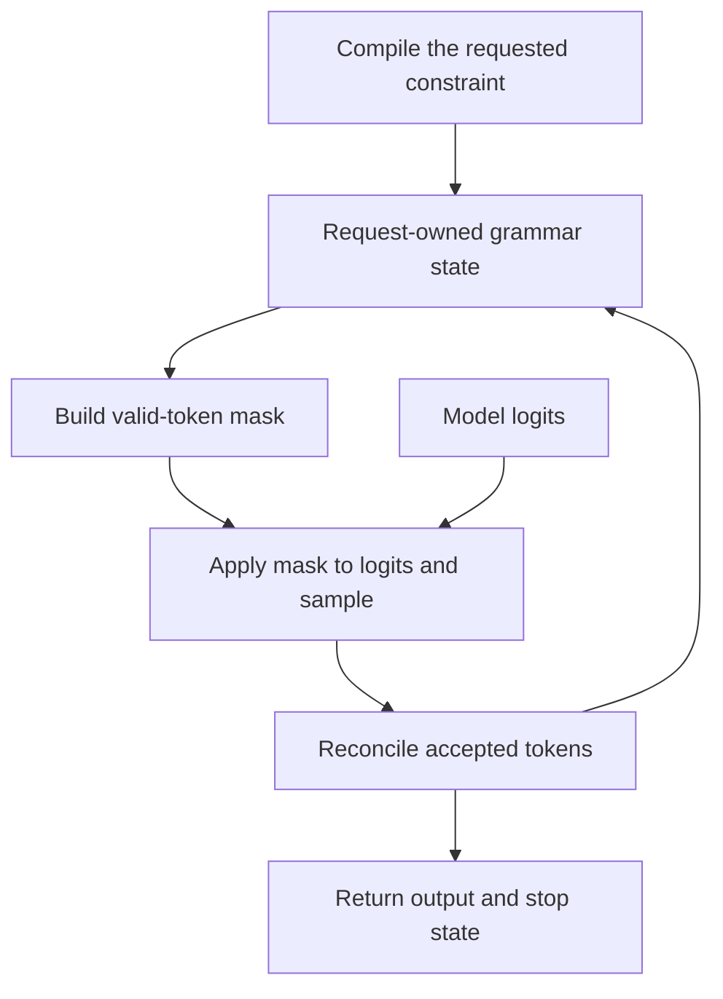

import Source from '../../../../components/Source.astro';

## Constraints participate in generation

An application may require JSON, a regex, a grammar or a finite choice. Structured generation restricts valid next token IDs during sampling. The model still supplies scores, while a request-owned grammar tracks which continuations satisfy the constraint.

Compiled constraint structure can be reused, but mutable output progress belongs to each request. Two requests using the same schema can be at different grammar positions.

## Follow the constraint loop

Accepted output closes the loop. Under speculative execution, proposed tokens can exceed accepted progress, so grammar state advances with the accepted sequence.

## Compile before the request can use its grammar

`StructuredOutputRequest` derives a constraint key from sampling parameters. `StructuredOutputManager` selects the backend and prepares a grammar, potentially through asynchronous compilation. The runtime handles the compilation result before using it for masks; a completed compilation can contain an error that must be surfaced to the request.

The selected backend determines which constraint forms are supported. In this snapshot the engine uses one structured-output backend, while each request maintains its own grammar/reasoning progress.

<Source project="vllm" path="vllm/v1/structured_output/request.py" label="Constraint request and compilation result" />
<Source project="vllm" path="vllm/v1/structured_output/__init__.py" label="StructuredOutputManager" />

## Build a mask for the correct request state

A vocabulary bitmask marks allowed tokens. The manager fills the mask rows for requests selected in the iteration, and sampling applies them to the corresponding logits. Correct request-to-row mapping matters as much as correct grammar logic.

For an illustrative choice between “yes” and “no,” the initial mask allows valid starts. Accepting part of “yes” changes the next mask to valid continuations. Actual allowed IDs follow the tokenizer, so visible words need not correspond to single tokens.

`accept_tokens` advances committed grammar state. The backend interface also supports the inspection needed by speculative processing, where rejected work must leave committed progress intact.

<Source project="vllm" path="vllm/v1/structured_output/backend_types.py" label="Grammar and backend interfaces" />

## Coordinate with execution and application validation

A forward pass can finish before earlier output has updated the grammar. The overlapping engine path then waits to build the correct mask before sampling. This preserves the accepted-output dependency while allowing model work to overlap elsewhere.

Grammar constraints address output form. Applications still validate the meaning of the values they receive—for example, whether a syntactically valid JSON result satisfies the business operation.

## Decisions and code-reading route

| Decision | Owner |
| --- | --- |
| Required output form | Application request |
| Supported constraint/backend | Engine configuration and manager |
| When constrained sampling is ready | Compilation result and current grammar state |
| Which output advances state | Accepted-token reconciliation |

Read `StructuredOutputRequest` → `grammar_init` → `grammar_bitmask` → sampler mask application → `accept_tokens`. Continue with [async/speculative execution](/architecture/vllm/async-and-speculative/) for the dependency between prior output and current sampling.
